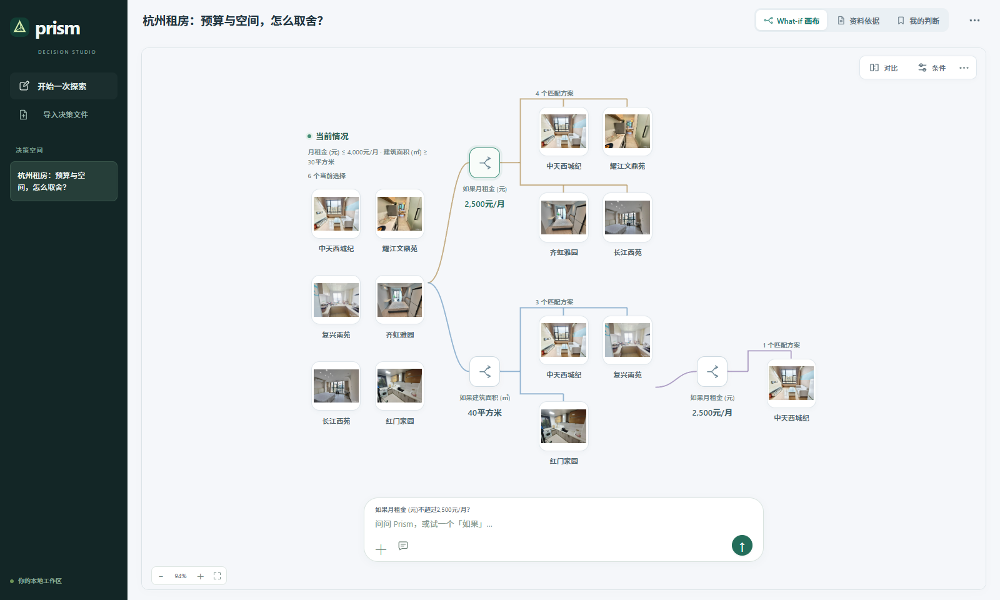
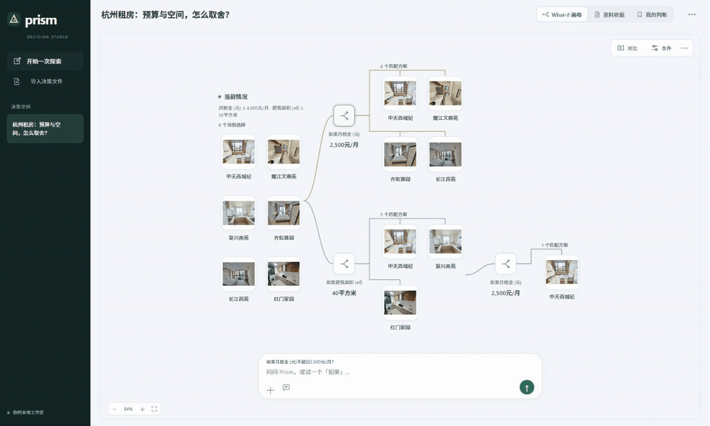

<div align="center">


# Prism

**An AI research agent with a canvas for every “what if.”**

Find the evidence. Explore the alternatives. Keep the reasoning behind your choice.

[](https://github.com/mianwtt/prism/actions/workflows/check.yml) [](LICENSE) [](docs/ARCHITECTURE.md) [](SECURITY.md) [](docs/ROADMAP.md)

[Quick start](#quick-start) · [Features](#features) · [Examples](#examples) · [Documentation](#documentation) · [简体中文](README.zh-CN.md)

</div>



*Recorded with public listing observations. The three display branches are curated hypotheses; photographs belong to their corresponding source pages. Startup demos use separate fictional data.*

Your budget changes. A new requirement matters. You want to know why an option disappeared. Prism keeps the research connected to an interactive **What-if canvas**, so you can explore those changes and continue the conversation with the same evidence.

## Quick start

Clone and run with **Node.js 24** and npm:

```sh
git clone https://github.com/mianwtt/prism.git
cd prism
npm ci
npm start
```

Open **[localhost:4317](http://localhost:4317)** and choose a laptop or housing demo. Change a condition, click an option for details, then save your decision. Both demos use fictional data and need no model or search key. The interface currently uses Chinese.

### Connect your agent

1. Run an Ollama model, or prepare a compatible Chat Completions endpoint.
2. For search without a commercial key, install [uv](https://docs.astral.sh/uv/) and run:

   ```sh
   npm run setup:search
   ```

3. Open **研究设置**, choose **tofu-search**, and connect your model. Native Ollama uses `http://localhost:11434/v1`, an installed model ID, and `ollama` in the key field.
4. Ask your question. Continue from the canvas when you want to change a condition or research more options.

[Setup, provider options and troubleshooting →](docs/SETUP.md)

## Features

- **Research that continues with you.** The agent searches, reads public pages and organizes source-backed options. Ask a follow-up or explicitly request more research along a selected path.
- **What-if you can interact with.** Click a condition or move its slider. Matching options update immediately; the baseline stays intact, descendants inherit changes, and explicit overrides remain their own.
- **Evidence behind each option.** Open a photo to inspect prices, parameters, saved quotations and source links in a floating window. Inspect disagreements and compare any two branches.
- **A model shaped by your question.** The agent proposes comparison fields: numbers, yes/no requirements or categories. Laptop and housing choices use the same canvas with different conditions.
- **Decisions you can revisit.** Save a choice with its reasons and original conditions. Recheck sources later, compare versions, and export or import a decision as JSON.

### Watch a condition change



*Budget: ¥2,500 → ¥2,000 → ¥3,000. The selected branch changes from 4 → 1 → 5 matching records. This interaction recalculates saved evidence; it does not run a new search.*

## Examples

| Start with a question | Continue exploring |
| --- | --- |
| “Find a development laptop under ¥7,000, with at least 16 GB RAM.” | “What if I need 32 GB?” · “Why did this option drop out?” |
| “Compare whole-apartment rentals in Hangzhou under ¥4,000/month, at least 30 m², with source photos.” | “What if the budget is ¥2,500?” · “Show more spacious options.” |
| An existing saved decision | “Keep this path and find more alternatives.” · “Recheck the evidence behind my choice.” |

For a ready-made canvas without a model, import an [example decision](examples/README.md).

**Real research check:** fresh Hangzhou and Chengdu rental tasks each returned **6 eligible listings with corresponding source photographs**, using local `qwen3.5:9b`, tofu and LangGraph. No listing URLs were supplied. These are dated observations, primarily from Fang.com; see [the full runs and their limits](docs/reports/AGENT-RESEARCH-REPAIR-2026-11-15.md).

## How it works

**Question → Agent research → Cited options → What-if branches → Saved decision**

LangGraph coordinates planning, search, reading and recovery. Typed validation binds values to saved quotations. A deterministic evaluator recalculates branches. SQLite checkpoints retain research progress; immutable JSON snapshots retain your decisions and their history.

[Architecture and source boundaries →](docs/ARCHITECTURE.md)

## Documentation

| Guide | What you will find |
| --- | --- |
| [Documentation index](docs/README.md) | All guides, project structure, media provenance and historical reports |
| [Setup](docs/SETUP.md) | Native installation, Ollama, search, configuration and troubleshooting |
| [Using the workspace](docs/WORKSPACE.md) | Conversation, conditions, evidence, decision memory, import and deletion |
| [Architecture](docs/ARCHITECTURE.md) | Agent graph, evaluator, persistence and trust boundaries |
| [Development](docs/DEVELOPMENT.md) | Tests, isolated data, live probes and Docker status |
| [Publishing](docs/PUBLISHING.md) · [Release notes](docs/releases/v0.4.0.md) | GitHub preparation and the public preview scope |
| [Verification](docs/reports/VERIFICATION.md) · [Roadmap](docs/ROADMAP.md) | Measured results and remaining release work |

## Development and verification

```sh
npm run test:release
```

Latest local verification: **161 unit/HTTP tests and 55 browser tests passed**. Controlled tests check behavior; separate live runs check actual retrieval. See [development instructions](docs/DEVELOPMENT.md) for Chrome/Chromium setup and individual commands.

Use `npm run check:project` to check the complete working-tree source and `npm run package:source` to create an archive excluding local settings, decision data and experiments. See [project structure and packaging](docs/PROJECT-STRUCTURE.md).

## Project status

Prism **0.4 is a development preview for local, single-user use**. Real research depends on the model, search engines and publicly readable sources. A saved citation records what a source said; it does not independently verify the publisher's claims.

The current live checks cover two rental tasks. Broader retrieval evaluation and cross-platform coverage remain in progress. PDF/Word/Excel/image ingestion is not implemented. Native Windows installations and runtime checks pass on Node 22.23.5 and 24.19.0. Docker and remote CI acceptance remain unverified; container distribution is experimental. See [release gates](docs/ROADMAP.md).

Questions and decision history are stored locally. External models, searches and source reads still receive the data needed for those requests. Read [security and privacy](SECURITY.md) before sharing exports or running with personal information.

## Contributing

Public-source adapters, reproducible data-quality cases and accessibility improvements are welcome. Start with [CONTRIBUTING](CONTRIBUTING.md).

Source code is [MIT licensed](LICENSE). Third-party content and photographs retain their respective rights.
