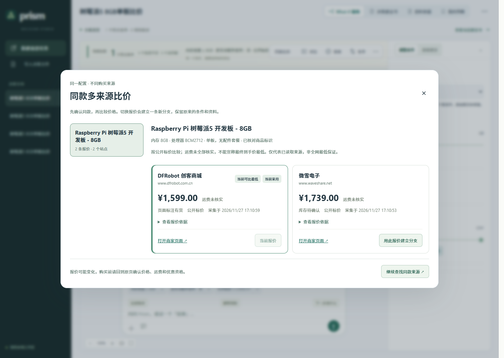
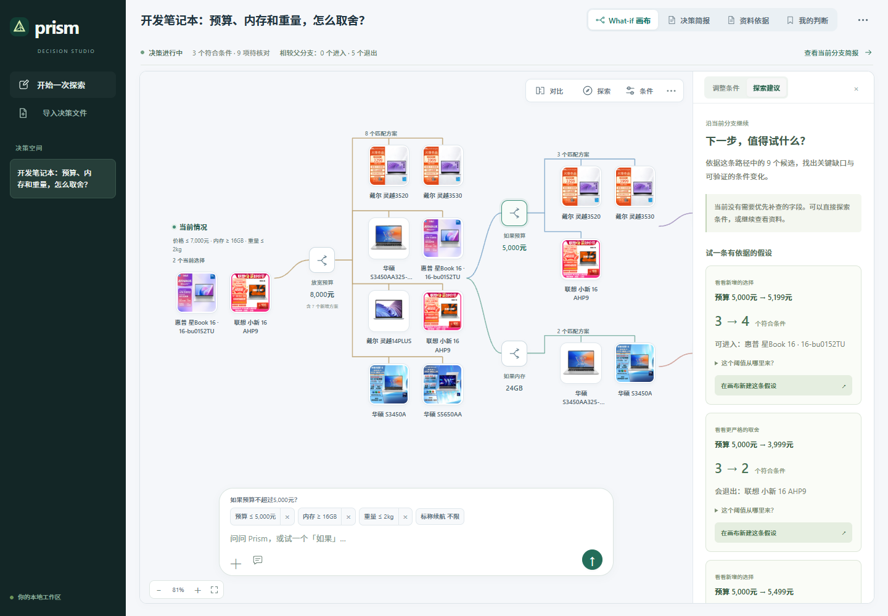
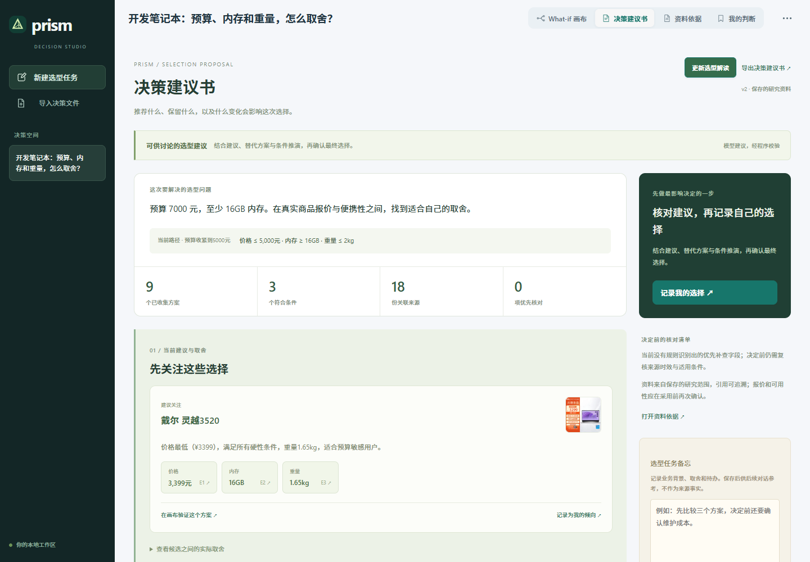
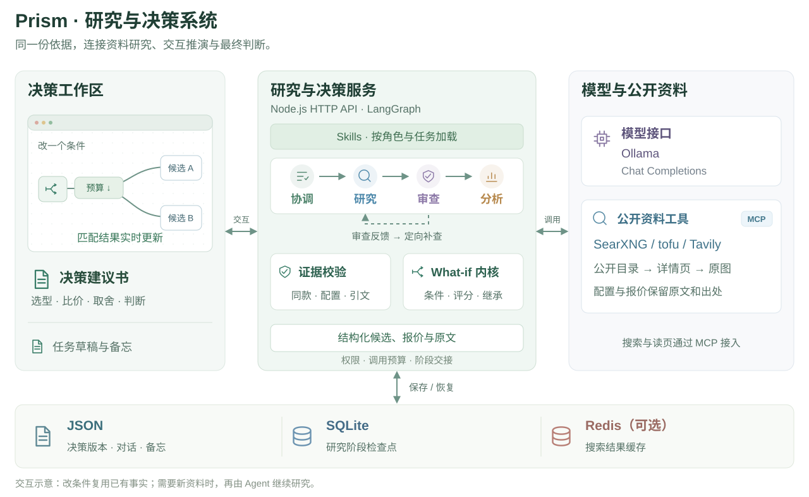

<div align="center">

**简体中文** · [English](docs/i18n/README.en.md)


# Prism

### 选哪款，哪家买，换个条件又会怎样？

一个把真实资料、同款报价和 What-if 画布连起来的多 Agent 决策工作台。

[](https://github.com/mianwtt/prism/actions/workflows/check.yml) [](LICENSE) [](docs/MULTI-AGENT.md) [](docs/ROADMAP.md)

[真实任务](#real-task) · [开始体验](#quick-start) · [整体架构](#system-architecture) · [下一步](#next) · [文档](#documentation)

</div>


实际运行截图，重放历史苏宁商品资料和对应原图；展示分支是条件假设，保存价格并非实时行情。

<a id="features"></a>
<a id="examples"></a>

## 从查资料，到做出自己的选择

选电脑、挑设备或找房子，通常要反复回答几个问题：资料能不能对上？同款有没有其他报价？预算变了，之前的推荐还成立吗？

Prism 把研究结果保存为**可以继续操作的决策空间**。Agent 搜索并核验候选，模型结合依据解释取舍；你在画布调整条件或采用另一条报价，查看方案变化和排除原因，最后生成决策建议书、记录自己的判断。

| 你想解决的问题 | 在 Prism 里怎么做 |
| --- | --- |
| **这些方案，哪些真的符合要求？** | 先核对字段和原文，再按硬条件过滤；缺证保持待核对。 |
| **同一款，从哪家买？** | 型号和配置一致后并列商家报价，分别保留价格、运费、优惠条件与采集时间。 |
| **如果预算降低，或更在意便携呢？** | 创建条件分支，直接重算已有事实，查看谁进入、谁退出，原始情况保留。 |
| **最终为什么这样选？** | 建议书汇总推荐、取舍、引用和核对事项；个人选择与模型建议分别保存。 |

<a id="real-task"></a>

## 看一次真实任务：同款查价，再试一个预算

> 预算 2,000 元，购买树莓派 5 的 8GB 单板，不要配件套装。比较不同商家的同款公开报价，保留原页配图和来源。

这次任务**没有预填商品链接、候选或报价**。系统沿搜索结果与商家公开目录读取详情，核对处理器、内存及包装，再将同一配置的报价放在一起。



**2026-11-27 的实际采集记录：** [DFRobot](https://www.dfrobot.com.cn/goods-3783.html) 标价 1,599 元，[微雪电子](https://www.waveshare.net/shop/Raspberry-Pi-5-8GB.htm) 标价 1,739 元。均核对为 8GB、BCM2712 单板；运费尚未全部核实，库存描述分别保留。

| 实际操作 | 得到的反馈 |
| --- | --- |
| 查看同款报价 | 默认采用已核对来源中可比的 1,599 元标价，保留另一家报价。 |
| 改用微雪 1,739 元报价 | 建立购买来源分支，原始 1,599 元路径仍在。 |
| 将这条分支预算降到 1,600 元 | 所选报价被排除，匹配数 **1 → 0**；这次只重算已有资料。 |
| 问差别、导出建议书 | 解释 **140 元标价差**，保留两家来源、当前采用的报价与待核对事项。 |

[阅读完整任务案例](docs/examples/SAME-PRODUCT-2026-11-27.md) · [查看真实验收记录](docs/reports/MULTI-SOURCE-OFFERS-2026-11-27.md)

## 画布上的每个「如果」，都可以回头比较

拖动预算、修改内存或面积等已有条件，候选会同步变化。分支继承未单独修改的条件；你也可以固定一个条件，保留另一种取舍。需要更多候选或新字段时，再继续研究。


这段录屏使用已保存的租房资料：预算 **2,500 → 2,000 → 3,000 元**，匹配记录 **4 → 1 → 5**。它演示条件计算，不是重新搜索房源。

**不知道下一步试什么？** 打开「探索」，查看根据当前事实计算的条件阈值、候选变化和来源依据；缺少关键证据时，可以只补查指定候选和字段。每条分支保留条件、候选与依据，方便回到当时的比较。

<details>
<summary>查看探索侧栏</summary>



截图重放历史资料；建议阈值来自保存的报价，不代表当前市场行情。

</details>

## 把研究交付成一份决策建议书

建议书回答：**目前建议关注谁、要接受什么取舍、哪些假设已经验证、决定前还缺什么。** 点击参数可以查看原文，并回到画布继续验证；导出的 Markdown 与页面使用同一份数据。

| 交付内容 | 保存什么 |
| --- | --- |
| **建议与备选** | 当前条件下的推荐、取舍、其他选择及排除原因。 |
| **报价与证据** | 当前采用的商家报价、其他来源、字段原文和采集时间。 |
| **推演与待办** | 已有分支的结果，以及需要补充核对的信息。 |
| **个人判断** | 用户确认的选择、理由及当时条件，支持版本回看。 |

<details>
<summary>查看实际建议书页面</summary>



截图使用历史商品资料与实际本地模型解读。规则初筛和模型建议有明确标记，旧判断保留记录时的条件。[交付流程验收 →](docs/reports/SELECTION-WORKSPACE-2026-11-27.md)

</details>

<a id="quick-start"></a>

## 开始体验

使用 **Node.js 24**，先运行无需模型和搜索 Key 的演示：

```sh
git clone https://github.com/mianwtt/prism.git
cd prism
npm ci
npm start
```

打开 **[localhost:4317](http://localhost:4317)**，选择笔记本或住房演示：改一个条件 → 查看方案和依据 → 建一条分支 → 打开「决策建议书」。演示明确使用虚构记录；也可导入[多分支示例 JSON](examples/README.md)。当前产品界面为中文。

### 接上模型，研究真实资料

1. 启动 Ollama 或准备兼容 Chat Completions 的模型服务，使用实际可用的模型名。
2. 若使用本项目的 SearXNG 部署，先启动 Docker Desktop，再运行 `npm run search:up`。
3. 打开「研究设置」，连接模型，搜索选择 **SearXNG**，地址填写 `http://127.0.0.1:4330`。本机 Ollama 地址为 `http://localhost:11434/v1`，密钥字段填 `ollama`。
4. 提出自己的问题，或试上面的树莓派需求；研究完成后继续在画布比较。

也可选择 tofu-search（`npm run setup:search`）或 Tavily。搜索服务与公开页面的可读性影响实际覆盖。[完整配置与故障排查 →](docs/SETUP.md)

<a id="system-architecture"></a>

## Agent 怎样把资料变成可推演的选择？

**模型负责理解、研究与解释；程序负责证据校验、报价计算和条件判断。** 两者交换结构化结果，避免修改一个预算就重新生成整份资料。



| 设计 | 在项目中的实际作用 |
| --- | --- |
| **LangGraph 角色子图** | 协调、研究、审查、分析分别交接；投影任务上下文，审查反馈驱动定向补查。 |
| **Skills 与执行控制** | Skills 提供角色工作方法；调用前检查工具权限、预算及输入长度，阶段结束校验交接。 |
| **MCP 工具接入** | 官方 SDK 注册、发现和调用公开搜索、目录、详情与报价能力，复用现有业务读取器。 |
| **多来源发现与核验** | SearXNG、tofu 或 Tavily发现来源，目录补充商品链接；详情核对配置与报价口径，争议字段暂缓采用。 |
| **共享计算与状态保存** | 前后端共用过滤、评分与分支逻辑；JSON 保存决策版本，SQLite 保存研究检查点，可选 Redis 缓存搜索。 |

<a id="agent-architecture"></a>

四种角色共享配置的模型服务，按阶段顺序交接。最多一轮反馈补查、两次模型审查，调用受角色权限与预算约束。[协作机制](docs/MULTI-AGENT.md) · [MCP 与 Skills](docs/MCP-SKILLS.md) · [技术报告](docs/TECHNICAL-REPORT.md)

<a id="development-and-verification"></a>

## 已验证到哪里？

| 验证范围 | 已记录结果 |
| --- | --- |
| **真实同款任务** | 无预填链接取得1个配置、2家商家报价，验证选价分支、预算排除、问答及导出。[记录](docs/reports/MULTI-SOURCE-OFFERS-2026-11-27.md) |
| **跨场景研究** | 历史租房复测中，杭州、成都任务各取得6套符合条件且带原页图片的房源。[记录](docs/reports/AGENT-RESEARCH-REPAIR-2026-11-15.md) |
| **软件回归** | 2026-11-27 本地389项单元/HTTP、完整94项Edge测试通过；相关调整后另跑14项Edge回归通过。 |

以上区分真实任务与软件测试，不以测试数量代替研究准确率。当前为 **0.4 本机单用户开发预览**；来源可能失效，需要登录或缺少同款证据时会保留待核对，不能保证所有平台可读或全网最低。

```sh
npm run check            # 语法、源码与文档链接
npm test                 # 单元和 HTTP 回归
npm run test:browser     # 浏览器交互回归
npm run test:offers:live # 已连接模型与搜索时，新建真实同款验收任务
```

<a id="next"></a>

## 接下来，优先把这三件事做好

- **找到更多能实际比较的来源。** 扩充公开商家适配，并用固定任务集检验同款归并、报价有效性和失败原因。
- **资料变了，知道哪条决策受影响。** 在已有刷新与失效检查上补充报价差异及受影响分支的提示，便于重新确认判断。
- **把自己的候选带进来。** 当前支持完整决策 JSON 导入；下一步考虑候选清单导入，区分用户提供的信息与已核对的网页事实。

这些是后续方向，未完成部分见[路线图与验收标准](docs/ROADMAP.md)。欢迎带着真实需求或失败案例提 [Issue](https://github.com/mianwtt/prism/issues)。

<a id="documentation"></a>

## 文档与参与

[安装配置](docs/SETUP.md) · [工作区指南](docs/WORKSPACE.md) · [同款比价](docs/MULTI-SOURCE-OFFERS.md) · [技术报告](docs/TECHNICAL-REPORT.md) · [开发与测试](docs/DEVELOPMENT.md) · [贡献指南](.github/CONTRIBUTING.md)

决策数据保存在本机，外部模型和搜索请求会传递所需内容。[安全与隐私](.github/SECURITY.md) · [截图与素材来源](docs/assets/README.md) · [MIT](LICENSE)

如果你也希望资料能查到出处、选择能反复推演，欢迎给 Prism 一颗 **⭐ Star**。项目还在持续完善，你的真实使用反馈会帮助我们决定下一步先改什么。
