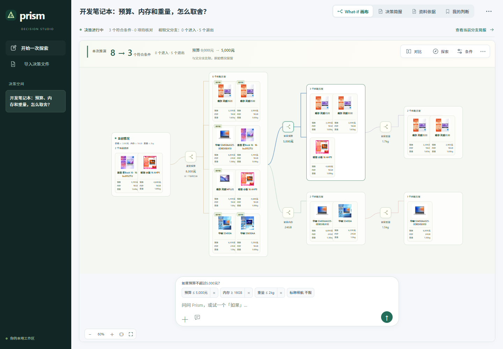
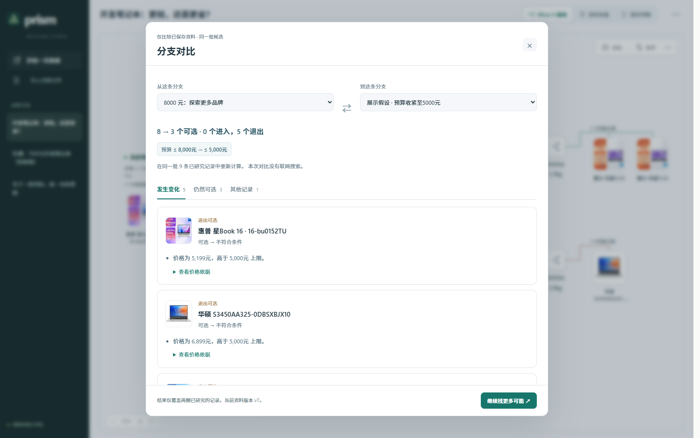
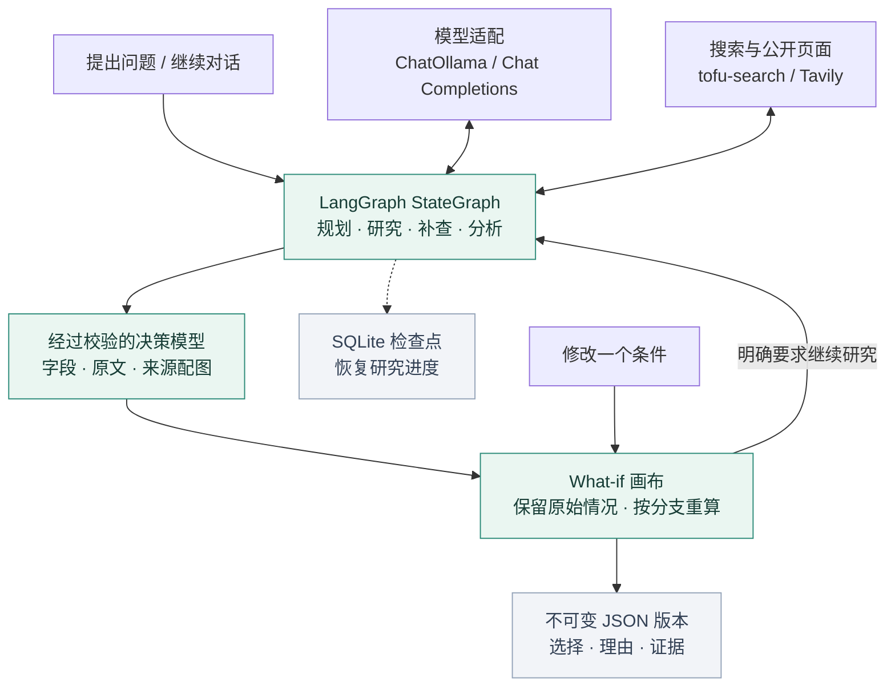
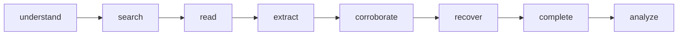

<div align="center">

**简体中文** · [English](docs/i18n/README.en.md)


# Prism

**让 Agent 找依据，让你推演每一个「如果」。**

有来源的研究，可交互的 What-if，留得下的判断。

[](https://github.com/mianwtt/prism/actions/workflows/check.yml) [](LICENSE) [](docs/ARCHITECTURE.md) [](.github/SECURITY.md) [](docs/ROADMAP.md)

[开始体验](#quick-start) · [核心功能](#features) · [使用场景](#examples) · [Agent 框架](#agent-architecture) · [文档](#documentation)

</div>



*电脑画面来自 Prism 的实际运行，使用历史苏宁商品观察及对应来源图片。五条分支是为展示设置的条件假设，保存的价格并非实时行情。*

预算变了，多了一个要求，或者你想知道某个方案为什么被排除。Prism 把 Agent 的研究结果放进一张 **What-if 画布**，让你沿着不同条件比较选择，也能接着对话、补充资料，保留原来的判断依据。

<a id="quick-start"></a>

## 快速开始

克隆本仓库，使用 **Node.js 24** 和 npm 运行：

```sh
git clone https://github.com/mianwtt/prism.git
cd prism
npm ci
npm start
```

打开 **[localhost:4317](http://localhost:4317)**，选择笔记本或住房演示。先改一个条件，点击方案查看详情，再保存自己的判断。两种演示均使用虚构数据，无需模型或搜索 Key；当前界面为中文。

### 接上真实研究

1. 启动本机 Ollama 模型，或准备兼容 Chat Completions 的模型接口。
2. 使用无需商业搜索 Key 的方案时，安装 [uv](https://docs.astral.sh/uv/)，运行：

   ```sh
   npm run setup:search
   ```

3. 打开「研究设置」，选择 **tofu-search**，连接模型。本机 Ollama 地址填 `http://localhost:11434/v1`，模型名选择实际已安装的模型，密钥栏填 `ollama`。
4. 提出问题，之后从画布继续修改条件或请 Agent 查找更多方案。

[完整配置与故障排查 →](docs/SETUP.md)

<a id="features"></a>

## 核心功能

- **Agent 可以继续为你研究。** 搜索并阅读公开资料，整理有来源的方案。沿选定路径追加问题，或明确要求继续查找更多选择。
- **每一个「如果」都有具体变化。** 点击条件或拖动滑杆，匹配方案立即更新。保留原始情况，联动继承条件的后续分支，也保留子分支单独修改过的要求。
- **点击方案，就能看到依据。** 图片、价格、参数、原文与来源链接在浮窗中展开；查看不同观察值，也能对比任意两条分支的进入与退出原因。
- **比较条件随问题生成。** Agent 从需求中提出数值、是非或分类维度。笔记本与住房使用同一张画布，各自呈现相应条件。
- **记住当时为什么这样选。** 保存选择、理由与原始条件；之后重新核对来源、比较版本，也能以 JSON 导出和导入决策。

### 选电脑：要求变了，看看哪些方案还能留下

先把预算放宽到 8,000 元，再比较「预算收紧到 5,000 元」「内存至少 24GB」「重量更轻」等路径。每条路径展示满足条件的全部方案；打开分支对比，可以看到哪些电脑退出，以及对应的价格原文。



*图中的对比将 8 个可选方案收紧到 3 个。商品资料为历史采集记录，不代表当前跨平台实时价格。*

### 选住房：月租变了，方案跟着变化


*预算从 2,500 → 2,000 → 3,000 元，选定分支的匹配方案从 4 → 1 → 5 个变化。此处使用已保存依据实时重算，不会因为每次拖动而重新搜索。*

<a id="examples"></a>

## 可以从这些问题开始

比较维度随问题生成：电脑可以关注价格、内存和重量，住房可以关注月租与面积。两类问题共用同一个 Agent、证据模型和 What-if 画布。

| 起点 | 继续探索 |
| --- | --- |
| 「选一台 7,000 元内、至少 16GB 内存的开发笔记本。」 | 「如果需要 32GB 呢？」·「为什么这个方案被排除了？」 |
| 「比较杭州 4,000 元/月内、至少 30㎡ 的整租房源，需要原页图片。」 | 「如果预算改成 2,500 元？」·「看看面积更大的选择。」 |
| 一次已经保存的判断 | 「保留这条路径，继续找其他方案。」·「重新核对这次判断的依据。」 |

想直接体验多条分支，可以导入[示例决策文件](examples/README.md)，无需连接模型。

**真实研究记录：** 使用本机 `qwen3.5:9b`、tofu 和 LangGraph，杭州与成都的新租房任务分别取得了 **6 套符合条件、带对应原页照片的房源**，输入没有房源链接。这些是有采集时间的网页观察，主要来自房天下；[完整记录](docs/reports/AGENT-RESEARCH-REPAIR-2026-11-15.md)包含中间失败和验证范围。

<a id="agent-architecture"></a>

## Agent 框架

研究 Agent 由 LangGraph 编排：模型理解需求、提出比较维度，调用搜索与读页，提取、补查并整理有引文的方案。What-if 直接使用这份决策模型重算分支；明确要求继续研究时，再由 Agent 扩充资料。



| 层次 | 实现 | 职责 |
| --- | --- | --- |
| 研究编排 | LangGraph `StateGraph` | 理解问题、调用工具、补齐依据、分析方案 |
| 模型与工具 | ChatOllama / 兼容 HTTP；tofu-search / Tavily | 连接本机或远程模型与可公开读取的资料 |
| 证据校验 | Zod 与来源／引文校验器 | 核对字段类型、单位、原文和对应图片 |
| 交互与记忆 | 确定性评估器、SQLite、JSON 版本 | 重算条件、恢复任务、保留判断上下文 |

<details>
<summary>展开真实 LangGraph 节点与代码入口</summary>



研究图：[general-research.mjs](src/general-research.mjs)。模型与搜索适配：[research-providers.mjs](src/research-providers.mjs)。分支校验与计算：[decision-schema.mjs](src/decision-schema.mjs)。检查点：[jobs.mjs](src/jobs.mjs)。

</details>

[完整架构与信任边界 →](docs/ARCHITECTURE.md)

<a id="documentation"></a>

## 文档

| 指南 | 内容 |
| --- | --- |
| [文档索引](docs/README.md) | 使用指南、项目结构、素材来源与历史报告 |
| [安装与配置](docs/SETUP.md) | 本机启动、Ollama、搜索服务、配置与故障排查 |
| [使用工作区](docs/WORKSPACE.md) | 对话、条件、资料依据、判断记录、导入与删除 |
| [架构说明](docs/ARCHITECTURE.md) | Agent 图、计算、存储与信任边界 |
| [技术实现报告](docs/TECHNICAL-REPORT.md) | 搜索与 BM25、Agent 执行、Redis 缓存、实现细节与测评 |
| [开发指南](docs/DEVELOPMENT.md) | 隔离测试、真实研究验证与 Docker 状态 |
| [GitHub 发布指南](docs/PUBLISHING.md) · [版本说明](docs/releases/v0.4.0.md) | 上传准备、仓库设置与公开预览版范围 |
| [验证记录](docs/reports/VERIFICATION.md) · [路线图](docs/ROADMAP.md) | 已测结果与后续发布工作 |

<a id="development-and-verification"></a>

## 开发与验证

```sh
npm run test:release
```

最近一次本地验证：**173 项单元／HTTP 测试、55 项浏览器测试通过**；另有 **3 项真实 Redis 集成测试通过**。受控测试验证产品行为，独立的真实调用验证资料获取；Chrome／Chromium 设置和分项命令见[开发指南](docs/DEVELOPMENT.md)。

`npm run check:project` 检查完整工作区源码；`npm run package:source` 生成排除本地配置、决策数据和实验目录的源码包。详见[项目结构与打包](docs/PROJECT-STRUCTURE.md)。

## 当前状态

Prism **0.4 是面向本机单用户的开发预览**。真实研究受模型、搜索引擎和公开网页可读性影响；保存引文表示可追溯到来源，不等于独立核实了发布者的说法。

当前真实验证覆盖两个租房任务，更广泛的场景评测和跨平台覆盖仍在推进。尚不支持 PDF／Word／Excel／图片资料导入。Windows 下 Node 22.23.5 与 24.19.0 的独立安装和运行检查均通过。首次 [GitHub CI](https://github.com/mianwtt/prism/actions/runs/44038301786) 也已通过 Windows/Linux Node 22/24 检查、浏览器回归、源码打包及 Docker 构建和运行自检。详见[发布工作](docs/ROADMAP.md)。

问题和决策历史保存在本机；外部模型、搜索和读页请求仍会传递相应数据。使用个人信息或分享导出文件前，请阅读[安全与隐私说明](.github/SECURITY.md)。

## 参与贡献

欢迎公开来源适配、可复现的数据质量案例与无障碍改进。请从 [CONTRIBUTING](.github/CONTRIBUTING.md) 开始。

项目源码采用 [MIT](LICENSE)；第三方内容和照片保留其原有权利。
