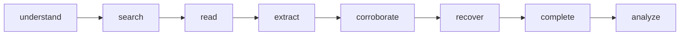

# Adaptive research Agent

[Documentation](README.md) · [Architecture](ARCHITECTURE.md) · [Verification](reports/VERIFICATION.md)

New research uses the compiled LangGraph in `src/general-research.mjs`. The model proposes a typed comparison model from the question; the application validates it and controls tool budgets. Housing, laptops and other questions share this path rather than selecting a fixed frontend template.

| Node | Responsibility |
| --- | --- |
| `understand` | Propose comparison dimensions, constraints, presentation requirements and search terms |
| `search` | Discover public sources through the configured provider |
| `read` | Read observed pages and concrete detail links within bounded budgets |
| `extract` | Extract candidate observations and source quotations |
| `corroborate` | Seek additional evidence for incomplete observations |
| `recover` | Supplement insufficient comparable results using observed catalogs and focused queries |
| `complete` | Validate supported fields, photo requirements, scopes and suggested branches |
| `analyze` | Produce commentary grounded in the resulting decision model and evidence |

The graph is compiled with a checkpointer. `src/jobs.mjs` persists task progress and SQLite checkpoints; a failed task can continue from saved steps. An interrupted external request may repeat. Model responses cannot execute arbitrary tools or exceed application budgets.

## Research, explanation and What-if

Conversation can explain existing evidence, change conditions or explicitly request further research. A condition edit uses the deterministic evaluator: it does not silently run another web search. Continued research is a separate scoped graph job and retains the original situation and sibling branches. The workspace keeps the user conversation with the decision; internal research traces are not the main product interface.

Numeric, boolean and categorical fields are validated against the typed model. A quoted field is traceable to saved source text, not independently verified truth. Conflicting or unsupported observations remain unresolved. Missing facts are not filled from model memory.

## Source and photograph boundaries

The no-commercial-key path uses tofu-search and public page reads. Optional public-page adapters improve supported merchant and rental templates. They do not log in, bypass verification or guarantee coverage of every platform. Source markup, provider availability and model quality can still prevent useful results.

Listing photographs must be bound to the corresponding observed listing. When a question explicitly requires source photos, text-only observations stay in research drafts. The application does not generate substitute listing photographs or invent commute durations from a location alone.

## Evaluation

Controlled tests cover graph orchestration, evidence validation, recovery, inheritance and browser interactions. The [2026-11-15 research report](reports/AGENT-RESEARCH-REPAIR-2026-11-15.md) separately records actual local-model/tofu tasks, including failures and final six-listing Hangzhou/Chengdu results. This small task set is not a general success-rate estimate or cross-platform verification.

The [legacy Agent notes](legacy/AGENT-0.4.md) preserve earlier product-oriented behavior used for compatibility with saved laptop decisions.
