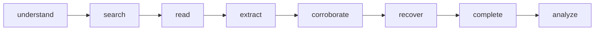

# Adaptive research Agent

[Documentation](README.md) · [Architecture](ARCHITECTURE.md) · [Verification](reports/VERIFICATION.md)

New research uses the compiled LangGraph in `src/general-research.mjs`. The model proposes a typed comparison model from the question; the application validates it and controls tool budgets. Housing, laptops and other questions share this path rather than selecting a fixed frontend template.

| Node | Responsibility |
| --- | --- |
| `understand` | Propose comparison dimensions, constraints, presentation requirements and search terms |
| `search` | Discover public sources through the configured provider |
| `read` | Read observed pages and concrete detail links within bounded budgets |
| `extract` | Extract candidate observations and source quotations |
| `corroborate` | Seek additional evidence for incomplete observations |
| `recover` | Supplement insufficient comparable results using observed catalogs and focused queries |
| `complete` | Validate supported fields, photo requirements, scopes and suggested branches |
| `analyze` | Keep match/unresolved counts deterministic; retain source-bound model interpretation separately |

The graph is compiled with a checkpointer. `src/jobs.mjs` persists task progress and SQLite checkpoints; a failed task can continue from saved steps. An interrupted external request may repeat. Model responses cannot execute arbitrary tools or exceed application budgets.

## Bounded evidence recovery

`src/research-recovery.mjs` reuses observed catalog entries and same-origin absolute/relative Markdown links. It reads and extracts details in small batches before issuing another search, stops after reaching three supported comparable alternatives, and keeps URL selection inside the observed set. Selection and extraction errors receive bounded retries; a failed query rewrite no longer discards already readable pages.

One recovery has a shared cap of two web-search/catalog discoveries, fourteen explicit page reads, three extraction calls and four URL-selection calls. The saved `agent.recovery` records before/after supported counts, missing fields, exclusion reasons, observed ranges, actual recovery-call counts and a stop reason. These describe that recovery stage, not a general research-accuracy score. Existing evidence and photo checks still decide what may become a comparison candidate.

## Research, explanation and What-if

Conversation can explain existing evidence, change conditions or explicitly request further research. A condition edit uses the deterministic evaluator: it does not silently run another web search. Continued research is a separate scoped graph job and retains the original situation and sibling branches. The workspace keeps the user conversation with the decision; internal research traces are not the main product interface.

Numeric, boolean and categorical fields are validated against the typed model. A quoted field is traceable to saved source text, not independently verified truth. Conflicting or unsupported observations remain unresolved. Missing facts are not filled from model memory.

## Source and photograph boundaries

The no-commercial-key path uses tofu-search and public page reads. Optional public-page adapters improve supported merchant and rental templates. They do not log in, bypass verification or guarantee coverage of every platform. Source markup, provider availability and model quality can still prevent useful results.

Listing photographs must be bound to the corresponding observed listing. When a question explicitly requires source photos, text-only observations stay in research drafts. The application does not generate substitute listing photographs or invent commute durations from a location alone.

The public rental reader also recognizes observed mobile filter routes and rental topic catalogs, preserving supported same-platform redirects. An explicitly monthly rent field may use currency-only display units when its label carries the billing period; its facts still need monthly quotation support. Annual, weekly and unspecified amounts cannot supply that monthly field, and rent cannot fill unrelated fields such as deposits.

For products, the Agent can select a short category for the public merchant catalog tool. If the large plan response omits that selection, one compact model turn may supply it; code does not guess a category or seed brands. `src/public-merchant-read.mjs` reads observed Suning product links, joins the public price and specification table by the same seller/product identity, and binds actual gallery images. It maps observed numeric attributes to the Agent-selected fields without imposing the legacy laptop schema. Missing or conflicting values remain unknown; source refresh withdraws stale observations and photos.

The product reader applies an already validated price ceiling through the platform's real controls and retains the resulting observed URL. Its main-price observer separates ordinary prices from coupon/final-price children, rejects deposit titles and refuses conflicting ordinary-price observations. Reading availability is independent of stock status.

For rentals, a public city index supplies the observed city URL. The Agent can then follow at most three consecutive same-city catalog filters. The third step permits a platform's price → type → combined-price flow; no city-code table or generated budget-filter URL is used. Details, monthly prices, areas and gallery images still need source support. Initial discovery retries a transient connection once across its catalog requests; invalid input is not retried.

Planning repairs only resolve representation: whitespace-equivalent quotations are restored to the actual request span, an unambiguous quoted quantity is converted using the existing comparator convention, and source/process/identity metadata stays separate from comparison fields. Repairs are saved in `agent.planRepairs`. Equivalent square-metre spellings are accepted; square feet are not treated as square metres. These repairs must not alter user thresholds or fill missing source facts.

The existing explicit-priority filter runs before schema validation for new research. An unsolicited invalid extra dimension must not reject otherwise valid user constraints. Fields anchored by exact user quotations stay in the contract; this does not fabricate extra enum choices or source facts. Continuations preserve existing schema meanings.

`src/candidate-diversity.mjs` conservatively groups merchant observations with matching source-supported brand/model/specification sets. Appearance preferences and reviewed/personal facts are preserved. Explicit configuration-diversity requests on capable public readers become evidence requirements: unidentifiable configurations cannot satisfy the research target. Other quotes/colours stay in source records and drafts; source facts are not merged or overwritten. Recovery uses observed choices and source-derived brands, with at most four rewrite/compact-choice turns including format repair; catalog discoveries and web searches still share the two-call supplemental budget. See [the preview-quality report](reports/PREVIEW-QUALITY-2026-11-18.md) for current complete batches and retained failures.

## Evaluation

`npm run evaluate:live` runs the [fixed ten-task acceptance protocol](reports/LIVE-ACCEPTANCE-2026-11-18.md). Requirements are held separately from the Agent schema, task processes are bounded, runtime/configuration changes stop a batch, and source images receive a separate browser load check. Local raw results remain under ignored `work/live-acceptance/`; this is recorded-source acceptance, not independently labeled truth or a general accuracy benchmark.

The retained initial ten-task batch passes 2/10 under the corrected application-eligibility gate; a later four-task regression passes 2/4. Further complete cohorts and the current discovery fixes are recorded separately in the [discovery report](reports/AGENT-DISCOVERY-2026-11-18.md), including failures. Results from different versions cannot be combined into a new ten-task success rate. The fixed tasks have been used during debugging and are not a holdout benchmark.

The final graph-version-13 cohort passes all ten fixed tasks under the recorded-source protocol: 51 qualifying records and 51 loaded source images in total, at least three per task. Intermediate complete cohorts remain 3/10 and 7/10. Product records are deduplicated by platform identity; C03 includes two colour variants of one series, so three passing records must not be presented as three distinct hardware models. This does not establish cross-platform truth, unseen-task accuracy or mature-release acceptance.

Controlled tests cover graph orchestration, evidence validation, recovery, inheritance and browser interactions. The [2026-11-15 research report](reports/AGENT-RESEARCH-REPAIR-2026-11-15.md) separately records actual local-model/tofu tasks, including failures and final six-listing Hangzhou/Chengdu results. This small task set is not a general success-rate estimate or cross-platform verification.

The [2026-11-18 recovery report](reports/AGENT-RECOVERY-2026-11-18.md) adds paired controlled replays, two failed live attempts and a final successful Hangzhou run with six eligible records and six source images. Reproduce controlled recovery with `npm run evaluate:recovery`; pass `-- --baseline-ref 0aa305f` to compare the earlier graph using the same current shared modules and fixtures.

The [legacy Agent notes](legacy/AGENT-0.4.md) preserve earlier product-oriented behavior used for compatibility with saved laptop decisions.
