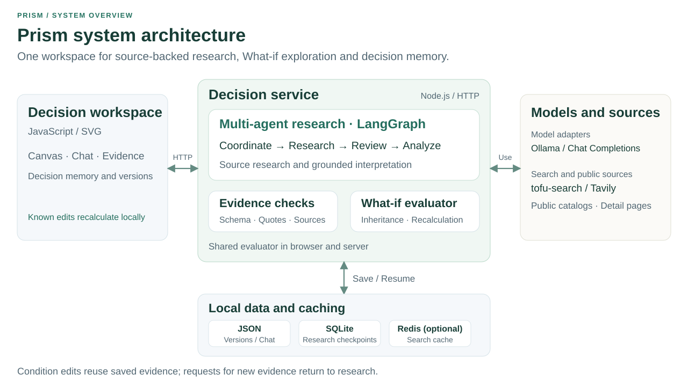
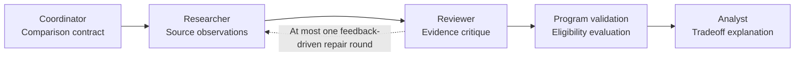
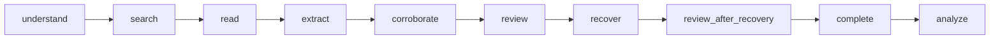

# Architecture and product boundaries

Prism's useful unit is a decision space, not a chat answer. A space contains a question, typed model, source snapshots, candidate facts, branch scopes, conversation and a versioned personal decision.

The production research adapter now uses the official MCP SDK for tool discovery and calls, and specialist contexts load task-selected Agent Skills. This adds protocol and procedural guidance layers while preserving the existing role permissions, evidence rules and deterministic decision engine. See [MCP and Skills](MCP-SKILLS.md).

## System overview

The detailed diagram exposes scoped specialist handoffs, review-driven repair, the program eligibility gate and typed decision artifacts. Solid edges show principal handoffs/dependencies; dashed edges distinguish conditional repair, known-condition recalculation, checkpoint recovery and optional search caching. The illustrated workspace is schematic.

The native JavaScript/SVG browser workspace uses the HTTP API in `src/server.mjs` for research, conversation and version operations. Application services combine the LangGraph research subsystem, conversation context, source/schema validation and a deterministic evaluator shared with the browser. Model and source adapters are dependencies of those services. Local JSON snapshots/job records, SQLite checkpoints, optional Redis search entries and browser drafts have separate ownership; the arrows show component dependencies rather than requiring every edit to pass through research.

## Interaction routes come before research

The UI and API separate three operations. They are not three Agents, and not every conversation turn invokes the research graph.

| Operation | Actual execution | Data boundary |
| --- | --- | --- |
| New question or additional evidence | A research job invokes the compiled LangGraph | Search/read/extract/validate observations, then commit a result |
| Change a known condition | Validate a typed operation and run the deterministic evaluator | Recalculate the active branch's candidate pool; preserve the baseline |
| Explain or clarify | Use the active path, conversation context and saved observations; call the model when needed | Do not change conditions or silently launch a search for an explanation |

The new-question entry is `POST /api/research`. Follow-ups use `POST /api/spaces/:id/conversation`: `src/conversation-intent.mjs` resolves supported contextual operations, `src/conversation.mjs` validates model proposals, and the server starts a separate scoped job when the result requests new research. Direct canvas edits use the shared evaluator in the browser. This is application routing, not a universal LLM router through which every mouse click passes.

For example, “budget 5000” recalculates acquired alternatives, “why was this excluded?” explains recorded conditions, and “find more options for this path” starts research. A new criterion may require clarifying the request before research. Zero matches are not evidence that no matching option exists in the market; the current numeric model also cannot apply a two-sided interval as a single upper/lower limit.

## Research and reasoning

`src/general-research.mjs` coordinates four compiled specialist subgraphs. `src/agents/specialist.mjs` gives each role a private task state, a model instruction and an allowed adapter surface. Research stages remain explicit for checkpoint compatibility:

Four is a count of responsibilities, not model instances: coordinator (comparison contract), researcher (source observations), reviewer (evidence critique), and analyst (tradeoff explanation). They use the configured model service sequentially; the parent graph owns scheduling. What-if evaluation, source validation, caches and persistence are program components rather than additional agents.

The underlying stage graph is:

The coordinator proposes 1–8 typed dimensions and a bounded presentation contract. The researcher handles source discovery, reading, extraction and bounded repair. An independent reviewer can withhold source-bound fields; its structured findings remain attached to repair so re-extraction does not silently restore the same disputed observation. The analyst sees the active candidate pool and evaluated status, and returns interpretation without rewriting facts or conditions. Program checks still decide source support and eligibility. See [the multi-agent implementation](MULTI-AGENT.md).

`src/research-providers.mjs` connects model/search services. ChatOllama handles local Ollama; compatible providers use the HTTP adapter. `src/jobs.mjs` persists task records and graph checkpoints in SQLite. Completed graph steps can resume after restart; an interrupted external request may repeat. Only one research job runs at a time.

The optional application-scoped Redis layer in `src/search-cache.mjs` caches successful search observations with bounded TTLs. Both tofu and Tavily share the adapter; saved sources retain their original observation time. Independent source/price reads and citation rechecks remain uncached. Cache faults fall back to the original search. This is neither a job queue nor model memory; JSON decisions and SQLite checkpoints retain their existing roles. See [the technical report](TECHNICAL-REPORT.md) for keys, counters and evaluation.

The historical laptop workflow remains for compatibility. `src/legacy-decision.mjs` adapts saved laptop records for the shared renderer; it does not choose the schema for new live research.

## What-if is deterministic

`src/decision-schema.mjs` validates dimensions, limits, weights and branch ancestry. A branch owns a candidate-ID scope. New research can expand that branch without mutating its baseline or sibling scopes.

The evaluator separates eligible, excluded, unresolved and disabled candidates. Missing evidence is not a low score. Numeric preference normalization uses declared bounds when present; otherwise it uses the compared pool. Scores express the selected model and preferences, not objective quality or probabilities. Decision records freeze their normalization so later pool changes do not silently alter the recorded model.

`public/branch-canvas.mjs` renders condition nodes and all matching image nodes, with a rooted tree layout and SVG connections. `public/universal-view.mjs` coordinates local recalculation, conversation, scoped research and modal inspection. No condition change is presented as a search unless a research job actually runs.

## Evidence and decision memory

`src/decision-workflow.mjs` checks saved quotations, handles human confirmation/withdrawal, captures decision context and compares versions. Quotations establish provenance to the captured text, not independent truth. `src/source-reconciliation.mjs` combines observations when an explicit supported identifier or the same supported merchant product ID binds them. Global product codes and host-scoped listing IDs have different scopes. Names alone do not authorize merging; disagreements remain unresolved. Identifier matching is a conservative binding rule, not a proof that two publishers describe the same hardware configuration.

`src/general-refresh.mjs` rechecks up to 12 referenced pages per resumable batch. Missing excerpts or failed reads withdraw support while retaining the historical value. It does not infer replacement prices. Follow-up research is a distinct graph job.

`src/store.mjs` commits immutable JSON snapshots with server-generated IDs, ancestry and timestamps. Older records remain accessible. A decision captures its candidate, rationale, original conditions, rules, facts and source metadata; later versions reassess it under that captured model.

Infrastructure supports these operations rather than forming a serial product workflow. Models interpret requests and source material; search and native public-page adapters collect observations. SQLite checkpoints belong to research jobs, JSON snapshots belong to business versions, and optional Redis entries cache searches. None is a substitute for the typed evaluator or source verification.

`src/workspace-draft.mjs` retains unsaved branch settings and input drafts in same-origin browser storage, keyed by immutable space version. Drafts are validated on restoration and keep source pools scoped; they do not overwrite saved facts, quotations or the pinned baseline. Export includes the current canvas conditions rather than silently downloading an older saved state. Successful deletion also clears the decision family's drafts in the current browser origin.

## Portable files and boundaries

`src/space-import.mjs` accepts bounded Prism JSON snapshots and adapts historical laptop exports. Import validates the model, IDs, references, branch graph and URL shapes. It creates a new root, drops model analysis/job state and does not inherit human confirmation. Imported sources are never fetched during import. Validated user/assistant conversation records are imported; previous version chains are not. A recorded rationale is restored without claiming that the old full decision context was recreated.

`src/server.mjs` serves the native browser modules and local API. Host/origin checks and CSP reduce accidental cross-site use; they do not make this an authenticated public service. Provider configuration is separate from spaces and never included in exports.

## Verification versus claims

Unit and HTTP tests cover validation, quote support, immutable persistence, calculations, imports and graph recovery. Browser integration uses controlled providers while running the actual graph/API/UI. Fictional demos test interactions across domains. These tests do not establish live search recall, price freshness, source truth or success on arbitrary housing/merchant websites.

See [SEARCH-EVALUATION](reports/SEARCH-EVALUATION.md) for measured retrieval observations and [ROADMAP](ROADMAP.md) for release gates.

## Evidence gaps and conversational action

`src/general-retrieval.mjs` prioritizes concrete merchant pages, allocates original-text excerpts across the selected dimensions, and keeps source engine/query metadata. The `corroborate` node selects up to two candidates needing evidence, performs at most two additional searches, reads up to four fresh pages and extracts at most two fresh batches. A missing result does not generate a fact.

The optional `src/public-product-read.mjs` adapter currently reads visible Suning page prices for at most two distinct product IDs. It uses anonymous public pages, does not attempt login, and does not gate information collection on stock. Price text and observation time are preserved. Other platforms still depend on available public source content.

`src/source-passages.mjs` can bind whitespace variants and recover a contiguous original numeric passage for a proposed value on a concrete detail page. Currency recovery requires an actual saved public-price observation; it cannot choose a price from a recommendation list. Known compatible unit conversions retain the original quote and are explained in the evidence view.

The conversational API accepts `autoResearch:true`. Only an explicit research request then starts an adaptive job after saving the conversation. The response supplies an ephemeral `nextAction` with a job ID; the UI waits while keeping the workspace visible. The completed version contains the research outcome in the conversation. Pure explanation turns remain read/explain operations. Existing API callers without the flag retain the earlier behavior.
