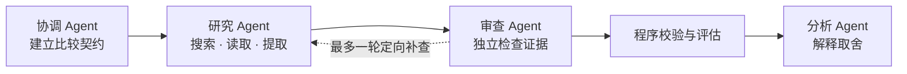

# Prism 多 Agent：实现、交接与验证

本页描述整体系统中的研究子模块。前端工作区、Node.js API、条件计算、模型检索与存储之间的完整关系，见 [README 整体架构](../README.md#system-architecture)及[架构说明](ARCHITECTURE.md#system-overview)。

Prism 的通用研究链路现在使用四个独立 LangGraph 子图：协调、资料研究、证据审查和决策分析。它们共用当前配置的模型服务，通过结构化任务与结果交接；调度顺序、补查预算和最终数据校验由应用控制。普通解释对话、已有条件的 What-if 计算沿用原有路径。

## 四个角色怎样分工

“四类”指职责种类，来自 `specialistPolicies` 中的四个定义，不是四套模型、四个进程或四次调用。当前配置的一个模型服务可以先后承担全部角色。应用按比较需求划分任务、按来源收集事实、单独审查证据、最后解释取舍；这是当前工程设计，不是行业规定必须使用四个 Agent。

以“7,000 元内、至少 16GB 内存的开发笔记本”为例：协调角色输出比较字段、条件和查询；研究角色取得商品详情与引用；审查角色检查条件报价及配置归属，发现问题时暂缓对应字段；程序评估资格后，分析角色解释哪些方案可选、各自有什么取舍。每个角色的独立任务状态和能力适配都由代码创建，不只是四个名称。

| 角色 | 输入与任务 | 可调用能力 | 返回值与限制 |
| --- | --- | --- | --- |
| 协调 Agent | 原问题、新关注点、已有字段、当前条件及少量来源元数据 | 模型 | 提出字段、约束、查询和假设；不读网页、不查看整段旧对话或全部旧事实 |
| 资料研究 Agent | 本轮比较契约、已观察来源和审查反馈 | 模型、搜索、公开目录、读页及来源图片读取 | 返回原文和候选观察；不能修改原始情况或自行放宽要求 |
| 证据审查 Agent | 有引用的观察及有界原文摘录 | 模型 | 对具体字段提出带原文依据的问题；不能编造替代数值、上网、改变资格规则 |
| 决策分析 Agent | 当前分支候选、引用事实及程序计算的资格状态 | 模型 | 返回引用绑定的取舍解释；不获取其他分支的数据，不更改事实或条件 |

角色定义、私有状态和能力适配见 [specialist.mjs](../src/agents/specialist.mjs)，研究调度见 [general-research.mjs](../src/general-research.mjs)。每次委派都会创建自己的任务对象，不把完整对话历史在角色间广播。这里的隔离是应用层的数据和能力范围，不是独立进程或操作系统沙箱。

协调子图负责模型规划；实际阶段调度由父图和受控规则完成。当前实现不是让一个 LLM 任意选择执行顺序的自由调度系统，也没有并行运行多个模型。这样可以继续使用本机模型，并保留阶段检查点和可复现的补查上限。

研究角色的 `search / read / extract / corroborate / recover` 是同一角色的不同阶段。两个审查阶段也复用同一个审查角色；`complete`、What-if 计算、Redis 缓存和 SQLite 存储属于程序或基础设施，不计为 Agent。所谓一轮补查指反馈后的恢复阶段，内部仍有明确的工具调用预算，不能解读为整轮研究只搜索一次。

## 审查怎样真正影响结果

审查新增了一条独立模型调用，而不只是给原校验函数改名。它可报告有条件报价、对象/配置混淆、矛盾、缺乏依据或区域不符。每条问题必须绑定现有候选、字段、来源 ID、事实引文以及来源中的问题证据。

应用校验反馈后，把被质疑的字段暂缓采用，保存原始数值与问题依据用于追溯。原文保持不变，审查不能填入另一个价格。最终资格仍需通过原有类型、单位、实体、引文、图片和用户约束检查。

不够三个可比较选择时，研究角色在原有预算内补查。审查反馈随任务传递；重新提取同一来源不能让同一笔争议观察自行恢复。新增证据或观察变化后再审查一次，没有变化则跳过。每轮研究最多两次模型审查、一轮受预算限制的补查。

审查实现见 [evidence-review.mjs](../src/agents/evidence-review.mjs)。模型审查失败或输入超出预算时，会保存 `unavailable` / `context-budget-exceeded` 状态并说明降级；候选仍受程序证据规则约束，不能把这种结果称为已通过独立模型审查。审查输入最多 20,000 个字符、最多 12 个候选；覆盖数量被记录，不保证所有观察都由模型审查。

## 状态、恢复与观测

父图保留 `understand / search / read / extract / corroborate / recover / complete / analyze` 阶段名，并增加前后审查节点。根检查点继续保存阶段产物，SQLite 仍负责任务恢复。各子图没有共享的隐式聊天历史。

保存的 `agent` 元数据包含：

- `architecture: bounded-specialist-subgraphs`，`graphVersion: 26`；
- `roles`：角色与可用能力；
- `runs`：完成交接的角色、阶段、模型/工具调用次数、耗时和输入输出字符数；
- `reviews`：审查状态、覆盖数量、带来源的问题和被忽略的无效反馈；
- `recovery`：原有补查前后数量、实际调用与停止原因。

字符数不是 Token 数，阶段耗时也不是纯模型推理耗时；这些记录不代表跨失败重试的完整计费账单。`GET /api/agent` 和 `/api/health` 返回当前通用架构信息，旧商品图的说明另放在 `legacy` 中。

## 本轮验证

完整本地回归：**299 项单元／HTTP、71 项 Microsoft Edge 浏览器测试通过**。新增协作测试覆盖角色工具权限、上下文投影、独立子图调用、非法审查反馈、审查后的字段暂缓、补查交接、复核次数以及审查不可用时的降级。具体见 [multi-agent.test.mjs](../tests/multi-agent.test.mjs)。

受控案例中，一条报价引文只写“4000元”，对应原文实际要求领券。审查角色指出条件并暂缓该字段，补查后取得另一项有依据的方案。这个案例验证反馈确实影响采用结果，不能当成总体准确率提升。

另外通过 Edge 从首页重新提交真实任务：

> 在杭州滨江租房，月租不超过4000元，面积至少30平方米，只看整租，需要原房源图片。不限制通勤，请找几个具体房源进行比较。

| 记录项 | 实测结果 |
| --- | --- |
| 满足全部原条件的房源 | 7 个，详情区域均为杭州滨江，保留对应原页照片 |
| 独立审查 | 1 次完成，检查 7 个候选，未提出暂缓项 |
| 已完成交接中的模型调用 | 协调 3 次、研究 5 次、审查 1 次、分析 1 次 |
| 审查阶段耗时 | 约 2.1 秒 |
| 整轮首页研究耗时 | 约 87.1 秒 |
| 月租改为 3000 元 | 7 → 2，保留原始情况 |
| 手机页面与脚本异常 | 无整页横向溢出，未捕获页面脚本异常 |

这是同一已用于调试任务的新回归，不是独立测试集。它证明角色、工具、引文、画布与持续对话可以连通；**尚未证明多 Agent 比原单流程具有更高准确率或更低成本**。更多角色也会增加调用和失败点。本轮没有加入 RAG、MCP、自进化或模型训练，也没有复用其他项目的实验指标。

原始模型／网页调用未替换为模拟响应，证据位于本机忽略目录 `work/interaction-research-2026-11-20/human-multi-agent-live/` 和 `work/multi-agent-2026-11-21/`。用户原始决策目录没有作为测试写入目标。Docker 与远程 CI 没有新增验收。

该组合方式参考官方 [LangGraph 子图通信](https://docs.langchain.com/oss/javascript/langgraph/use-subgraphs)和[子 Agent 上下文管理](https://docs.langchain.com/oss/javascript/langchain/multi-agent/subagents)；项目采用的是受控专职子图，而不是直接照搬官方自由 Supervisor 工具调度示例。
