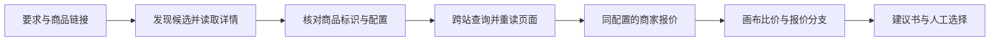

# 同款多来源比价

商品选型要回答：**选哪个配置，以及从哪个来源购买**。不同商家的价格独立保存，不再合并为一个冲突字段。用户可在画布采用另一条报价，保留原来的比较。

## 使用流程

1. 提出预算、配置和偏好，也可以直接提供商品详情链接。
2. Agent 发现候选并读取详情，核对具体型号、配置与原页依据。
3. 独立比价阶段跨站查找同款，重新读取搜索发现的页面。
4. 在画布打开 **同款比价**，查看商家、标价、运费、优惠资格、库存描述和采集时间。
5. 采用另一条可比报价时建立新分支；原来的候选、价格、条件和来源不变。
6. 决策建议书及 Markdown 导出保留采用的报价与其他来源。

这仅代表已核对来源，不保证全网最低，也不代表库存或最终结算已确认。

## 数据组织与身份核对

| 对象 | 内容与作用 |
| --- | --- |
| 商品配置 | 厂商品牌、型号或 GTIN、原页配置属性；商家自己的 SKU 不能直接跨站使用 |
| 固有参数 | 内存、重量等字段及原文，用于判断是否满足条件 |
| 商家报价 | 来源、商家、币种、标价、运费、条件、库存描述、有效期与时间 |
| 报价分支 | 新候选快照、所选报价及父分支，用于验证换来源后的影响 |

归并使用带校验位的 GTIN，或原页品牌、完整型号和具体配置。电脑缺少 CPU、内存或存储信息时，不凭系列名归并。配置有冲突或缺项时保留独立候选。搜索摘要不能成为报价。

## 搜索与读取

商品目录只是发现候选的起点。原先取得一个平台的目录后可能停止搜索，现在仍会检索其他来源。独立的 LangGraph `compare_offers` 阶段位于候选补查之后、最终审查之前，补查中新取得的候选也能参与。

- 每次搜索最多返回 12 条线索，去重后按站点交替取用，避免一个平台占满结果。
- 当前比价阶段优先处理最多 3 个已观察配置，最多 6 个查询、10 个详情。以完整型号和关键配置先广查，再核对其他平台。
- 对支持的电子元件商家，每个已观察配置另有最多 2 次公开目录发现。只沿原页实际搜索表单和分类链接找详情，不猜商品 URL。目录线索优先，多个商家的链接交替进入有限上下文，避免第一家占满名额。
- 明确要求同款比价时，已有一个完整商品便进入跨商家报价核对，不再为了凑三个候选而补入其他代际或配件。型号相似的外壳、散热器不能作为单板配置归并。
- 按批并发，时间预算到达后不启动新批次；沿用工具白名单、预算与 SQLite 检查点。
- 配置多个服务后，同款查询可并行调用；普通检索不足时也可使用补充服务。

| 工具 | 当前用途与接入 |
| --- | --- |
| tofu-search | 保留多引擎发现与正文读取，扩大结果窗口；BM25 排名不等于同款校验 |
| [SearXNG](https://github.com/searxng/searxng) | `npm run search:up` 部署固定镜像，监听本机 4330；实际 JSON 检索通过后报告就绪，支持独立选用 |
| 商家公开目录 | DFRobot 的原页 GET 搜索表单、微雪的原页分类导航；弥补通用搜索的同款覆盖不足，不把目录标题当报价 |
| Tavily | 已配置密钥时补充发现与读取 |
| Microsoft Edge | 固定只读选择器和原页 JSON-LD，读取支持商家的公开动态详情 |
| [Crawl4AI](https://github.com/unclecode/crawl4ai) | 可选对接已有服务的 `/crawl`，补充动态渲染；默认不安装、不启动 |

SearXNG 实例需要启用 JSON；一些公共实例关闭该格式，不能假定任意地址都可用。依据：[搜索 API](https://docs.searxng.org/dev/search_api.html)。Crawl4AI 的连接与认证见其[自托管文档](https://docs.crawl4ai.com/core/self-hosting/)。所有读取均不登录、不下单、不绕过访问验证。

本地实际验证使用 SearXNG 的 `bingrss` 引擎读取 Bing 公开 RSS 结果；原生 Google、Qwant、Brave、DuckDuckGo 等在本机存在拒绝、验证或解析失败，不假定其有效。通用搜索可能忽略 `site:`，因此详情读取与目录补充都是必要环节。DFRobot 的静态主价范围可直接读取；微雪的 Vue 价格先等待 Edge 渲染，再读取主商品价格和已选套餐，排除关联商品和未选变体。

## 报价怎样参与比较

程序检查价格原文、数值、币种和同款身份。结构化报价从原页 `Product`、`Offer` 解析并保留原始记录，不由模型填写价格。

非 JSON-LD 商家使用固定 DOM 范围，保存读取方法。单板的处理器、内存和包装内容分别核对，内存同义字段也映射到比较模型；单品包装清单或已选“单独主机无套餐”可支持不含套装的判断。主价与页面数据属性冲突时不采用该报价。问答接收程序重建的报价集合，保留当前采用来源，价格差额由程序计算；模型不能把已核对的来源重新说成缺失价格。

券后、会员、补贴等资格未明确的价格只保留展示。缺货、预售、到期、不同币种和采集超过 24 小时的报价不自动参与。库存未知明确提示，不能解释成有货。

运费全部明确时可按已知合计比较，否则按标价比较并保留运费待核对。未知运费不能写成零元。切换来源经服务端重新校验，不能通过修改页面参数采用失效报价。独立审查暂缓的来源也不能通过价格归并重新成为最低项。

## 实现位置

| 模块 | 文件 |
| --- | --- |
| 搜索联邦、去重与站点分散 | [search-network.mjs](../src/search-network.mjs) |
| 同款检索计划与有界执行 | [offer-research.mjs](../src/offer-research.mjs) |
| 标识、配置、报价与分支 | [product-offers.mjs](../src/product-offers.mjs) |
| 安全读取与 JSON-LD | [public-product-page.mjs](../src/public-product-page.mjs) |
| 商家模板与实际目录导航 | [retail-page.mjs](../src/retail-page.mjs)、[retail-catalog.mjs](../src/retail-catalog.mjs) |
| Edge 与可选 Crawl4AI | [product-browser.mjs](../src/product-browser.mjs)、[crawl4ai-reader.mjs](../src/crawl4ai-reader.mjs) |
| 比价界面 | [product-offers-view.mjs](../public/product-offers-view.mjs) |
| 图编排 | [general-research.mjs](../src/general-research.mjs) |
| 核心回归与完整图测试 | [product-offers.test.mjs](../tests/product-offers.test.mjs) |

当前自动比价覆盖人民币一次性商品报价；租房与其他方案不自动套用商品身份规则。需要登录或没有公开价格的来源保持未完成。目前没有足够实测证明在所有电商平台都能稳定取得同款价格。

软件回归、真实来源探测及界面样例见[本轮验收记录](reports/MULTI-SOURCE-OFFERS-2026-11-27.md)。
