# Prism 核心技术报告 · 架构与实现

**围绕项目工作原理，解释架构、Agent 决策、关键算法、数据一致性与技术取舍。**

源码基准：Prism 0.4.0，`0aa305f`；核对日期：2026-11-17。以下机制来自应用源码及实际安装的 `tofu-search==0.12.25`。教学计算、受控实验与真实研究结果分别标注。

2026-11-18 的公开目录工具、商品参数/标价/原图读取，以及固定真实任务验收另见[验收协议与早期失败](reports/LIVE-ACCEPTANCE-2026-11-18.md)及[后续发现与读取修复](reports/AGENT-DISCOVERY-2026-11-18.md)。这些报告保留失败和版本差异，不将下文的机制解释当作真实研究成功率。

后续配置多样性、手机与新城市验收及本机预览版分发检查，见[质量改进报告](reports/PREVIEW-QUALITY-2026-11-18.md)。

## 技术主线

自然语言需求 → Agent 建立比较模型 → 搜索并读取具体来源 → 校验字段证据 → 形成决策空间 → 用户改变条件、即时重算 → 对话补查、保存判断。

| 章节 | 核心问题 |
| --- | --- |
| 01–03 | 整体怎样工作，框架怎样分工，Agent 在哪里作决定？ |
| 04–06 | 信息怎样发现、排序、提取，并确保参数属于同一个对象？ |
| 07–10 | What-if 如何联动，Redis 缓存什么，状态如何恢复，对话如何继续？ |

## 01 项目整体如何工作

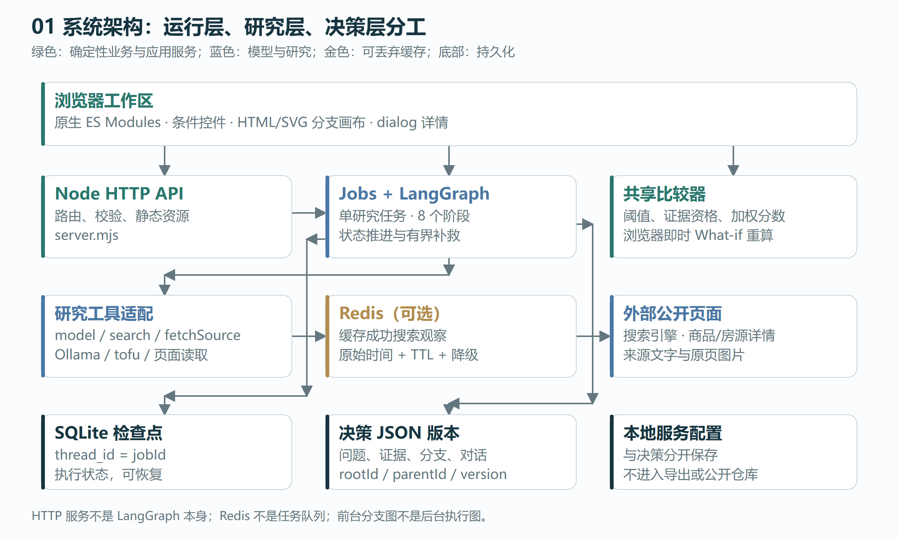

**图 01｜系统职责图。** 连线概括模块职责关系，精确调用先后见图 02。后台执行图组织研究；前台业务分支组织条件情景。这是两种不同的图，不能因为画布出现多个分支就认为启动了多个 Agent。

### 1.1 项目的输入、输出和完整业务链

输入是包含目标、约束和关注点的自然语言；输出是一个结构化决策空间，包含比较字段、具体方案、字段证据、来源图片、条件分支、对话及人的判断。

以“月租不超过 4000 元、面积至少 30㎡”为例：模型先定义月租/面积字段和约束，搜索工具发现平台目录，读取器取得具体房源正文，校验器确认每个值与对象、引文、单位相符；比较器再判断资格与偏好分数。用户把月租改为 5000 元时，系统用已保存的事实重新计算；用户要求查新区域时，才启动新的研究任务。[S01] [S03] [S12]

项目的核心是把**研究获得的事实**和**条件变化后的判断**分开：前者依赖模型与外部工具，后者由确定性代码计算。
### 1.2 关键技术各自负责什么

| 层级 | 实际技术 | 职责 |
| --- | --- | --- |
| 前端 | 原生 JavaScript ES Modules、HTML/CSS、SVG。 | 字段驱动的条件控件、分支画布、来源详情与对话。 |
| HTTP 后端 | Node 原生 `http.createServer()`。 | 接口、输入验证和异步研究任务；未使用 Express/FastAPI。 |
| 研究编排 | LangGraph `StateGraph` / `StateSchema`。 | 组织阶段、传递状态和保存执行检查点。 |
| 模型适配 | ChatOllama 与兼容 Chat Completions 接口。 | 需求建模、查询/详情选择、资料提取与取舍解释。 |
| 搜索与网页 | Python tofu-search 0.12.25、平台解析器、Playwright。 | 多引擎发现、正文读取、BM25 重排和公开标价读取。 |
| 验证与计算 | Zod、共享 JavaScript 业务模块。 | 类型、引文、实体、单位、约束资格和加权评分。 |
| 状态与缓存 | JSON、SQLite 检查点、可选 Redis。 | 分别保存业务版本、执行状态、短期搜索观察。 |
| 验证工具 | Node Test、Playwright Test、GitHub Actions。 | 单元/HTTP、浏览器、缓存和运行产物检查。 |

LangGraph 是业务编排库，HTTP 服务由 Node 提供。LangChain 相关包提供模型/工具抽象；主通用图通过普通 provider 方法调用工具，旧商品图有 LangChain Core `tool()` 封装。[S01] [S02] [S04] [S05]
### 1.3 为什么分开模型、编排和计算

**运行层**解决请求如何进入、长任务如何运行和数据如何保存；**模型层**解决不确定的需求理解和资料整理；**计算层**解决明确条件下的可复现判断。模型能力不足时可以更换模型，但不必重新实现所有版本和比较规则。

从当前代码结构看，这样分层有三个直接收益：第一，用户拖动条件时可以即时计算，不等待一次推理；第二，错误参数可以在进入比较前被拒绝；第三，研究中断与界面重载不会等于删除整个决策空间。代价是要维护自己的输入契约、校验、版本和 UI 协调代码，不能把所有复杂度交给框架。[S01] [S03] [S12] [S15]
### 1.4 为什么使用显式状态图

采用显式图结构，可以把读取、校验、补救和分析设为可检查阶段，也方便接入检查点。若全部写成一次模型调用，恢复和确定性校验会很难区分；若把每个阶段拆成独立智能体，则会增加通信、重复上下文与协调开销。当前项目并没有完成这些架构之间的对照实验，因此这里是对设计的工程解释，不是实验上证明该架构最优。[S03] [E01]
### 1.5 跨场景适配的实现与边界

电脑、租房等问题共用数值/布尔/枚举字段、证据结构、分支模型和画布。模型提出“比较什么”，校验器决定这个模型是否可执行，前端依据字段契约生成标签和控件。

这种通用性存在边界。数据提取仍需要理解具体来源，已实现的房天下读取器和苏宁标价读取器都是平台适配代码。**统一比较内核，不代表任意网站都能直接读取；能表达通勤字段，不代表已经具备地图通勤数据。** [S03] [S07] [S08] [S12]
## 02 一次研究请求的端到端流程

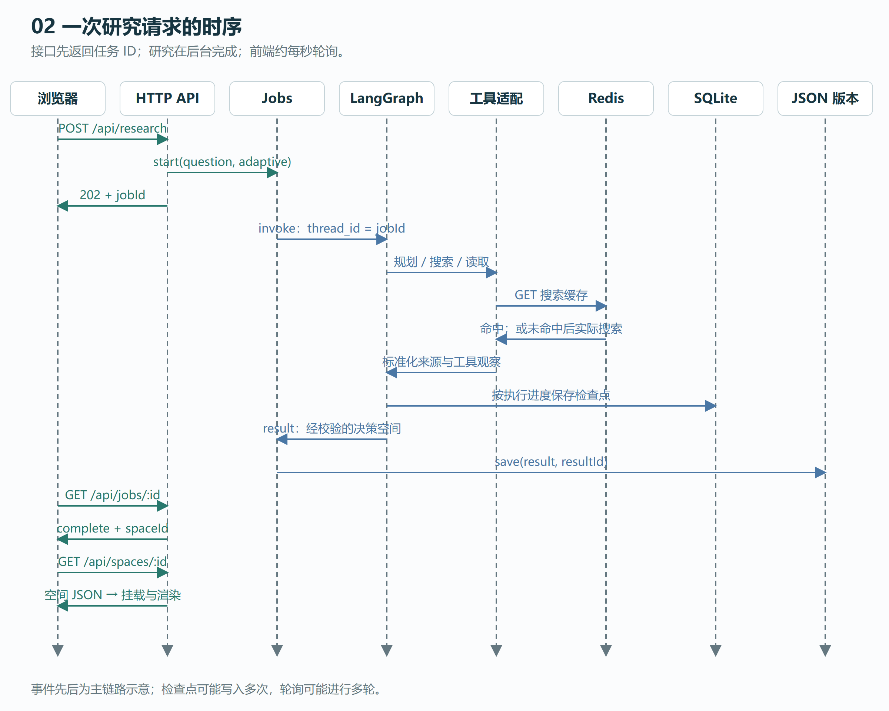

**图 02｜接口与任务时序。** `202` 表示任务已接受；`complete` 表示结果已保存。它们都不等于所有字段正确、所有方案都满足需求。

### 2.1 请求如何变成后台任务

页面提交 `POST /api/research`，`Jobs.start()` 分配 jobId 和固定 resultId，保存任务并异步执行研究图，HTTP 立即返回 202。LangGraph 使用 jobId 作为检查点 thread_id；图返回结构化空间后，Store 使用 resultId 提交业务版本，任务才标为 complete。[S01] [S03] [S15]

接口请求与模型研究分离后，浏览器连接结束不会等于丢掉整项任务；固定 resultId 则为恢复后的重复提交提供幂等标识。检查点恢复与业务结果幂等是两个机制，具体见第 09 章。
### 2.2 前端如何得到最终结果

`watchJob()` 约每秒调用 `GET /api/jobs/:id`。任务完成后，前端再读取 `/api/spaces/:spaceId`，得到完整空间 JSON，挂载工作区并计算各分支结果。当前没有使用 SSE、WebSocket 或模型逐 Token 流式输出。[S20]

这种方式实现简单，服务重启后也能根据任务记录恢复列表。代价是会有轮询延迟和重复状态请求。未来若改成事件推送，应保留任务查询作为重连后的事实来源，而不能只依赖短暂连接中的消息。
### 2.3 并发与失败怎样表达

后台一次只接受一个研究任务，忙时返回相应错误；它不是一个会把任意任务自动排队执行的队列。图内部的工具出错可能被补救节点消化，也可能让任务进入 failed。即使图最终完成，业务上也可能仍然没有完整候选，这需要在结果状态中表达。[S03] [S15]
## 03 Agent：建模、行动选择与有界补救

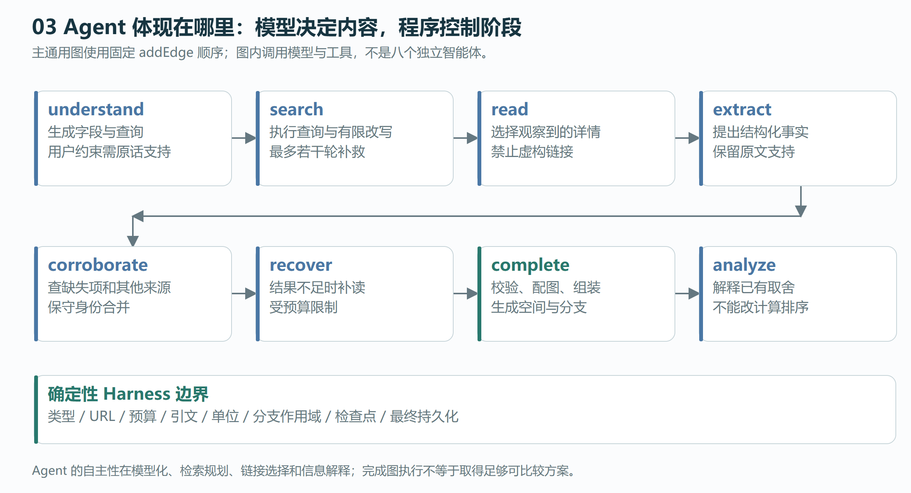

**图 03｜自主性和控制权。** 主图的阶段是固定的；模型在阶段内部提出与任务有关的内容。八个节点是八类步骤，不是八个独立 Agent 角色。

### 3.1 研究状态 State 保存什么

通用图使用 `StateSchema` 保存问题 `question`、比较契约 `contract`、来源 `sources`、提取草稿 `raw`、事件 `trace`、结果 `result`，以及后续研究时的旧空间、当前情景和新关注点。节点返回状态更新，LangGraph 按边把执行推进到下一阶段。[S03]

### 3.2 understand：从自然语言到可执行契约

`planDecision()` 要求模型输出字段、约束、检索词和假设分支。字段契约可表达数值、布尔和枚举；包含机器 key、中文标签、单位、方向、别名、步长和展示字段。校验器允许 1–8 项，提示一般要求聚焦 2–4 项用户明确关注的维度。[S03] [S12]

以租房需求为例，以下只是**教学结构**，不对应实际房源：

```json
{
  "schema": {
    "fields": [
      {"key":"rent","label":"月租","type":"number","unit":"元/月","direction":-1},
      {"key":"area","label":"面积","type":"number","unit":"㎡","direction":1}
    ],
    "layout":{"primaryField":"rent","summaryFields":["area"]}
  },
  "constraints": [
    {"field":"rent","value":4000,"quote":"月租不超过4000元"},
    {"field":"area","value":30,"quote":"面积至少30㎡"}
  ],
  "queries":["杭州 整租 房天下"]
}
```

代码不只检查 JSON 能否解析，还检查约束是否引用现有 key、值类型是否正确、quote 是否属于用户输入，以及数值和方向是否得到这段原话支持。无效计划最多有两次尝试，修复提示携带具体错误。无法修复时报告失败，不静默退回一个固定电脑/租房模板。[S03]

### 3.3 比较条件和研究要求必须分开

“面积至少 30㎡”是决策约束；“要来源、要原图”是研究证据要求。若把“有图片”错误建成一个需要参数提取的布尔比较字段，可能导致整批候选因缺失该字段而无法比较，甚至污染权重。

源码有 `normalizeResearchPlan()` 等检查，将部分错误嵌套的查询/约束恢复到契约结构，并分离取证类字段。是否必须有来源图片，则根据原始问题和后续明确请求维护。不能把这些修正理解为任意改写用户偏好。[S03] [S29]

### 3.4 后续七个节点分别做什么

| 节点 | 输入与动作 | 输出与停止边界 |
| --- | --- | --- |
| search | 执行有限的规划查询，去重来源；完全无结果时可请求短查询改写。 | 来源数组；无结果不会自动生成候选。 |
| read | 排序已有来源，读取正文；从实际观察到的目录链接中选择具体详情。 | 原文、可验证链接、部分平台结构化观察。 |
| extract | 对一般正文分批调用模型；平台解析结果可直接转换为提取草稿。 | 候选名称与字段观察；每批提取与重试有上限。 |
| corroborate | 选择缺信息或缺其他站点观察的少量候选，按名称/标识定向补查。 | 新来源和观察；不同来源出现不自动等于可合并。 |
| recover | 完整可比较结果不足时，再读剩余目录详情或改写查询。 | 有界补救结果；不能保证一定找到足够方案。 |
| complete | 统一验证、保守合并、绑定图片、设置分支范围和基线。 | 可保存的空间，连同草稿和警告。 |
| analyze | 根据确定性计算结果和已引用事实生成简短取舍解释。 | 与当前条件/情景绑定的分析；不负责重新定义资格。 |

这些节点通过固定 `addEdge()` 链连接，节点内部有依照观察决定是否补查的逻辑。当前更准确的定位是“有受限自主决策能力的研究工作流”。LangGraph 官方也区分预定路径工作流与动态行动选择的 Agent；框架同时支持二者，不会因导入一个库就自动获得完全自主性。[S03] [E01]

### 3.5 模型与工具的接口

工具适配层提供 `model(messages)`、`search(query)`、`fetchSource(url)` 以及可选图片/商品读取方法。本地 Ollama 路径使用 ChatOllama，设置 JSON 格式、低随机性、上下文设置和单次超时；远程兼容路径请求 `/chat/completions` 的 JSON 对象响应。[S04]

主通用流程没有向服务商发送原生 `tools` 列表，也没有处理 `tool_calls`；它让模型产生结构化计划，再由宿主程序执行具体方法。旧商品图有 `tool()` 封装和 search/finish 动作协议。二者都不能直接称为已实现 MCP 服务。[S04] [S05]

控制权最终留在代码中：模型不能通过一句话执行任意本地程序，不能绕过限定来源链接、类型校验或版本写入规则。低 temperature 只减少采样随机性，不保证事实正确；可靠性来自数据和验证链路共同约束。

## 04 搜索与正文爬取：从查询到具体对象

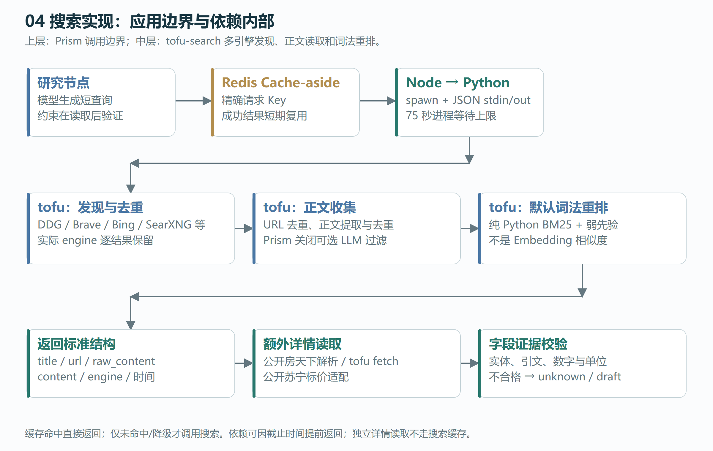

**图 04｜发现、读取、排序与验证。** 搜索发现一个 URL、读到它的正文、取得同一配置的字段，以及通过校验，是四个不同阶段。

### 4.1 应用调用链和结果协议

真实调用为：研究节点调用 `io.search()`，provider 先查可选 Redis；未命中时，tofu 路径通过 `spawn()` 启动 Python，执行 `scripts/tofu-search.py`，再调用 `tofu_search.search(query,max_results=4)`。另一条路径请求 Tavily search API。[S04] [S06] [S09]

Node 将请求 JSON 写入子进程标准输入；Python 将结果 JSON 写到标准输出。日志不混进协议输出。每次调用是独立 Python 进程，因此依赖内部的进程内缓存不能自然跨多次 Node 调用保留；应用层 Redis 可跨这些调用复用观察。这是引入 Redis 的一个具体理由。

返回协议的核心字段如下：

| 字段 | 含义 | 后续用途 |
| --- | --- | --- |
| title / url | 搜索标题与真实发现的地址。 | 来源标识、实体初筛和进一步读取。 |
| raw_content | 依赖已取得的正文，可能为空。 | 结构化提取的原始资料。 |
| content | 摘要。 | 正文不可读时保留有限观察，不能冒充完整详情。 |
| engine | 结果归属的引擎记录。 | 保留检索可追溯信息。 |
| retrieval | 正文字数、是否仅摘要、是否达到截止时间等。 | 解释结果不足和后续读取策略。 |
| retrievedAt / cache | 启用缓存后附加的原采集和提供时间。 | 避免把缓存观察当成本轮新抓取。 |

### 4.2 tofu 依赖实际负责哪些步骤

核对固定安装版本的 `search/orchestrator.py` 可以看到，依赖将引擎发现与页面读取尽量重叠：某一引擎返回结果后，先去重并做轻量相关性检查，再把合适 URL 交给读取池，不必等待全部引擎结束才开始读网页。[T01]

依赖随后整理相近摘要、读取正文并处理重复正文，最后默认进入词法重排。Prism 的桥接明确关闭 `filter_enabled`，也没有配置 `local_reranker`，所以不能宣称当前启用了依赖可选的 LLM 过滤或 Qwen 神经重排。依赖提供某能力，与应用确实配置并运行该能力，需要分开核对。[S06] [T01]

当前版本含 DDG-HTML、Brave、Bing、DDG-API、SearXNG、Marginalia 等引擎实现。实际服务可达性、路由和截止时间会影响结果，不能笼统说所有搜索都来自 Google，也不能声称每次都成功查询了六个引擎。SearXNG 是聚合入口，其底层来源也不能凭猜测补写。[T01]

### 4.3 查询为什么先短后细

通用规划要求先发现合适平台目录，例如“杭州 整租 房天下”，再根据观察到的目录条目选详情。把预算、面积、图片、公开来源和所有限制全部写入一句搜索词，可能显著缩小召回，返回资讯而不是可比较对象。

所以这里把约束分为两个阶段：检索阶段尽量保留地点和对象类别；详情阶段再核对月租、面积、出租方式等。它允许搜索到暂时不满足当前条件的候选，因为这些记录在放宽预算的 What-if 下仍可能有价值。[S03]

### 4.4 详情怎样被选择

来源正文和专用目录读取器可以提供 `observedLinks`。模型只可从这批实际看到的链接中选择具体页面，宿主再次检查选择是否在观察集合内。这样把“建议打开哪个详情”的自主性，与“能否访问一个任意 URL”的权限分开。[S03] [S07]

`prioritizeSources()` 还使用页面类型、是否商家商品、是否新闻，以及与字段标签/单位的匹配进行规则排序，并尝试站点多样性。它是应用的规则优先级，不是 BM25 本身，更不是已经加载的 Cross-Encoder 神经重排器。[S10]

### 4.5 两类专用读取器

**房天下公开读取器。** 识别受支持的桌面与移动目录/详情地址，处理中文编码、解析目录中真实观察的条目，核对 URL 房源编号和页内主信息，提取月租、面积、出租方式和主图片区。只跟随受支持、次数受限、保持身份的实际跳转；登录或验证跳转不能被伪造成成功读取。[S07]

**苏宁公开标价读取器。** 把桌面/移动商品地址归一到同一商品 ID，使用 Playwright 打开公开移动页，从主价格区域取得可见标价与文本快照。库存只保留作上下文，不作为收集标价的前提；但起价、优惠条件和参考口径必须区分。[S08]

| 陷阱 | 处理原则 |
| --- | --- |
| 列表里的两个房源名称接近 | 用具体详情身份与房源编号，不能把邻居条目字段混入当前候选。 |
| 商品主图展示另一种配置 | 图片作为展示来源；精确配置仍靠页面文字与支持标识。 |
| 平台页面写了“无货” | 公开标价仍可以作为观察保存，不能说因此无价可取。 |
| 只找到新闻里的首发价 | 不把它变成当前公开商品标价。 |
| 房源有地铁距离，没有通勤时间 | 不从距离直接猜通勤分钟数。 |
| 页面读不到 | 保留失败和已有资料，继续有限补救，不生成占位事实。 |

### 4.6 时间和预算有几层

桥接层限制查询长度、返回条数和进程等待；Python 设置搜索总预算、正文读取超时和最大字符数；通用图限制阶段中的目标、批次和补救规模。这些都是有界执行措施，但不能把某一个“75 秒进程上限”说成整个研究任务 75 秒内一定完成，因为一项研究可能调用多次搜索和模型。[S03] [S06]

| 边界 | 当前配置或规则 | 作用范围 |
| --- | --- | --- |
| Node 子进程 | 等待上限 75 秒；stdout 超过 2,000,000 字节就终止。 | 一次桥接调用，含进程启动和 JSON 返回。 |
| Python 搜索 | `search_deadline_secs=40`、`max_results=4`。 | 一次依赖搜索的预算及返回数量。 |
| 搜索正文 | `fetch_top_n=4`、`fetch_timeout=10`、`fetch_max_chars_search=10000`。 | 搜索阶段的正文收集参数。 |
| 独立正文读取 | `fetch_url_deadline_secs=20`，调用 `fetch_url(..., max_chars=16000, timeout=10)`。 | 单页读取；不等同于重新执行搜索。 |
| 通用图 read | 初始来源最多读 8 个；只从实际观察的链接中再选最多 6 个详情。 | 该阶段的执行规模；其他补救阶段仍有额外调用。 |

依赖内部截止时间是配置给依赖的执行预算；外层进程计时是应用的停止等待边界。即使都存在，模型调用、多个阶段和重试仍会累积耗时。当前尚无统一的整任务费用或总时长调度器。[S03] [S06] [S30]

## 05 BM25：依赖实现、分词与相关性排序

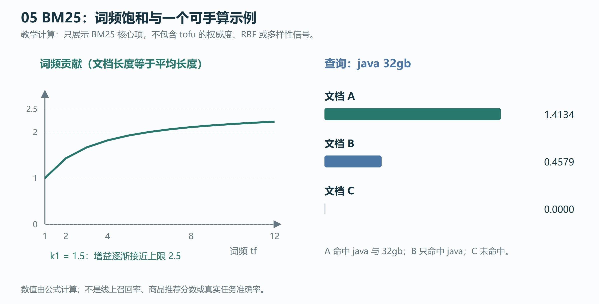

**图 05｜BM25 教学计算。** 左图展示长度等于平均长度时的词频饱和，右图是下面三段教学文本的核心分数。它不是真实搜索准确率或商品效用评分。

### 5.1 到底用了哪个包

Prism 通过 `tofu-search==0.12.25` 间接使用其自带的纯 Python BM25 重排。应用没有自己维护 BM25 索引，也没有直接安装或调用 `rank_bm25`。固定依赖的入口是 `tofu_search.search.rerank.rerank_by_bm25()`，核心计算在同文件 `_rank_candidates()`。[T01]

这句话包含三个层次：应用选择并配置了一个搜索依赖；依赖实现了重排算法；外部搜索引擎仍然负责初始网页发现。不能把后两个层次都说成 Prism 自己搭建了全网检索索引。

### 5.2 中文和英文怎样变成词项

`lexical.tokenize()` 先进行 Unicode NFKC 规范化与大小写统一，再处理词项、部分符号标识和连续中文片段。连续中文主要使用二元片段，对很短的片段还保留字符特征；英文则保留规范化单词并处理停用词。它不是 jieba 的分词调用。[T01]

例如“轻薄笔记本”可产生“轻薄、薄笔、笔记、记本”这类词法片段。它们是匹配特征，不代表模型理解了中文词义；同义改写、词序和跨语言需求仍可能召回不足。分词规则会直接影响 df、tf 和排序，不能只背一个 BM25 公式而忽略输入表示。

依赖还会把 `site:` 等检索操作符和不应作为正向主题证据的片段，与实际主题区分。不能因为文档文本出现了一个网址或查询操作符，就自动认定该文档与用户主题相关。[T01]

### 5.3 统计量和公式

设当前重排集合有 N 段文档，tf(t,d) 是词 t 在文档 d 的出现次数，df(t) 是包含该词的文档数，|d| 是分词后文档长度，avgdl 为平均长度。固定依赖的核心形式为：

```text
IDF(t) = ln(1 + (N - df(t) + 0.5) / (df(t) + 0.5))

BM25(q,d) = Σ IDF(t) × tf(t,d) × (k1 + 1)
                      / [tf(t,d) + k1 × (1-b + b × |d|/avgdl)]

k1 = 1.5，b = 0.75
```

IDF 降低常见词的区分作用；词频项随重复次数增加而逐渐饱和；长度归一化减少长文档仅因篇幅大而得到更多匹配的偏差。当前 N、df 和 avgdl 来自本次候选集合，集合变化后分数可能变化，因此这些分数不能直接横跨不同查询比较。[T01]

### 5.4 一个完整可手算的例子

查询是 `java 32gb`。为了只观察核心算法，使用已经按空格分好的英文教学文本，排除中文分词和其他先验的干扰：

| 文档 | 文本 | 长度 | java 的 tf | 32gb 的 tf |
| --- | --- | ---: | ---: | ---: |
| A | java development laptop memory 32gb light | 6 | 1 | 1 |
| B | java development laptop memory 16gb light | 6 | 1 | 0 |
| C | gaming laptop memory 16gb gpu | 5 | 0 | 0 |

N=3，avgdl=17/3；java 的 df=2，32gb 的 df=1。所以 IDF(java)≈0.4700，IDF(32gb)≈0.9808。把长度和默认 k1、b 代入后，A 得到两项贡献、B 只得到 java 项、C 为零。图 05 和附带计算数据给出对应结果。

这说明算法怎样衡量词法证据，不证明 A 是更适合开发的电脑。选择是否符合预算、重量和用户偏好，要在后面的字段比较器中判断，不能用搜索相关性分数替代产品决策分数。

### 5.5 和 TF-IDF 的联系与差别

TF-IDF 和 BM25 都利用词频与逆文档频率。TF-IDF 有多种 tf 变换和向量归一化实现，不能把它固定等同于“原始词频乘一个公式”；BM25 则显式设置词频饱和与长度归一化参数，并将匹配词项贡献相加。

两者都主要依赖词项匹配，不需要 Embedding 模型。向量检索处理的是另一类表示与相似性计算；本项目没有把当前 BM25 重排称为向量 RAG，也没有因为引入 Redis 就自动增加语义检索能力。

### 5.6 tofu 的最终顺序不只有 BM25

有正文时，依赖将标题/摘要信号和查询相关原文片段组成有限长度的排序表示，BM25 得分可再结合受限制的权威先验、上游多引擎排名及正文可用性等信号。只有摘要时，可能进入与上游排名的 RRF 融合路径；还可能做实体/域名多样性选择。[T01]

因此不能声称最终列表就是对网页完整正文裸算 BM25 再排序。Prism 在依赖之外还会做平台、详情页和字段相关性的规则优先级，并对参数重新验证。每一层解决不同问题。

## 06 证据校验与多源合并

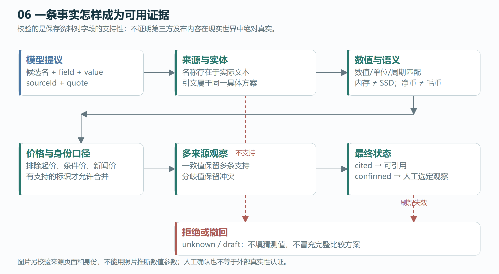

**图 06｜字段支持性检查。** 模型输出先被当成待验证的观察。拒绝、冲突、失效和人工确认必须保留不同含义。

### 6.1 保存结构如何支持追溯

一个候选包含名称、主要身份来源、可选的支持标识以及 `facts[fieldKey]`。每个 fact 保存值、状态、来源 ID、引文以及其他一致或冲突观察；source 保存地址、文本、时间与检索元数据。不是仅在推荐文字末尾附几个 URL。[S03] [S11] [S13]

```json
{
  "name":"教学方案甲",
  "sourceId":"source-a",
  "facts":{
    "memory":{
      "value":32,
      "status":"cited",
      "sourceId":"source-a",
      "quote":"已安装内存32GB"
    }
  }
}
```

上述结构是说明数据关系的教学片段，不是完整导入文件。真实来源文本必须实际包含对应候选及引文，不能仅凭 JSON 自称有证据。

### 6.2 六个关键门槛

1. **候选存在。** 名称要能在实际取得的来源中定位，避免模型创造一个看似合理的商品或房源。
2. **引文存在。** sourceId 有对应 source，quote 能定位到保存文本，允许的空白/表达恢复仍须回到真实原文。
3. **实体归属正确。** 列表或多型号文章中的邻居数据不能借给当前对象。
4. **数值与单位支持。** 引文中的金额、周期、容量、面积、质量等要与字段类型和单位兼容。
5. **字段语义正确。** SSD、显存和可扩展上限不是已安装内存；包装重量不是机身净重。
6. **口径可以使用。** 起价、新闻参考价、券后/补贴后价和区间不能直接充当具体配置的无条件公开标价。[S11]

每个门槛都是确定性业务规则。规则能拒绝已识别的错误模式，但不能保证理解所有商家文案，也不保证接受的网页发布信息在现实中真实。

### 6.3 引文恢复不是编造引文

模型有时会把原文多个不相邻片段拼成一句话，或者忽略空白差异。`locateSourceText()` 与受限制的数值片段恢复在实际页面中重新定位支持文本；找不到就拒绝，不让模型重写一条“像原文”的句子。

价格尤其不能从一个页面任意出现的同值数字恢复，例如优惠门槛、推荐商品或旧款价格。专用公开标价观察保留主价格文本与页面身份，经过口径验证后才可能补入候选。[S08] [S11]

### 6.4 多来源怎么合并

`validatedIdentity()` 要求标识本身得到原文支持。产品标识可以采用全局作用域，平台房源编号仍保持站点作用域；同名并不自动构成同一实体。没有显式标识时，规则退回具体页面及名称，苏宁同商品页还有支持的商品 ID 归一化。[S13]

同一支持标识的值一致时保留多条证据；不一致时保留 conflictingEvidence，并可能将主值置为 unknown。不能默认选便宜的一条，也不能用来源数量做多数投票后宣称独立核验。配置、时间和发布者口径都可能导致分歧。

### 6.5 图片如何与对象绑定

房源图从对应详情的主图片区取得，核对房源身份并排除推荐区、无关封面等；一般商品页面预览则有不同的 media 标记，不能证明它恰好是某一 RAM/SSD 配置。图片 URL、来源 ID 和页面地址独立保存。[S07] [S08]

当用户明确要求对应原图，只有文字而没有合格图片的记录可保留为草稿，不能伪装成图文完整候选。项目没有用生成图片代替真实房源照片，也没有用照片估算面积或通勤。

### 6.6 刷新时如何处理失效

`refreshGeneralEvidence()` 重新读已引用页面，每批最多 12 份，并保存逐页进度。旧引文消失、读取失败或原文不再支持时，撤回当前比较资格，保留历史观察和原版本；房源图片也重新绑定或撤回。[S17]

刷新是“核对已有支持”，不是“搜索到最新值并自动替换”。若旧价格消失，系统不能凭猜测补一个新价格，需要重新研究并建立新的可验证观察。

## 07 What-if：动态模型、评分与分支继承

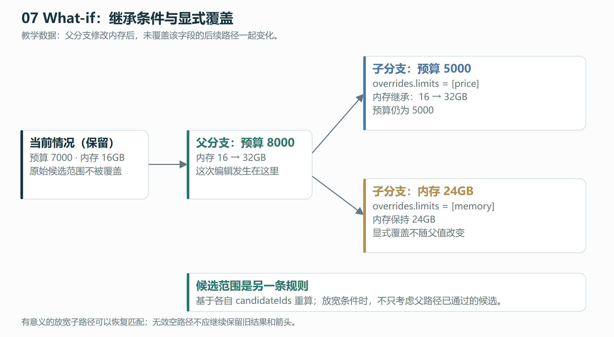

**图 07｜分支的两类状态。** 条件继承由 overrides 管；每个分支还拥有自己的 candidateIds 范围。不能把两者混为“复制一份当前通过的商品列表”。

### 7.1 字段契约怎样驱动计算

数值字段有方向：`direction=-1` 表示越小越好，对应上限；`direction=1` 表示越大越好，对应下限。布尔和枚举硬条件按值相等匹配。settings 保存每个字段的 limit、weight 和证据模式。[S12]

这简化了预算、面积、重量等常见条件，但也把数值的偏好方向和阈值方向关联起来。若要表达“面积在 40–60㎡之间，但越接近 50 越好”这类区间与目标效用，需要扩展模型，不能假装当前字段已自然支持所有非线性偏好。

### 7.2 先判资格，再谈分数

`evaluateDecision()` 依次区分暂停、违反已知硬条件、缺少必要可用字段，以及可比较。字段有硬条件或正权重时，缺少证据就是必要信息缺口。默认引用模式允许通过校验的 cited 值；reviewed 模式会进一步要求确认。[S12]

| 结果 | 含义 | 如何对待 |
| --- | --- | --- |
| eligible | 有所需依据，且不违反硬条件。 | 可参与当前条件下的推荐排序。 |
| unresolved | 没有已知违规，但缺少必要可用依据。 | 不当成“低分但可选”。 |
| excluded | 已知参数违反至少一个条件。 | 保留具体排除原因。 |
| disabled | 用户暂停比较。 | 数据仍可保留，当前不推荐。 |

候选可以有一个较高的偏好分数，却因预算超限而被排除。资格不是通过分数阈值决定的，两套规则有明确先后。

### 7.3 分数怎样计算

数值字段使用声明 range；没有 range 时使用当前比较池的范围。将值线性归一化并截断到 0–1，按方向取正向效用或反向效用；区间相同取 0.5。布尔/枚举按期望值匹配给分，没有明确期望时贡献中性值。[S12]

```text
z_i = clamp((value_i - min_i) / (max_i - min_i), 0, 1)
u_i = z_i                       当 direction = 1
u_i = 1 - z_i                   当 direction = -1
score = 100 × Σ(weight_i × u_i) / Σ(weight_i)
```

分数是当前模型与偏好下的相对效用，不是满意概率或事实置信度。新增候选若改变归一化范围，也可能改变分数；判断快照因此要保存当时的基准。

### 7.4 一个可重算的教学例子

假设三个**虚构教学候选**，基线为预算≤7000、内存≥16GB、重量≤2kg；价格/内存/重量权重为 40/30/30。固定归一化范围为价格 4800–7500、内存 16–32、重量 1.4–1.9。

| 候选 | 价格 | 内存 | 重量 | 偏好分数约值 | 基线资格 |
| --- | ---: | ---: | ---: | ---: | --- |
| 甲 | 4800 | 16GB | 1.7kg | 52.00 | eligible |
| 乙 | 6200 | 32GB | 1.9kg | 49.26 | eligible |
| 丙 | 7500 | 32GB | 1.4kg | 60.00 | excluded：预算超限 |

将内存要求改为 32GB，基线预算不变时只剩乙；将预算放宽到 8000，丙也可进入；同时收紧重量到 1.5kg，则只有在预算允许时丙才匹配。每次改变都来自同一批记录的重新计算，不需要模型生成新商品。

### 7.5 为什么需要显式 overrides

子分支只改变预算时，应继续继承父路径的内存。父路径内存从 16 改为 32，子路径也应变成 32；另一条明确选择 24GB 的子路径则保持 24。只比较当前值是否相等，无法稳定表达这个意图：父值某次碰巧等于子值，也不表示用户放弃了覆盖。[S12] [S25]

所以每个分支维护 `parentScenarioId`、解析后的 settings，以及 `overrides.limits/weights/evidenceMode`。`resolveScenarioInheritance()` 检查循环和父节点，再把未覆盖字段继承下去；更新函数返回受影响情景，前端按新状态重算。

### 7.6 候选范围为什么独立保存

新分支应继承父路径所研究的候选范围，而不是只复制当时已通过的候选；否则放宽预算后，被排除的丙永远回不来。后续研究可能向目标分支增加新记录，但基线和兄弟路径仍保持自己的范围。[S03] [S12]

当父条件变化，后续路径必须跟着重算，不能继续显示旧的图片集合和箭头。同时，父路径暂时无结果不代表所有后续路径都无意义——一条真正放宽限制的子路径可能恢复匹配。画布会结合结果和当前查看路径收起无效空分支，保留有意义的恢复路径。[S22] [S25]

### 7.7 条件变化如何同步到全部后续结果

```text
字段控件 input / change / click
  → applyLive()
  → 基线上建立新分支，或更新当前分支
  → changeScenarioSettings() 解析继承和覆盖
  → 各分支按自己的候选范围 evaluateDecision()
  → 计算进入/退出与撤销信息
  → 重画实际结果和连线，标记 dirty
  → 保存时服务端重新验证并创建版本
```

滑块拖动时需要保留控件节点和编辑会话，不能每次输入都完全替换正在操作的 DOM。条件规则在浏览器和服务端共享纯模块，减少两边对同一数字使用不同判断逻辑的风险。[S12] [S21]

### 7.8 通用控件与画布怎样表达结果

schema 的字段类型、单位、方向、primaryField 和 summaryFields 驱动条件标签及详情摘要。电脑与住房复用同一控件生成和比较流程，平台取证仍有各自适配器。[S12] [S21] [S23]

画布不是把一张图贴进页面。`connectBranches()` 根据父子关系计算深度、各层列宽、子树跨度和节点坐标，再根据实际元素位置画 SVG 连线。ResizeObserver 监听尺寸变化；指针事件控制平移，按钮和 Ctrl+滚轮控制缩放。[S22]

结果节点展示该情景全部 eligible 方案的图和名称；详情放到原生 dialog，包含参数与证据，不需要滚到页面底部寻找。事件、观察器在重绘/切换时清理，避免反复挂载造成重复处理。这里没有使用 React Flow 或专门图布局库。

前后端共享比较规则，减少资格判断分叉；原生模块减少构建依赖，但树布局、DOM 状态和事件清理仍需自己维护。候选与分支规模有限时可以线性扫描；规模扩大后仍需测量布局和重绘成本。[S12] [S21] [S22]

## 08 Redis：缓存设计、一致性与故障降级

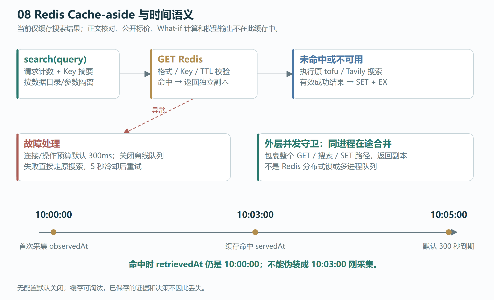

**图 08｜缓存的边界。** Redis 只缓存成功搜索观察；JSON 保存业务成果，SQLite 保存执行进度。三者不能互换职责。

### 8.1 接入位置和生命周期

HTTP 应用创建一个搜索缓存实例，并传入 provider，供多次任务和对话研究共用。provider 的 `search()` 包住 tofu 与 Tavily，补查别名也复用同一入口。直接脚本调用 provider 时可拥有自己的实例；空闲 Redis 连接 unref，避免任务完成后 CLI 因可选缓存而不退出。[S01] [S04] [S09]

独立 `fetchSource()`、公开商品标价和引用核对仍访问原工具；模型答案不缓存，拖动 What-if 本身也不走 Redis。缓存提高的是重复观察的复用，不会让原本不可读的网站突然可读。

### 8.2 Key 包含什么

实际 key 是 `prism:search:v1:` 加 SHA-256 摘要。输入包含缓存格式版本、数据目录作用域、提供者、去掉首尾空白的查询，以及按 key 排序的搜索参数。参数中还包含结果数、正文请求标志、读取器版本与提供者配置摘要。[S09]

Tavily 账户密钥及 tofu 解释器/部分路由配置以摘要参与隔离，避免更换服务配置后错误复用。原始查询和凭据不直接出现在 Redis Key。没有按语义相似度查缓存，也没有 Embedding；仅措辞相近不等于命中。

数据目录作用域适合本机多个隔离空间环境，但不是多用户授权模型。值中仍保存第三方结果文字，可能间接反映查询意图，Key 哈希不是加密，因此 Redis 仍应按受控本地服务管理。

### 8.3 Value 和双重有效期

缓存记录包含 version、key、observedAt、expiresAt 和 results。写入 Redis 时设置服务端 EX；命中时再检查格式、Key、原采集时间、记录有效期及当前配置允许的年龄。[S09]

默认 TTL 为 300 秒，允许 1–3600 秒。若缩短配置，旧记录不能只因原先设了更长 TTL 就继续无限服役。空结果、搜索异常与超过 1MB 上限的数据不缓存，防止一次失败反复压住补救流程。

返回结果中 `retrievedAt` 保留原采集时间，`retrieval.cache` 记录命中及本次 servedAt。命中不能被标成刚刚抓取；后续若真正阅读了详情，则那是另一项实际外部观察。

### 8.4 降级怎样避免缓存拖住研究

node-redis 关闭离线命令排队和自动重连；连接与各操作有超时预算。默认 300ms 是**每次缓存连接/操作**预算，不是整次搜索或整个研究的总时限。异常只影响缓存路径，原搜索照常执行，并在约 5 秒冷却后再尝试 Redis。[S09] [E02]

| 故障 | 当前行为 | 结果语义 |
| --- | --- | --- |
| 未配置 / XXX | 不连接 Redis，直接搜索。 | 正常未启用缓存。 |
| 配置格式错误 | 缓存关闭，健康信息标 invalid-config。 | 不伪装已连接。 |
| 连接或 GET 失败 | 销毁故障连接、冷却，调用原搜索。 | 研究仍可能成功。 |
| SET 失败 | 返回已经取得的搜索结果，缓存进入降级。 | 不丢掉真实外部结果。 |
| 缓存 JSON 损坏或过期 | 当作未命中。 | 不把坏缓存当作事实。 |
| 原搜索失败 | 失败按原工具语义传播，不写缓存。 | 不缓存假成功。 |

### 8.5 同时请求如何去重

实例内的 pending Map 用请求 key 记录在途 Promise；同进程相同请求共享一次加载，但返回副本，避免一个调用者改坏另一个结果。这是进程内 single-flight，不是 Redis 分布式锁。

当前没有 Redis 任务队列、跨进程锁或全局限流。多个应用进程同时冷启动时仍可能同时查外部服务；若将来引入分布式锁，需要另行处理租约、拥有者令牌、超时和解除锁的正确性，不能用“加了 Redis”笼统代表这些能力。[S09]

### 8.6 怎样证明缓存起作用

健康接口提供 requests、hits、misses、loads、coalesced、errors 等进程内累计计数，不返回查询、连接地址或凭据。对照工具实际调用次数，才能区分命中、在途合并和正常搜索。[S01] [S09]

三个查询各重复三次的受控实验中，外部加载从 9 次降为 3 次。它证明重复请求被复用，不证明实际研究准确率提升；首次搜索、模型调用和独立详情读取仍需原成本。该实验使用固定加载器；外部加载减少比例为 66.7%。[S27]

## 09 持久化、检查点与结果幂等

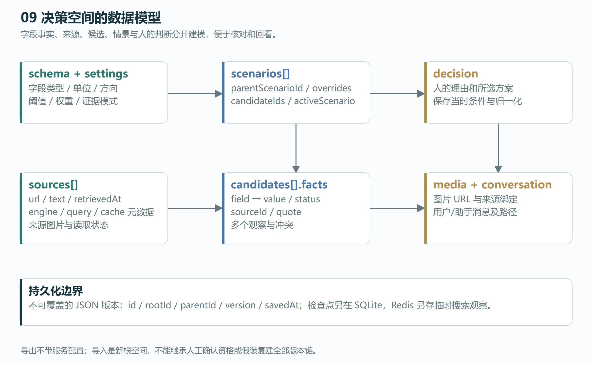

**图 09｜数据关系。** schema 表达比较规则，facts 表达来源观察，scenarios 表达情景，decision 表达人的判断。把这四类对象混在聊天文字里会丢失可复算性。

### 9.1 JSON 和 SQLite 为什么同时存在

决策 JSON 保存一个完整、可导出、可回看的版本；SQLite 由 LangGraph 检查点适配器管理图状态；任务 JSON 保存状态、事件、尝试次数和结果关联。Redis 保存可丢弃的搜索观察。分开保存体现的是数据生命周期不同，而不是存储组件越多越好。[S09] [S15] [S16]

JSON 的优势是易检查和迁移，完整版本不依赖一串事件重放。代价是列表读取需要扫描文件，跨文件事务能力有限；它没有自动获得数据库索引、关系约束、多进程锁或租户隔离。这里不是完整 Event Sourcing 系统。

### 9.2 检查点保存什么，如何恢复

`Jobs` 创建 `SqliteSaver`，任务 ID 作为图 `thread_id`。恢复时查询已有检查点；存在时以恢复模式继续图，不存在时使用初始输入。通用图使用同步持久化设置并有递归上限，引用复核则有自己的逐页快照。[S03] [S15] [E04]

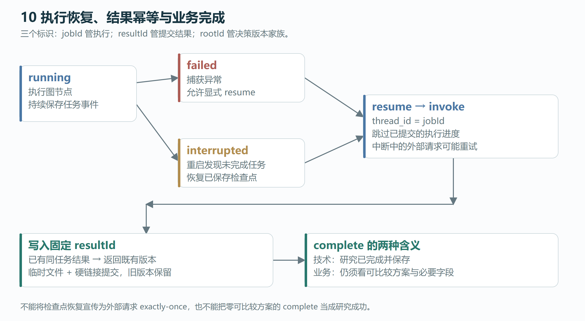

**图 10｜状态与标识。** jobId 标识一次执行，resultId 标识其结果提交，rootId 标识决策家族。复用检查点和避免重复保存不是同一个问题。

重启发现 running 记录时，会把它标为 interrupted；failed 与 interrupted 可以显式 resume。已经持久化的阶段可以被复用，中断中的外部调用仍可能重新执行。这属于可恢复执行，不保证一次网络操作恰好执行一次。

### 9.3 如何减少重复版本与半写入

任务开始就分配 resultId。`Store.writeVersion()` 先将内容写入唯一临时文件，再通过同文件系统硬链接提交到最终文件名，避免覆盖已有版本。若目标已存在且属于同一个 researchJobId，可以返回已提交结果，减少恢复导致的重复版本。[S15] [S16]

同一 root 的写操作通过进程内锁串行化；保存前重新检查父版本，减少删除与写入竞态。版本带 id、rootId、parentId、version 和 savedAt。version 由父版本加一，因此从旧版本分叉时可能有同号版本，不能当成全空间全局唯一事务序号。

这些措施不是跨进程分布式事务，也没有证明所有崩溃场景下的 fsync 持久性。SQLite、多个 JSON 与缓存的修改没有统一事务管理器。

### 9.4 空间删除为何不能只删侧栏

一个空间包含同 rootId 的多个版本、关联任务与执行检查点。删除要处理这组关联数据，并拒绝仍有运行任务的删除，防止任务结束后将空间写回。当前采用进程内保护，多个文件与 SQLite 的删除不构成统一原子事务。[S01] [S15] [S16]

### 9.5 决策记忆到底记住什么

`captureDecision()` 保存人的选择和理由，以及当时路径、设置、候选范围、字段事实、匹配状态、排名摘要、来源时间和归一化基准。后续 `reassessDecision()` 按当时模型对照新资料，检查事实、资格、首选与来源状态的变化。[S14]

它保存的是外部结构化记忆，不是更新模型权重。即使用户没有选定候选，也可以记录仍未定的判断；复核用于提醒原决定的依据是否变化，不替用户自动决定新的答案。

## 10 持续对话：上下文、动作路由与后续研究

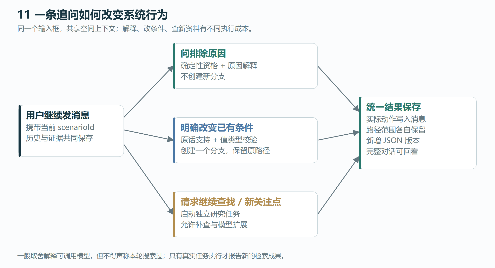

**图 11｜统一消息入口，不同动作。** 一条解释消息、一次明确条件变更和一次真实补查，在系统里具有不同副作用与成本。

### 10.1 当前上下文由什么组成

一般模型对话会携带原始问题、当前消息、最近 16 条历史消息记录、schema、当前路径条件、确定性排名、候选事实与来源元数据。最近 16 条指记录数，不是 16 轮完整对话。[S39]

研究提取通过 `dimensionExcerpt()` 按字段选择原文片段，保留省略标记；旧商品图另有 `researchMessages()` 的来源优先级和字符预算。它们是上下文选择，不是向量检索；字符上限也不等于精确 Token 预算。[S10] [S38]

### 10.2 三类消息的执行差异

“为什么这个不符合条件”可以由确定性理由直接解释；一般取舍追问可以基于已有资料调用模型，但不能声称本轮做了搜索。

明确的已有字段变更要经过类型与用户原话验证；只有验证后的实际设置改变才创建一个分支。模型推测出一项用户没说过的偏好，不能仅凭自然语言答复就修改状态。

明确请求继续查找时，服务保存本轮消息并启动自适应研究；新关注点可能扩展比较模型，新结果按目标分支合并，保留原始情况和其他路径。意图识别同时含规则与模型判断，仍可能误判，不能描述成无误的自然语言路由器。[S01] [S03] [S39]

### 10.3 为什么对动作的回复不能全信模型

回复中“我已经搜索”“已经建立分支”“现在有几个可选”必须对应实际执行结果。源码会根据校验后的状态变化重写动作说明；不能让模型说已经改了预算，但数据实际没变，或说刚刚联网却只解释了旧记录。[S39]

完整对话随空间版本保存，前端聚焦主输入框即可展开记录。历史消息作为上下文，不作为要重复执行的旧指令；路径 ID 让用户能够回到消息所对应的条件环境。[S21] [S22]

### 10.4 当前上下文机制的限制

还没有自动长历史摘要、向量记忆、统一全局 Token/费用预算。限制历史记录数并不能完全控制输入大小，因为候选事实也会进入上下文；网页指令在提示中被标记为不可信数据，但这不是提示注入防御的完整证明。

## 附录：核心源码定位

正文的 S 编号可直接跳转固定提交的源码；下表只列机制入口，便于沿调用链阅读。

| 编号 | 文件与起点 | 关注机制 |
| --- | --- | --- |
| S01 | [src/server.mjs:40](https://github.com/mianwtt/prism/blob/0aa305f03ceab83815d5d82da4da7e6c997e7e6d/src/server.mjs#L40) | HTTP 入口、应用实例与路由 |
| S03 | [src/general-research.mjs:152](https://github.com/mianwtt/prism/blob/0aa305f03ceab83815d5d82da4da7e6c997e7e6d/src/general-research.mjs#L152) | 通用研究图；同文件 planDecision / 候选校验 |
| S04 | [src/research-providers.mjs:28](https://github.com/mianwtt/prism/blob/0aa305f03ceab83815d5d82da4da7e6c997e7e6d/src/research-providers.mjs#L28) | 模型与信息工具适配 |
| S06 | [src/tofu-search.mjs:27](https://github.com/mianwtt/prism/blob/0aa305f03ceab83815d5d82da4da7e6c997e7e6d/src/tofu-search.mjs#L27) | Node/Python 进程桥接与预算 |
| S07 | [src/public-rental-read.mjs:14](https://github.com/mianwtt/prism/blob/0aa305f03ceab83815d5d82da4da7e6c997e7e6d/src/public-rental-read.mjs#L14) | 房天下目录/详情/图片与身份 |
| S08 | [src/merchant-browser.mjs:22](https://github.com/mianwtt/prism/blob/0aa305f03ceab83815d5d82da4da7e6c997e7e6d/src/merchant-browser.mjs#L22) | 公开商品标价与页面快照 |
| S09 | [src/search-cache.mjs:36](https://github.com/mianwtt/prism/blob/0aa305f03ceab83815d5d82da4da7e6c997e7e6d/src/search-cache.mjs#L36) | Redis Key、TTL、降级与并发合并 |
| S10 | [src/general-retrieval.mjs:7](https://github.com/mianwtt/prism/blob/0aa305f03ceab83815d5d82da4da7e6c997e7e6d/src/general-retrieval.mjs#L7) | 原文片段和来源优先级 |
| S11 | [src/decision-evidence.mjs:24](https://github.com/mianwtt/prism/blob/0aa305f03ceab83815d5d82da4da7e6c997e7e6d/src/decision-evidence.mjs#L24) | 字段数值、单位和语义校验 |
| S12 | [src/decision-schema.mjs:68](https://github.com/mianwtt/prism/blob/0aa305f03ceab83815d5d82da4da7e6c997e7e6d/src/decision-schema.mjs#L68) | 资格、分数、条件与继承 |
| S13 | [src/source-reconciliation.mjs:5](https://github.com/mianwtt/prism/blob/0aa305f03ceab83815d5d82da4da7e6c997e7e6d/src/source-reconciliation.mjs#L5) | 保守身份绑定与冲突合并 |
| S14 | [src/decision-workflow.mjs:43](https://github.com/mianwtt/prism/blob/0aa305f03ceab83815d5d82da4da7e6c997e7e6d/src/decision-workflow.mjs#L43) | 人的判断与后续复核 |
| S15 | [src/jobs.mjs:20](https://github.com/mianwtt/prism/blob/0aa305f03ceab83815d5d82da4da7e6c997e7e6d/src/jobs.mjs#L20) | 任务分派、恢复与结果提交 |
| S16 | [src/store.mjs:11](https://github.com/mianwtt/prism/blob/0aa305f03ceab83815d5d82da4da7e6c997e7e6d/src/store.mjs#L11) | JSON 版本、锁与删除 |
| S22 | [public/branch-canvas.mjs:55](https://github.com/mianwtt/prism/blob/0aa305f03ceab83815d5d82da4da7e6c997e7e6d/public/branch-canvas.mjs#L55) | 画布、布局、连线和平移缩放 |
| S27 | [tests/redis.integration.mjs:12](https://github.com/mianwtt/prism/blob/0aa305f03ceab83815d5d82da4da7e6c997e7e6d/tests/redis.integration.mjs#L12) | 真实 Redis 与控制实验 |

**固定依赖源码核对。** `tofu-search==0.12.25`：`search/orchestrator.py` 的引擎列表与流水线；`search/rerank.py` 的 `BM25_K1/BM25_B`、`rerank_by_bm25()`、`_rank_candidates()`；`lexical.py` 的 `tokenize()`；`config.py` 的可选能力默认值。上述文件的版本与摘要随报告构建记录保留，不将依赖实现归为自研。

图示由应用机制整理，BM25 与 What-if 例子为教学计算；Redis 对照和真实租房结果沿用已注明范围的实测记录。框架概念参考 LangGraph [E01]、持久化 [E04] 与 Redis 缓存模式 [E02]。

[S01]: https://github.com/mianwtt/prism/blob/0aa305f03ceab83815d5d82da4da7e6c997e7e6d/src/server.mjs#L40
[S02]: https://github.com/mianwtt/prism/blob/0aa305f03ceab83815d5d82da4da7e6c997e7e6d/package.json#L10
[S03]: https://github.com/mianwtt/prism/blob/0aa305f03ceab83815d5d82da4da7e6c997e7e6d/src/general-research.mjs#L152
[S04]: https://github.com/mianwtt/prism/blob/0aa305f03ceab83815d5d82da4da7e6c997e7e6d/src/research-providers.mjs#L28
[S05]: https://github.com/mianwtt/prism/blob/0aa305f03ceab83815d5d82da4da7e6c997e7e6d/src/research-agent.mjs#L81
[S06]: https://github.com/mianwtt/prism/blob/0aa305f03ceab83815d5d82da4da7e6c997e7e6d/src/tofu-search.mjs#L27
[S07]: https://github.com/mianwtt/prism/blob/0aa305f03ceab83815d5d82da4da7e6c997e7e6d/src/public-rental-read.mjs#L14
[S08]: https://github.com/mianwtt/prism/blob/0aa305f03ceab83815d5d82da4da7e6c997e7e6d/src/merchant-browser.mjs#L22
[S09]: https://github.com/mianwtt/prism/blob/0aa305f03ceab83815d5d82da4da7e6c997e7e6d/src/search-cache.mjs#L36
[S10]: https://github.com/mianwtt/prism/blob/0aa305f03ceab83815d5d82da4da7e6c997e7e6d/src/general-retrieval.mjs#L7
[S11]: https://github.com/mianwtt/prism/blob/0aa305f03ceab83815d5d82da4da7e6c997e7e6d/src/decision-evidence.mjs#L24
[S12]: https://github.com/mianwtt/prism/blob/0aa305f03ceab83815d5d82da4da7e6c997e7e6d/src/decision-schema.mjs#L68
[S13]: https://github.com/mianwtt/prism/blob/0aa305f03ceab83815d5d82da4da7e6c997e7e6d/src/source-reconciliation.mjs#L5
[S14]: https://github.com/mianwtt/prism/blob/0aa305f03ceab83815d5d82da4da7e6c997e7e6d/src/decision-workflow.mjs#L43
[S15]: https://github.com/mianwtt/prism/blob/0aa305f03ceab83815d5d82da4da7e6c997e7e6d/src/jobs.mjs#L20
[S16]: https://github.com/mianwtt/prism/blob/0aa305f03ceab83815d5d82da4da7e6c997e7e6d/src/store.mjs#L11
[S17]: https://github.com/mianwtt/prism/blob/0aa305f03ceab83815d5d82da4da7e6c997e7e6d/src/general-refresh.mjs#L5
[S18]: https://github.com/mianwtt/prism/blob/0aa305f03ceab83815d5d82da4da7e6c997e7e6d/src/config.mjs#L38
[S19]: https://github.com/mianwtt/prism/blob/0aa305f03ceab83815d5d82da4da7e6c997e7e6d/src/space-import.mjs#L49
[S20]: https://github.com/mianwtt/prism/blob/0aa305f03ceab83815d5d82da4da7e6c997e7e6d/public/app.mjs#L1021
[S21]: https://github.com/mianwtt/prism/blob/0aa305f03ceab83815d5d82da4da7e6c997e7e6d/public/universal-view.mjs#L9
[S22]: https://github.com/mianwtt/prism/blob/0aa305f03ceab83815d5d82da4da7e6c997e7e6d/public/branch-canvas.mjs#L55
[S23]: https://github.com/mianwtt/prism/blob/0aa305f03ceab83815d5d82da4da7e6c997e7e6d/public/live-conditions.mjs#L13
[S24]: https://github.com/mianwtt/prism/blob/0aa305f03ceab83815d5d82da4da7e6c997e7e6d/src/branch-comparison.mjs#L6
[S25]: https://github.com/mianwtt/prism/blob/0aa305f03ceab83815d5d82da4da7e6c997e7e6d/tests/branch-inheritance.test.mjs#L12
[S26]: https://github.com/mianwtt/prism/blob/0aa305f03ceab83815d5d82da4da7e6c997e7e6d/tests/search-cache.test.mjs#L28
[S27]: https://github.com/mianwtt/prism/blob/0aa305f03ceab83815d5d82da4da7e6c997e7e6d/tests/redis.integration.mjs#L12
[S28]: https://github.com/mianwtt/prism/blob/0aa305f03ceab83815d5d82da4da7e6c997e7e6d/.github/workflows/check.yml#L8
[S29]: https://github.com/mianwtt/prism/blob/0aa305f03ceab83815d5d82da4da7e6c997e7e6d/docs/reports/AGENT-RESEARCH-REPAIR-2026-11-15.md#L1
[S30]: https://github.com/mianwtt/prism/blob/0aa305f03ceab83815d5d82da4da7e6c997e7e6d/scripts/tofu-search.py#L10
[S31]: https://github.com/mianwtt/prism/blob/0aa305f03ceab83815d5d82da4da7e6c997e7e6d/src/public-product-read.mjs#L5
[S32]: https://github.com/mianwtt/prism/blob/0aa305f03ceab83815d5d82da4da7e6c997e7e6d/src/source-passages.mjs#L4
[S33]: https://github.com/mianwtt/prism/blob/0aa305f03ceab83815d5d82da4da7e6c997e7e6d/deploy/docker/Dockerfile#L1
[S34]: https://github.com/mianwtt/prism/blob/0aa305f03ceab83815d5d82da4da7e6c997e7e6d/deploy/docker/compose.yaml#L2
[S35]: https://github.com/mianwtt/prism/blob/0aa305f03ceab83815d5d82da4da7e6c997e7e6d/docs/reports/EVIDENCE-EVALUATION.md#L1
[S36]: https://github.com/mianwtt/prism/blob/0aa305f03ceab83815d5d82da4da7e6c997e7e6d/scripts/evaluate-evidence.mjs#L5
[S38]: https://github.com/mianwtt/prism/blob/0aa305f03ceab83815d5d82da4da7e6c997e7e6d/src/agent-context.mjs#L25
[S39]: https://github.com/mianwtt/prism/blob/0aa305f03ceab83815d5d82da4da7e6c997e7e6d/src/conversation.mjs#L6
[T01]: https://github.com/rangehow/tofu-search
[E01]: https://docs.langchain.com/oss/javascript/langgraph/workflows-agents
[E02]: https://redis.io/docs/latest/develop/use-cases/cache-aside/nodejs/
[E03]: https://docs.docker.com/get-started/docker-concepts/the-basics/what-is-a-container/
[E04]: https://docs.langchain.com/oss/javascript/langgraph/persistence
