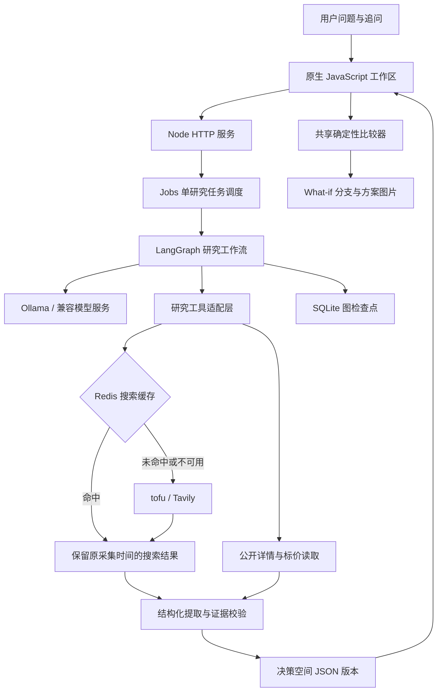
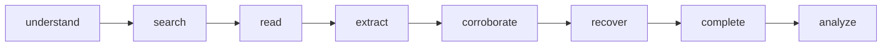

# Prism 技术实现报告

本文面向源码理解与技术面试，说明已经实现的链路、Redis 的具体作用和可验证边界。当前实现以 Node.js、LangGraph、公开信息工具、确定性比较器和本地版本存储组成。

## 1. 架构与分工



| 层 | 实际技术与职责 |
| --- | --- |
| Web 服务 | Node `http.createServer()`，入口 `src/server.mjs`。LangGraph 不负责监听 HTTP。 |
| 前端 | 原生 HTML/CSS/JavaScript ES Modules，HTML 节点与 SVG 连线，原生 dialog 详情窗。没有 React/Vue/React Flow。 |
| 研究编排 | `@langchain/langgraph`，当前通用图在 `src/general-research.mjs`。 |
| 模型适配 | 本机使用 `@langchain/ollama` 的 ChatOllama；其他兼容服务使用 HTTP Chat Completions JSON 接口。 |
| 工具接口 | `src/research-providers.mjs` 提供 `model/search/fetchSource/enrichImages/readMerchantOffer` 等方法。 |
| 检索缓存 | `redis@6.3.1`，可选，缓存搜索结果，不承担事实校验。 |
| 决策存储 | 完整 JSON 快照，保存问题、事实、来源、分支、对话和人的判断。 |
| 执行状态 | LangGraph SQLite 检查点与任务 JSON，支持中断后继续。 |

这种分工让模型处理不确定的理解和提取，让程序控制网络访问、数据约束、即时比较和持久化。当前面向本机单用户，后台一次只运行一个研究任务；不是多租户或分布式任务系统。

## 2. 搜索到底通过什么实现

### 2.1 项目自己的调用链

```text
LangGraph search / corroborate / recover 节点
  → io.search(query)
  → research-providers.mjs
  → search-cache.mjs：可选 Redis 查询
  → tofu-search.mjs：Node spawn Python 子进程
  → scripts/tofu-search.py
  → tofu_search.search(query, max_results=4)
  → 结果标准化为 title / url / raw_content / content / engine
  → 回到 Node，按实际来源和字段做后续验证
```

Node 与 Python 通过 stdin/stdout JSON 协议交换数据。不是 MCP，也不是另一个 Python Web 后端。进程最多等待 75 秒，响应大小受限；Python 内还有搜索、正文读取和文本长度预算。

tofu 包固定为 `0.12.25`，在可选 Python 环境中安装。另一条可选路径是 Tavily 官方 search/extract HTTP API；缓存放在它们共同的适配层，因此两种搜索后端都可复用。

### 2.2 tofu 依赖内部还做了什么

本次还阅读了本机固定版本的 `tofu_search/search/orchestrator.py`、`search/rerank.py` 和 `lexical.py`，不能只把依赖视为黑盒：

1. 多引擎发现候选，URL 去重，部分页面读取与引擎请求重叠执行。
2. 根据标题/摘要做低成本的取正文前筛选，整理重复摘要和正文。
3. 读取并清洗可访问的页面文本。
4. 可选 LLM 内容过滤；Prism 的桥接代码设置 `filter_enabled=False`，不使用这一过滤功能。
5. 默认进入 BM25 等词法证据排序，结合弱先验、上游排名和多样性策略选择结果。达到截止时间等提前返回情况不保证走完全部阶段。

该版本包含 Bing、Brave、DuckDuckGo、SearXNG 等引擎实现。具体一次结果来自哪里，要以结果中的 `engine` 记录为准；不能把 SearXNG 的所有底层引擎都当成该次已调用的来源。Prism 没有因此获得所有站点的登录能力或稳定读取保证。

### 2.3 BM25 用了什么包，和 TF-IDF 什么关系

准确说法是：**Prism 通过 tofu-search 间接使用其纯 Python BM25 重排实现；Prism 自己没有维护 BM25 文档索引，也没有直接使用 rank_bm25 包。**

该固定依赖版本中：

- 入口是 `tofu_search.search.rerank.rerank_by_bm25()`，不是项目自己写的召回引擎。
- 默认参数可在依赖源码定位：`k1=1.5`、`b=0.75`。
- 分词在 `lexical.tokenize()`：Unicode 规范化、大小写统一、词项与连续中文二元片段等处理，不应说成使用 jieba。
- 排序文本包括标题/摘要与从正文选出的查询相关原文片段；并非只比标题。
- 依赖还融合其他信号，因此最终顺序不能全部归因于一个裸 BM25 分数。

TF-IDF 和 BM25 都利用词频与逆文档频率衡量词项匹配。BM25 进一步引入词频饱和和文档长度归一化，避免重复词无限增分，以及长文档仅凭长度获得不当优势。这里的统计集合是当前重排候选，不是 Prism 已建立了全网倒排索引。

该依赖实现中的核心形式为：

```text
IDF(t) = ln(1 + (N - df(t) + 0.5) / (df(t) + 0.5))
BM25(q,d) = Σ IDF(t) × tf(t,d) × (k1+1)
                      / [tf(t,d) + k1 × (1-b + b × |d|/avgdl)]
```

`N` 是参与本次排序的文档数，`df` 是包含该词的文档数，`tf` 是词在文档中的次数，`|d|/avgdl` 是相对文档长度。`k1` 控制词频饱和，`b` 控制长度归一化程度。常见 TF-IDF 将词频与 IDF 相乘，具体归一化形式有不同变体；不能把两者说成只是调用同一个函数的不同名字。

这一区别值得在面试中主动说明：使用依赖提供的算法、自己实现算法、运营一个完整检索索引，是三种不同工作。

## 3. 研究流程与 Agent 的实际体现



| 阶段 | 真实工作 |
| --- | --- |
| understand | 模型提出适合当前问题的字段、单位、比较方向、用户约束、检索词和 What-if 建议；代码验证类型与用户原话。 |
| search | 执行有限查询；无结果时允许受限查询改写。Redis 在这一工具调用路径上复用搜索观察。 |
| read | 阅读优先来源；模型只可从实际观察到的链接中选择详情，不能凭空生成详情 URL。 |
| extract | 模型分批提取字段；专用房源解析也可产生结构化观察。 |
| corroborate | 为部分缺失字段或缺其他站点依据的候选补查；合并必须有身份依据。 |
| recover | 可比较选择不足时，补读观察到的目录详情，或换简短查询；次数有上限。 |
| complete | 校验引文、单位、实体、价格口径，绑定来源图片并组装空间与分支。 |
| analyze | 基于已计算的资格和证据解释取舍，不允许模型决定另一套数学排序。 |

Agent 的能力主要体现为**在任务上下文中生成比较模型、决定查什么、选哪些详情、从观察结果中提取并补查**。主图的阶段顺序由代码固定，是有受限自主决策能力的研究工作流，不能称为任意工具自由循环。

真正的 Agent Loop 通常包括观察状态、选择行动、执行、接收反馈、判断是否继续和终止。Prism 在节点内部实现部分反馈和有界补救；原商品兼容图还有 `plan/search/repair` 条件循环。当前没有多个独立 Agent 角色协作，八个节点不等于八个 Agent。

## 4. Redis 搜索缓存

### 4.1 放在哪，为什么

`src/search-cache.mjs` 包在 provider 的 `search()` 外层。缓存命中可以省去 Python 子进程、搜索引擎请求以及该次搜索所包含的正文收集；未命中仍走原工具。

当前不缓存独立 `fetchSource()`、公开标价读取或模型生成。重新核对已有引用走原页面读取，仍然联网。What-if 拖动使用已有数据本地重算，本来就不需要 Redis。

### 4.2 Key、内容和时间

```text
key = prism:search:v1:SHA256(
    缓存格式版本 + 数据目录作用域 + 搜索服务 + 查询词 + 搜索参数
)

value = {
    version, key,
    observedAt, expiresAt,
    results: [...标准化搜索结果]
}
```

实际参数还包括提供者账户/解释器配置的摘要指纹，减少更换服务配置后的错误复用。Key 不保存原始查询、密钥或 Redis URL；value 保存第三方结果，不保存聊天记录或模型提示。查询相似不等于命中：当前做的是精确请求缓存，不是语义缓存。

- 默认 TTL 为 300 秒，可配置 1–3600 秒。
- Redis `SET` 使用服务端过期时间；读取时还检查记录版本、Key、原采集时间和当前 TTL 容忍窗口。
- 结果中 `retrievedAt` 保留原采集时间，`retrieval.cache` 记录是否命中及本次提供时间。
- 缓存返回后仍进行实体、引文和单位验证，不继承“已确认事实”资格。
- 不缓存空结果、异常或超过大小上限的数据，避免短期搜索失败阻止补救。

### 4.3 命中、降级和并发

1. Redis 可用且命中有效记录：复制结果后返回，避免调用者改写共享对象。
2. 未命中：调用原搜索，成功且符合缓存条件时写回。
3. 同进程同一请求同时到来：合并为一次在途调用，各调用者得到独立结果。
4. Redis 连接/读/写失败或超过预算：保留原搜索能力，进入 5 秒连接冷却后再尝试。
5. 默认每次缓存连接/操作预算 300ms，可配置；关闭离线命令排队和自动重连，避免缓存故障长期拖住研究。

这里的并发合并是进程内机制，没有使用 Redis 分布式锁或任务队列。首次缓存未命中仍需要完整外部搜索，Redis 不能提高未读取页面的可访问性。

### 4.4 状态与运维

`GET /api/health` 中的 `searchCache` 提供 `enabled/status/ttlSeconds` 和 `requests/hits/misses/loads/coalesced/bypasses/errors/skippedWrites` 等当前进程累计计数，不返回连接地址、密码或查询内容。

状态有 `disabled`、`invalid-config`、`idle`、`ready`、`degraded`、`closed`。配置存在但尚未调用搜索时为 idle，不代表已经验证 Redis 可连接。计数在应用重启后归零。

Redis 缓存是临时公共搜索观察，与空间历史分开，到期或淘汰不影响已保存决策。缓存仍包含外部结果文本，适用于本机受控 Redis；Key 哈希不等于加密。当前没有多用户授权和按用户缓存隔离。

## 5. 启用方法

### 本机 Node + Redis

先准备可访问的 Redis。已有 Docker 引擎可用时，可以只启动可选缓存服务：

```sh
docker compose -f deploy/docker/compose.yaml --profile cache up -d redis
```

在本机 `.env` 设置以下字段，再重新启动应用。不要覆盖已有模型和搜索配置，不要提交真实 URL：

```dotenv
REDIS_URL=redis://127.0.0.1:6379
REDIS_SEARCH_TTL_SECONDS=300
REDIS_CACHE_TIMEOUT_MS=300
```

公开 `.env.example` 保持 `REDIS_URL=XXX`。没有设置、设为 XXX 或移除 URL 时不会连接 Redis，搜索按原方式运行。配置格式错误时缓存关闭且健康信息标为 invalid-config。

Compose 的 Redis 服务只发布到本机回环地址，设置内存上限和淘汰策略，关闭磁盘持久化。它不自动修改本机 `.env`。应用重启会关闭自己的缓存连接，不会停止你管理的 Redis 服务。

### Node 与 Redis 都在 Compose 中

在 Compose 启动环境中设置 `REDIS_URL=redis://redis:6379`，启用 `cache` profile 再启动服务。容器中的 localhost 指容器自身，不能用本机连接地址替代服务名。

例如 PowerShell：

```powershell
$env:REDIS_URL = 'redis://redis:6379'
docker compose -f deploy/docker/compose.yaml --profile cache up --build
```

即使 Redis 比应用启动得晚，缓存仍按故障降级和冷却重试处理。默认 `docker:up` 不强制启动 Redis。容器中的 tofu Python 运行时仍须另行准备，不能据此声称容器已支持全部本机研究工具。

## 6. 存储和可靠性为什么分开

| 组件 | 保存什么 | 能否丢弃 |
| --- | --- | --- |
| Redis | 短期可复用的搜索观察。 | 可以，重新搜索可重建。 |
| SQLite | 图检查点和执行状态。 | 恢复执行依赖它，不属于缓存。 |
| 决策 JSON | 问题、证据、分支、对话、人的理由及版本关系。 | 属于用户工作成果，需要保留。 |

原始情况、兄弟分支和已保存来源不因缓存淘汰而改变。任务恢复仍允许中断中的外部请求重复；Redis 没有把它变成 exactly-once 系统。

## 7. 测评方法与结论边界

专项测试覆盖默认关闭、命中、TTL/损坏记录、参数与账户隔离、并发去重、异常与超时降级、采集时间保留、健康信息脱敏及引用读取不缓存。

另有独立的真实 Redis 集成测试：

```powershell
$env:PRISM_TEST_REDIS_URL = 'redis://127.0.0.1:6379'
npm run test:cache:redis
```

测试只清理自己生成的随机作用域 Key，不执行 FLUSHDB。没有指定服务时测试会明确失败，不用跳过来冒充通过。GitHub Actions 增加独立 Redis 服务任务，但本地通过不代表这次改动的远端任务已经执行。

受控性能对照使用相同的三个查询，各重复三次，总计九次请求；加载器延迟固定为 20ms。关闭缓存需要九次加载，开启缓存需要三次加载、六次复用。该实验验证调用削减和客户端行为，**不是 tofu 实时网络性能或研究准确率测评**；第一次查询和模型推理仍需要原有时间。

## 8. 面试中的准确回答

**后端靠什么运行？** Node 原生 HTTP 服务。LangGraph 位于业务执行层，组织研究状态和节点。

**Redis 解决什么？** 复用相同搜索观察，减少重复外部调用，并通过 TTL、采集时间、降级、进程内去重和指标控制可靠性。当前不是用它存所有数据或调度多 Agent。

**RAG 与 Embedding？** 有检索后基于证据提取/分析的模式，没有独立向量知识库、Embedding 模型或向量数据库。tofu 的 BM25 是词法重排，不是向量检索。

**MCP 工具有哪些？** 当前没有封装 MCP 服务。`search/fetchSource` 是应用内部方法；Python 子进程 JSON 协议不等于 MCP。不能把依赖包可选的 MCP 能力当成本项目已接入。

**Skills、自进化和训练？** 当前没有 Skills 加载器、自动 Prompt 优化、SFT/DPO/RL 训练或自进化代码审查 Agent。修改提示后人工验证属于开发迭代，不是已建立自动自进化系统。

**AI 辅助开发怎么用？** 可以用于定位调用链、生成小范围实现和测试、分析失败；必须核对依赖源码与运行证据。此次即区分了应用层没有自建 BM25 索引和依赖层存在 BM25，避免仅看 package.json 或套用技术名词得出错误结论。

## 9. 源码定位

- [HTTP 入口](../src/server.mjs)：创建应用级缓存实例，复用和关闭连接，返回脱敏统计。
- [工具适配](../src/research-providers.mjs)：把缓存接到两种搜索后端及补查别名。
- [搜索缓存](../src/search-cache.mjs)：Key、TTL、时间、降级与在途合并。
- [通用来源整理](../src/general-retrieval.mjs)、[旧商品图](../src/research-agent.mjs)、[商品补查](../src/candidate-retrieval.mjs)：保存来源时保留搜索观察时间。
- [Python 桥接](../scripts/tofu-search.py)：实际 tofu 调用及当前配置。
- [缓存回归](../tests/search-cache.test.mjs)、[真实 Redis 集成](../tests/redis.integration.mjs)：行为和集成验收。
- [Compose](../deploy/docker/compose.yaml)、[CI](../.github/workflows/check.yml)：可选服务及独立集成任务。

参考：[Redis Cache-aside](https://redis.io/docs/latest/develop/use-cases/cache-aside/nodejs/)、[Node 客户端生产配置](https://redis.io/docs/latest/develop/clients/nodejs/produsage/)。具体客户端 API 还核对了本项目安装的 node-redis 类型定义。
