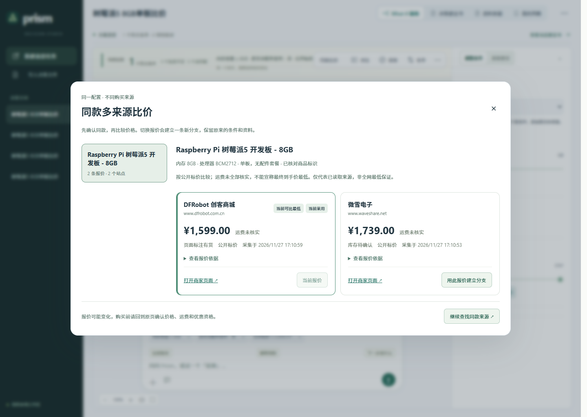
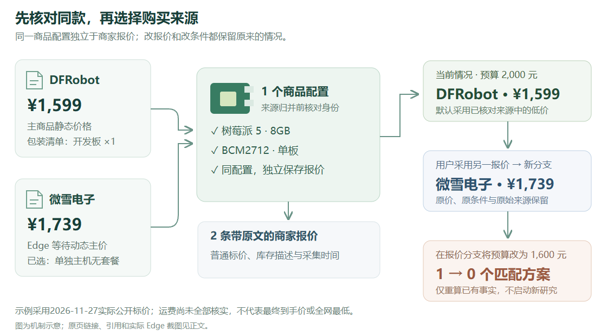

# 真实任务：从同款报价到画布分支

[返回首页](../../README.md) · [完整验收](../reports/MULTI-SOURCE-OFFERS-2026-11-27.md)

这是一份**已记录任务的案例解读**，串起同一需求的自主研究结果与后续 Edge 操作。来源采集于2026-11-27，以下标价不是实时查询，也不是结算价保证。产品图片均来自对应详情页。

## 用户提出什么问题

> 预算2000元，购买树莓派5的8GB单板，不要配件套装。比较不同商家的同款公开报价，核对内存和套餐内容，保留原页配图与来源依据。

没有预填商品链接、候选或报价。Agent 需要自己发现详情，并确认它们描述的是同一个配置。

## 先确认同款，再把价格放在一起

| 核对项 | DFRobot | 微雪电子 |
| --- | --- | --- |
| 商品 | 树莓派5单板 | Raspberry Pi 5单板 |
| 内存 | 8GB | 8GB |
| 处理器 | BCM2712 | BCM2712 |
| 包装或已选套餐 | 包装清单为开发板 ×1 | 已选“单独主机无套餐” |
| 公开标价 | 1,599元 | 1,739元 |
| 库存描述 | 页面标注有货 | 尚未核实 |
| 运费 | 尚未核实 | 尚未核实 |
| 真实详情 | [DFRobot](https://www.dfrobot.com.cn/goods-3783.html) | [微雪电子](https://www.waveshare.net/shop/Raspberry-Pi-5-8GB.htm) |

DFRobot 的价格从主商品静态区域读取；微雪的价格在静态 HTML 中是占位符，需要 Edge 执行页面脚本并显示主价。程序核对型号、内存、处理器和套餐后，保存**一个配置、两条独立商家报价**。

4GB、16GB、不同代际及含配件套装不会给这个8GB单板贡献价格。搜索摘要和目录标题只用于找详情，不能成为已核对报价。



## 选择报价，再验证一个预算假设

| 路径 | 采用的报价 | 预算 | 结果 |
| --- | --- | --- | --- |
| 当前情况 | DFRobot 1,599元 | 2,000元 | 1个符合条件的配置 |
| 改用微雪报价 | 微雪1,739元 | 2,000元 | 仍符合条件，原始路径保留 |
| 在微雪分支降低预算 | 微雪1,739元 | 1,600元 | 当前报价超出预算，匹配数1→0 |

验收中刻意采用较高报价，是为了检查用户选择与系统默认推荐能否分开保存，并不表示已经购买，或微雪在其他维度更优。

切换报价建立独立候选快照和来源分支；降低预算只重算这条路径已有的事实。原始1,599元报价及其条件保留，刷新后仍可回看。选择另一家、降低预算和继续查新资料是三种不同操作。



## 最后留下什么交付

已保存的问答解释了140元标价差，并保留运费和库存缺项。下面是实际回答中的摘录，金额与缺项由程序根据已核对报价重建：

> 同配置已核对报价：DFRobot 创客商城1599元；微雪电子1739元。当前采用微雪电子。当前标价高140元，可在画布切换来源。运费未全部核实。部分来源库存待确认。

决策建议书及 Markdown 导出保留：

- 当前问题、条件、采用的报价和其他商家来源。
- 具体参数、原文引用及采集时间。
- 条件分支结果、排除原因和待核对事项。
- 用户选择与理由的保存入口，和模型建议分开管理。

这份交付帮助用户检查取舍，不能把运费未知写成零，也不能把已读取商家中的低标价写成全网最低。

## 自己体验

先按[安装说明](../SETUP.md)连接模型与搜索，在首页提交上面的需求。想先体验画布，可使用首页明确标注的虚构演示，无需模型和搜索Key。

连接服务后，也可以从项目根目录运行：

```sh
npm run test:offers:live
```

该命令会**新建真实研究任务**，并记录条件合格、同款身份与至少两个独立站点的可比报价是否成立。外部页面可能变化；不能要求新的研究复现这份历史记录中的价格。具体模型、工具与软件检查见[验收记录](../reports/MULTI-SOURCE-OFFERS-2026-11-27.md)。
