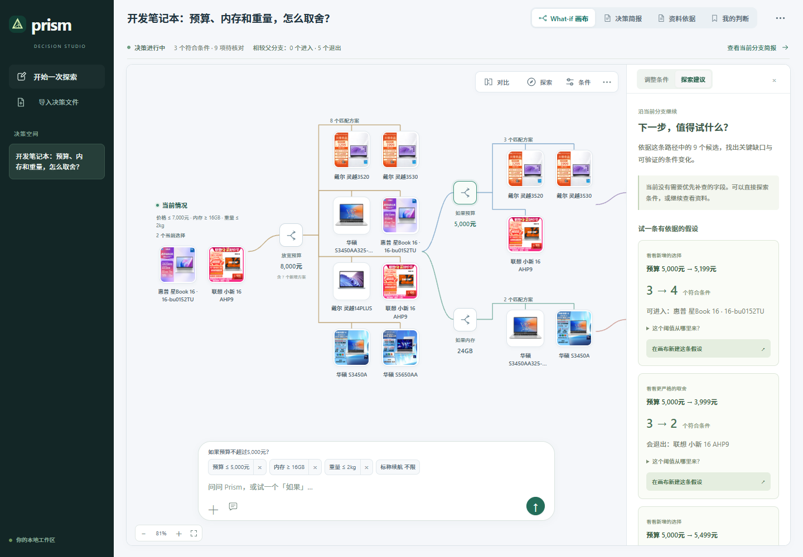
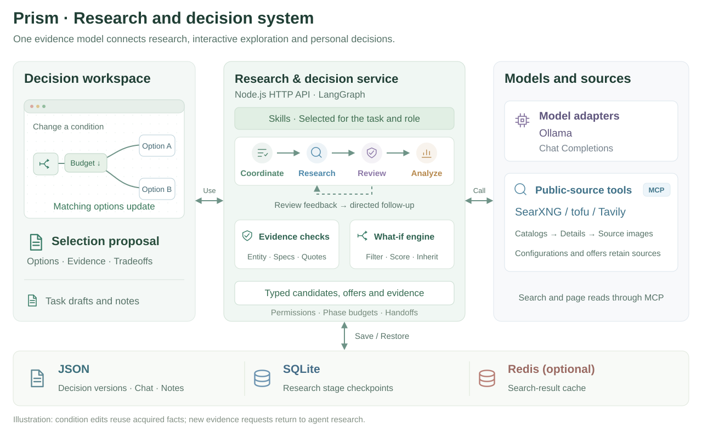

<div align="center">

[简体中文](../../README.md) · **English**


# Prism

### Which option, which seller—and what if your requirements change?

A multi-agent decision workspace connecting source research, same-product offers and a What-if canvas.

[](https://github.com/mianwtt/prism/actions/workflows/check.yml) [](../../LICENSE) [](../MULTI-AGENT.md) [](../ROADMAP.md)

[Real task](#real-task) · [Try the canvas](#quick-start) · [Architecture](#system-architecture) · [What's next](#next) · [Docs](#documentation)

</div>


Actual application capture replaying historical Suning observations and their source photographs. Display branches are hypotheses; saved prices are not live offers.

<a id="features"></a>
<a id="examples"></a>

## From researching options to making your own choice

Buying a laptop, choosing equipment or finding a rental often means checking scattered information, comparing sellers and revisiting a recommendation as requirements change.

Prism saves research as an **interactive decision workspace**. Agents find and check options; models explain tradeoffs using evidence. Change conditions or choose another seller on the canvas, inspect what changes and why, then export a decision proposal and record your own judgment.

| Your question | What you can do |
| --- | --- |
| **Which options actually meet the requirements?** | Check fields against source text, apply hard constraints and retain unresolved evidence gaps. |
| **Where should I buy this exact product?** | Compare offers after matching model and configuration; retain shipping, promotion requirements and collection times separately. |
| **What if my budget or priorities change?** | Create a branch, recalculate saved facts and see entries, exits and exclusion reasons while preserving the baseline. |
| **Why did I choose it?** | Deliver recommendations, tradeoffs, citations and checks; save personal choices separately from model advice. |

<a id="real-task"></a>

## A real task: compare sellers, then test the budget

> Budget ¥2,000 for a Raspberry Pi 5 8GB board, without an accessory kit. Compare public offers from different sellers and retain source photographs and evidence.

This task started with **no supplied item URLs, candidates or prices**. The system followed search results and observed shop catalogues, read details, and checked processor, RAM and bundle contents before comparing offers.


**Observed on 2026-11-27:** [DFRobot](https://www.dfrobot.com.cn/goods-3783.html) listed ¥1,599; [Waveshare](https://www.waveshare.net/shop/Raspberry-Pi-5-8GB.htm) listed ¥1,739. Both were checked as 8GB BCM2712 boards without an accessory bundle. Shipping was not fully verified, and availability statements were retained separately.

| Actual action | Visible result |
| --- | --- |
| Compare matching offers | Default to the lower comparable saved list price, ¥1,599, while retaining the other seller. |
| Choose Waveshare's ¥1,739 offer | Create a purchase-source branch and keep the original ¥1,599 path. |
| Lower this branch's budget to ¥1,600 | Exclude its selected offer: matches **1 → 0**, using saved evidence without new research. |
| Ask about the difference and export | Explain the **¥140 list-price difference**, retain both sources and identify pending checks. |

[Read the task walkthrough](../examples/SAME-PRODUCT-2026-11-27.md) · [Inspect the live acceptance record](../reports/MULTI-SOURCE-OFFERS-2026-11-27.md)

## Keep every What-if available for comparison

Move the budget or change an existing RAM or area condition to update the options. Branches inherit conditions unless explicitly overridden, so different assumptions remain comparable. Requests for new options or fields return to research.


This recording reuses saved rental evidence: **¥2,500 → ¥2,000 → ¥3,000** produces **4 → 1 → 5** matches. It demonstrates recalculation, not a fresh property search.

**Unsure what to try next?** Explore derives useful condition thresholds and affected options from current evidence. When key evidence is missing, request a focused check of that candidate and field. Each branch retains its conditions, options and evidence so you can revisit the comparison.

<details>
<summary>See the exploration sidebar</summary>



This capture replays historical observations; proposed thresholds are not current market quotes.

</details>

## Deliver the research as a decision proposal

The proposal explains **which options to consider, what tradeoffs to accept, which hypotheses were tested and what still needs checking**. Follow a field to its original evidence or return to the canvas. Markdown export and the page share one data model.

| Deliverable | What it retains |
| --- | --- |
| **Recommendations and alternatives** | Advice under current conditions, tradeoffs and exclusion reasons. |
| **Offers and evidence** | Selected seller, other offers, field quotations and collection times. |
| **Experiments and checks** | Existing branch outcomes and evidence to verify before deciding. |
| **Personal judgment** | Your confirmed choice, reasons and conditions, with version history. |

<details>
<summary>See an actual proposal page</summary>


The capture uses historical observations and actual local-model analysis. Rule-based screening and model advice are labeled separately. Saved decisions retain their original context. [Workflow acceptance →](../reports/SELECTION-WORKSPACE-2026-11-27.md)

</details>

<a id="quick-start"></a>

## Get started

Use **Node.js 24**. Try the demo without a model or search key:

```sh
git clone https://github.com/mianwtt/prism.git
cd prism
npm ci
npm start
```

Open **[localhost:4317](http://localhost:4317)** and choose a laptop or housing demo: change a condition → inspect an option and its evidence → create a branch → open **决策建议书** (decision proposal). Demos are explicitly fictional. You can also import a [multi-branch JSON example](../../examples/README.md). The product interface currently uses Chinese.

### Connect a model for live research

1. Start Ollama or a compatible Chat Completions service, using an available model ID.
2. To use the bundled SearXNG deployment, start Docker Desktop and run `npm run search:up`.
3. Open **研究设置**. Connect the model, select **SearXNG** and enter `http://127.0.0.1:4330`. Native Ollama uses `http://localhost:11434/v1` and `ollama` in the key field.
4. Ask your own question or try the Raspberry Pi task above, then continue comparing on the canvas.

tofu-search (`npm run setup:search`) and Tavily are alternatives. Search availability and public-page readability affect actual coverage. [Full configuration and troubleshooting →](../SETUP.md)

<a id="system-architecture"></a>

## How does research become an explorable decision?

**Models understand, research and explain. Program rules validate evidence, compare offers and evaluate conditions.** Structured handoffs let a budget change reuse facts instead of generating the research again.



| Design | Actual role |
| --- | --- |
| **LangGraph specialist subgraphs** | Coordinator, researcher, reviewer and analyst exchange scoped artifacts; review feedback directs follow-up research. |
| **Skills and execution controls** | Skills guide role methods; pre-call checks constrain tools, budgets and input size, followed by recorded handoffs. |
| **MCP integration** | The official SDK registers, discovers and calls search, catalogue, source-reading and offer tools around business adapters. |
| **Multi-source discovery and validation** | SearXNG, tofu or Tavily discover sources; catalogues supplement item links; details establish configuration and price basis. |
| **Shared evaluation and persistence** | Browser and server share filtering, scoring and inheritance. JSON stores versions, SQLite stores checkpoints and optional Redis caches search. |

<a id="agent-architecture"></a>

Roles share the configured model service and exchange artifacts sequentially, with at most one feedback-repair stage and two model reviews. Permissions and budgets constrain actual calls. [Specialist collaboration](../MULTI-AGENT.md) · [MCP and Skills](../MCP-SKILLS.md) · [Technical report](../TECHNICAL-REPORT.md)

<a id="development-and-verification"></a>

## What has been verified?

| Scope | Recorded result |
| --- | --- |
| **Real same-product task** | One configuration and two seller offers without supplied URLs; quote branches, budget exclusion, advice and export checked. [Record](../reports/MULTI-SOURCE-OFFERS-2026-11-27.md) |
| **Other research scenarios** | Historical Hangzhou and Chengdu rental checks each found six eligible listings with matching source photographs. [Record](../reports/AGENT-RESEARCH-REPAIR-2026-11-15.md) |
| **Software regression** | On 2026-11-27, 389 unit/HTTP and the full 94 Edge tests passed; 14 related Edge checks passed after subsequent advice and offer changes. |

Real tasks and software tests are separate evidence. Prism **0.4 is a local, single-user development preview**. Sources can expire; login-gated prices and incomplete identity evidence remain unresolved. Coverage is not a promise that every platform is readable or that an offer is the lowest anywhere.

```sh
npm run check            # Syntax, source and documentation links
npm test                 # Unit and HTTP regression
npm run test:browser     # Browser interaction regression
npm run test:offers:live # New live task with configured model and search
```

<a id="next"></a>

## Three priorities for what comes next

- **More sources that support an actual comparison.** Expand public retailer adapters and evaluate identity matching, valid prices and failure causes on fixed tasks.
- **Show which decisions are affected when evidence changes.** Extend existing refresh and invalidation checks with price differences and affected-branch summaries.
- **Bring your own shortlist.** Complete decision JSON import already works; candidate-list import is a next step, keeping user input distinct from verified web facts.

These are planned directions. See the [roadmap and acceptance gates](../ROADMAP.md), or bring a real task or failure to [Issues](https://github.com/mianwtt/prism/issues).

<a id="documentation"></a>

## Documentation and contributing

[Setup](../SETUP.md) · [Workspace](../WORKSPACE.md) · [Same-product offers](../MULTI-SOURCE-OFFERS.md) · [Technical report](../TECHNICAL-REPORT.md) · [Development](../DEVELOPMENT.md) · [Contributing](../../.github/CONTRIBUTING.md)

Decisions stay on your machine; external model and search requests transmit the information they need. [Security and privacy](../../.github/SECURITY.md) · [Media provenance](../assets/README.md) · [MIT](../../LICENSE)

If evidence-backed research and explorable decisions would help you, consider giving Prism a **⭐ Star**. The project is still evolving, and real usage feedback helps decide what to improve next.
