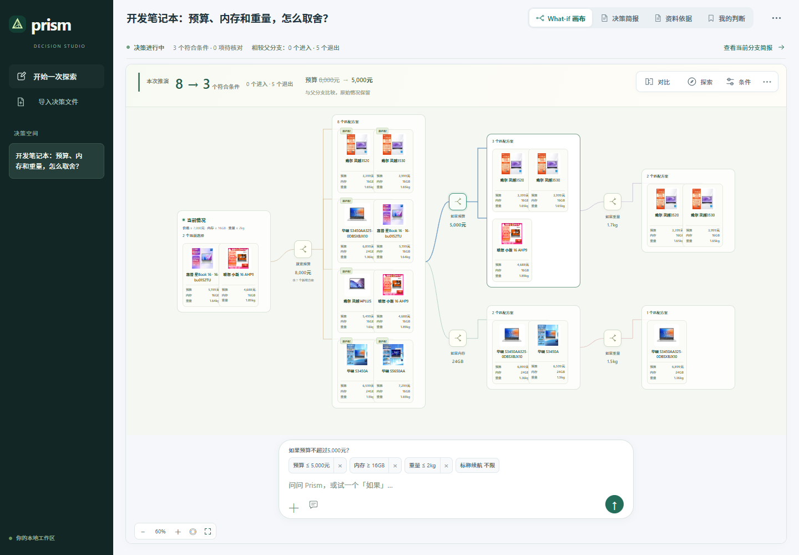
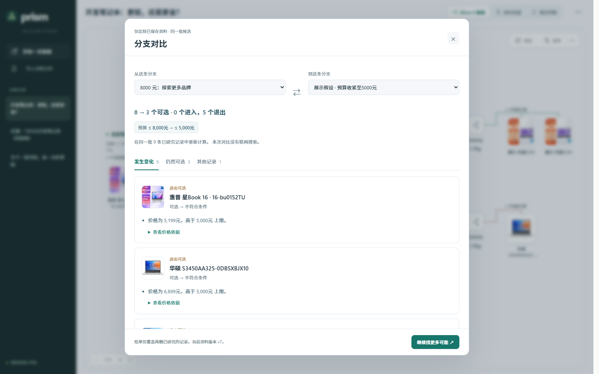
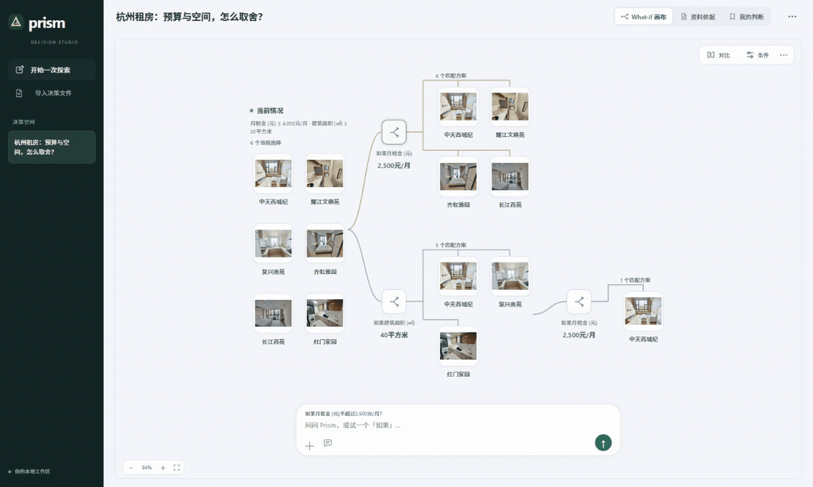
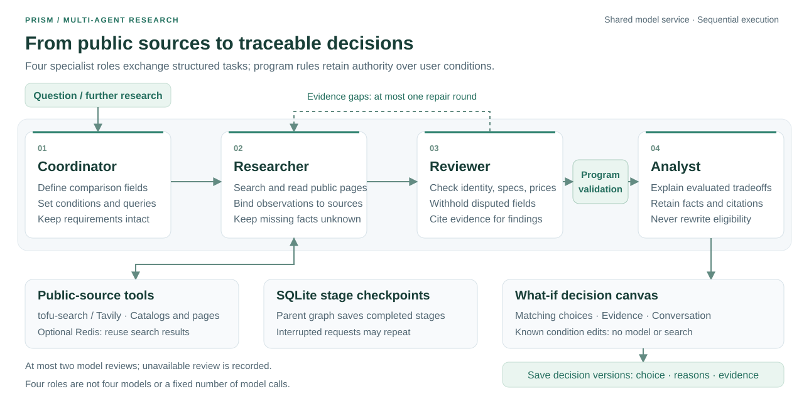
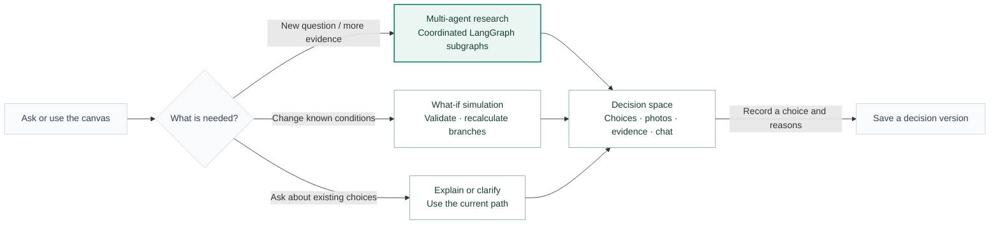
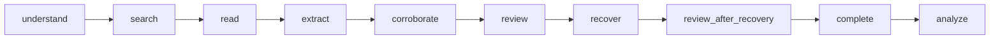

<div align="center">

[简体中文](../../README.md) · **English**


# Prism

**An AI research agent with a canvas for every “what if.”**

Research with specialist agents. Explore the alternatives. Keep the reasoning behind your choice.

[](https://github.com/mianwtt/prism/actions/workflows/check.yml) [](../../LICENSE) [](../MULTI-AGENT.md) [](../../.github/SECURITY.md) [](../ROADMAP.md)

[Quick start](#quick-start) · [Features](#features) · [Examples](#examples) · [Agent architecture](#agent-architecture) · [Documentation](#documentation)

</div>



Laptop canvas captured from Prism with historical Suning product observations and corresponding source images. Five display branches are curated hypotheses; saved prices are not live offers.

Your budget changes. A new requirement matters. You want to know why an option disappeared. Prism keeps the research connected to an interactive **What-if canvas**, so you can explore those changes and continue the conversation with the same evidence.

## Quick start

Clone and run with **Node.js 24** and npm:

```sh
git clone https://github.com/mianwtt/prism.git
cd prism
npm ci
npm start
```

Open **[localhost:4317](http://localhost:4317)** and choose a laptop or housing demo. Change a condition, click an option for details, then save your decision. Both demos use fictional data and need no model or search key. The interface currently uses Chinese.

### Connect your agent

1. Run an Ollama model, or prepare a compatible Chat Completions endpoint.
2. For search without a commercial key, install [uv](https://docs.astral.sh/uv/) and run:

   ```sh
   npm run setup:search
   ```

3. Open **研究设置**, choose **tofu-search**, and connect your model. Native Ollama uses `http://localhost:11434/v1`, an installed model ID, and `ollama` in the key field.
4. Ask your question. Continue from the canvas when you want to change a condition or research more options.

[Setup, provider options and troubleshooting →](../SETUP.md)

## Features

- **Specialists research and review the evidence.** A coordinator defines the comparison, a researcher searches and reads, a reviewer challenges observations, and an analyst explains tradeoffs. Continue along a selected path or request more evidence.
- **What-if you can interact with.** Click a condition or move its slider. Matching options update immediately; the baseline stays intact, descendants inherit changes, and explicit overrides remain their own.
- **Evidence behind each option.** Open a photo to inspect prices, parameters, saved quotations and source links in a floating window. Inspect disagreements and compare any two branches.
- **A model shaped by your question.** The agent proposes comparison fields: numbers, yes/no requirements or categories. Laptop and housing choices use the same canvas with different conditions.
- **Decisions you can revisit.** Save a choice with its reasons and original conditions. Recheck sources later, compare versions, and export or import a decision as JSON.

### Laptops: see which options survive a changed requirement

Expand the budget to ¥8,000, then compare a ¥5,000 path, at least 24 GB RAM, or a tighter weight limit. The canvas keeps all matching options on their paths. Open a branch comparison to see which products drop out and the quotations behind that result.



The captured comparison changes 8 eligible records to 3. Its product observations are historical; it is not a current cross-platform price check.

### Housing: watch a condition change


Budget: ¥2,500 → ¥2,000 → ¥3,000. The selected branch changes from 4 → 1 → 5 matching records. This interaction recalculates saved evidence; it does not run a new search.

## Examples

Each question shapes the comparison model: price, RAM and weight for a laptop; rent and area for housing. Both use the same multi-agent research workflow, evidence model and canvas.

| Start with a question | Continue exploring |
| --- | --- |
| “Find a development laptop under ¥7,000, with at least 16 GB RAM.” | “What if I need 32 GB?” · “Why did this option drop out?” |
| “Compare whole-apartment rentals in Hangzhou under ¥4,000/month, at least 30 m², with source photos.” | “What if the budget is ¥2,500?” · “Show more spacious options.” |
| An existing saved decision | “Keep this path and find more alternatives.” · “Recheck the evidence behind my choice.” |

For a ready-made canvas without a model, import an [example decision](../../examples/README.md).

**Real research check:** fresh Hangzhou and Chengdu rental tasks each returned **6 eligible listings with corresponding source photographs**, using local `qwen3.5:9b`, tofu and LangGraph. No listing URLs were supplied. These are dated observations, primarily from Fang.com; see [the full runs and their limits](../reports/AGENT-RESEARCH-REPAIR-2026-11-15.md).

<a id="agent-architecture"></a>

## Multi-agent architecture

Prism uses **four specialist roles: coordinator, researcher, reviewer and analyst**, each implemented as a compiled LangGraph subgraph. Scoped task contexts, adapter permissions and structured artifacts define their handoffs. They execute sequentially using the configured model service: four roles do not mean four models or a fixed number of model calls.



| Role | Responsibility | Reason for the boundary |
| --- | --- | --- |
| Coordinator | Turn the request into comparison fields, conditions and retrieval tasks | Define what to research before collection; research cannot silently relax requirements |
| Researcher | Use search, public catalogs and page readers to gather source-bound observations | Keep acquisition separate from judgment; missing facts stay unknown |
| Reviewer | Independently challenge evidence and withhold disputed fields | Findings require source quotations; review cannot invent replacement values |
| Analyst | Explain tradeoffs among evaluated candidates | Interpretation cannot rewrite facts, conditions or eligibility |

For a laptop request, the coordinator establishes a ¥7,000 budget and at least 16 GB RAM. The researcher reads product details; the reviewer checks whether the price requires a coupon and whether specifications belong to the same configuration. Program rules evaluate eligibility before the analyst explains the alternatives. Evidence gaps may trigger **at most one feedback-driven repair round and two model reviews**; one round can contain multiple bounded tool calls. Unavailable review is explicitly recorded, not counted as completed review. No controlled comparison currently establishes that four roles outperform a single agent.

**Why four roles?** These are the current responsibility boundaries—define the task, collect observations, challenge evidence, explain choices—not a universal agent count. What-if evaluation and caching are program components, not extra agents.

### How conversation and the canvas connect

New questions, additional sources or new comparison criteria enter research. Changes to known conditions recalculate What-if; questions about existing choices use the current path's evidence. Follow-up messages retain the active conditions and conversation context.

<details>
<summary>View the three interaction routes</summary>



These are application routes, not three independent Agents.

</details>

**A condition change is not another search.** A ¥5,000 budget is first evaluated against the current branch's saved evidence. Asking for more alternatives or new evidence starts research. Zero matches describe the acquired records, not the entire market.

| Layer | Implementation | Responsibility |
| --- | --- | --- |
| Research orchestration | LangGraph `StateGraph` and isolated subgraphs | Contract-based handoffs between coordinator, researcher, reviewer and analyst |
| Models and tools | ChatOllama / compatible HTTP; tofu-search / Tavily; native public-page readers | Called when needed for research and conversation understanding |
| Evidence validation | Zod and source/quotation validators | Check field types, units, excerpts and corresponding photographs |
| What-if evaluation | Deterministic evaluator | Validate conditions, recalculate choices and preserve the baseline |
| Persistence | SQLite; JSON versions; browser drafts; optional Redis | Resume research, retain business snapshots and unsaved work, and cache searches respectively |

<details>
<summary>View execution stages and source entry points</summary>



These stages are not ten agents. The coordinator handles `understand`; the researcher handles `search / read / extract / corroborate / recover`; both review stages belong to the same reviewer, with the second skipped when evidence and observations are unchanged. The analyst handles `analyze`; `complete` is program validation and assembly.

Research graph: [general-research.mjs](../../src/general-research.mjs). Role subgraphs: [specialist.mjs](../../src/agents/specialist.mjs). Evidence review: [evidence-review.mjs](../../src/agents/evidence-review.mjs). [Implementation and verification →](../MULTI-AGENT.md)

</details>

[Architecture and trust boundaries →](../ARCHITECTURE.md)

## Documentation

| Guide | What you will find |
| --- | --- |
| [Documentation index](../README.md) | All guides, project structure, media provenance and historical reports |
| [Setup](../SETUP.md) | Native installation, Ollama, search, configuration and troubleshooting |
| [Using the workspace](../WORKSPACE.md) | Conversation, conditions, evidence, decision memory, import and deletion |
| [Architecture](../ARCHITECTURE.md) | Agent graph, evaluator, persistence and trust boundaries |
| [Multi-agent implementation](../MULTI-AGENT.md) | Four roles, scoped contexts and tools, review/repair, and verification limits |
| [Development](../DEVELOPMENT.md) | Tests, isolated data, live probes and Docker status |
| [Publishing](../PUBLISHING.md) · [Release notes](../releases/v0.4.0.md) | GitHub preparation and the public preview scope |
| [Verification](../reports/VERIFICATION.md) · [Roadmap](../ROADMAP.md) | Measured results and remaining release work |

## Development and verification

```sh
npm run test:release
```

Latest complete local regression: **299 unit/HTTP tests and 71 Edge browser tests passed**. See [multi-agent implementation and live verification](../MULTI-AGENT.md); the earlier **11 real-service usage checks** retain their scope in the [usage report](../reports/USER-JOURNEY-2026-11-21.md). Controlled tests and live retrieval remain separate. Earlier **3 real-Redis integration tests** and historical cohorts retain their original scope; see the [quality report](../reports/PREVIEW-QUALITY-2026-11-18.md) and [development instructions](../DEVELOPMENT.md).

Use `npm run check:project` to check the complete working-tree source and `npm run package:source` to create an archive excluding local settings, decision data and experiments. See [project structure and packaging](../PROJECT-STRUCTURE.md).

## Project status

Prism **0.4 is a development preview for local, single-user use**. Real research depends on the model, search engines and publicly readable sources. A saved citation records what a source said; it does not independently verify the publisher's claims.

Additional live checks cover computers, phones and rentals in different cities. The [quality report](../reports/PREVIEW-QUALITY-2026-11-18.md) retains per-version successes, failures and configuration-diversity limits; these are not independently labeled generalization accuracy. PDF/Word/Excel/image ingestion is not implemented. Earlier Windows Node 22/24 installation checks and the [historical GitHub CI run](https://github.com/mianwtt/prism/actions/runs/44038301786) apply to their respective revisions; the current changes need a new remote CI run after submission. Container startup and complete live research require separate acceptance. See [release gates](../ROADMAP.md).

Questions and decision history are stored locally. External models, searches and source reads still receive the data needed for those requests. Read [security and privacy](../../.github/SECURITY.md) before sharing exports or running with personal information.

## Contributing

Public-source adapters, reproducible data-quality cases and accessibility improvements are welcome. Start with [CONTRIBUTING](../../.github/CONTRIBUTING.md).

Source code is [MIT licensed](../../LICENSE). Third-party content and photographs retain their respective rights.
