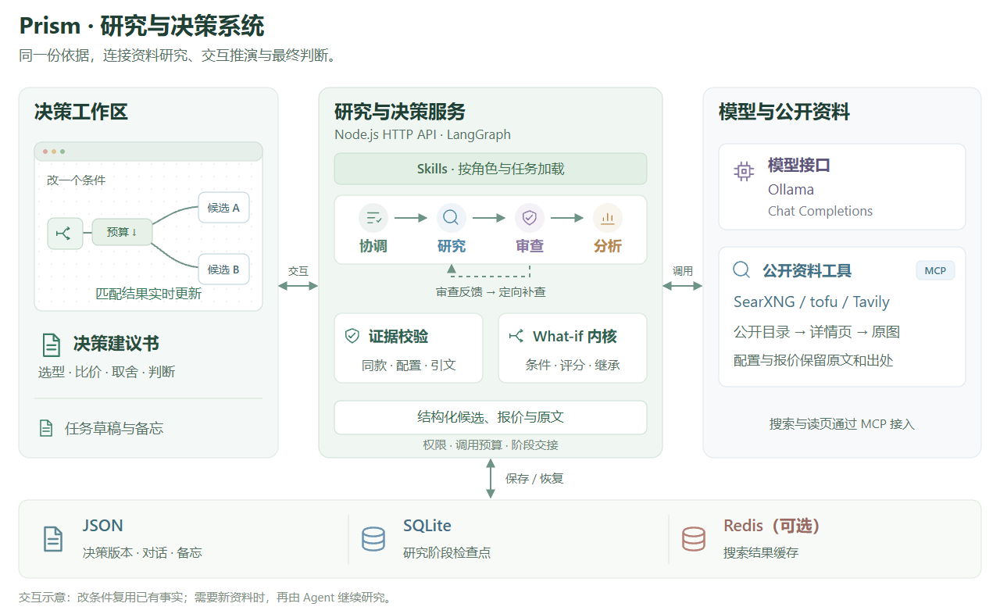
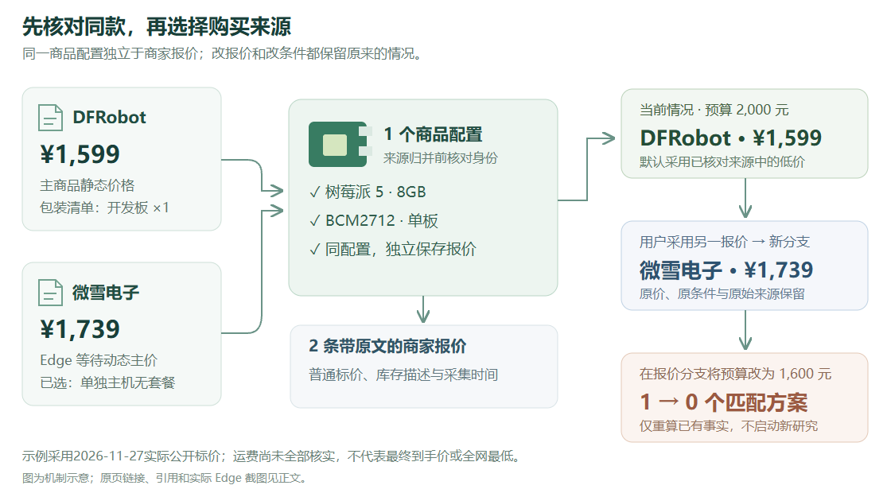
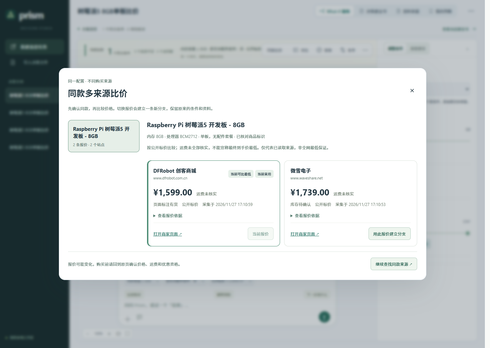

# Prism 面试技术报告

## 1. 开场怎样介绍项目

**项目动机：减少多条件决策中反复查资料、核对口径和重新比较的成本。**

选购电脑或租房时，用户的要求往往在比较过程中才逐渐明确：起初关心预算，看到候选后又开始考虑“多花一点能轻多少”“通勤缩短是否值得增加租金”。用户需要同时弄清资料是否可信，以及不同要求下哪个方案更合适。

Prism 的切入点，是把已经核验的资料保存为一份可以持续操作的决策空间。首次由 Agent 搜集、核验并解释方案；随后修改已有条件时，复用这些事实重算，展示候选变化和排除原因；需要新候选或新字段时再补充研究。

### 1.1 30 秒版本：先让面试官听懂产品

我做 Prism，是希望减少选购、租房中反复查资料、改要求、重做比较的成本。系统先检索并核验真实资料，形成带来源的候选，再由模型解释方案取舍。用户调整预算等条件时，可以直接在 What-if 画布上同步看到哪些方案符合要求、哪些被排除，并保存选择理由。核心是让一次资料研究支持持续的、有依据的决策。

### 1.2 90 秒版本：突出自己做的技术

我做这个项目的切入点，选购电脑或租房时，用户的要求往往在比较过程中才逐渐明确：起初关心预算，看到候选后又开始考虑“多花一点能轻多少”“通勤缩短是否值得增加租金”。用户需要同时弄清资料是否可信，以及不同要求下哪个方案更合适。

因此我希望先是把已经核验的资料保存为一份可以持续操作的决策空间，再让用户在同一份事实基础上调整条件，由模型解释取舍、程序重算结果，逐步形成最终方案，这也是 Prism 同时包含 Agent 研究与 What-if 决策画布的原因。

我把研究与决策支持设计为 LangGraph 父图与四类角色子图：

协调角色选择比较维度并确认硬条件，

研究角色负责信息检索与保存

审查角色核对实体、配置和报价口径，

决策分析角色把用户偏好与候选事实联系起来，说明不同方案适合什么取舍。通过结构化结果交接；存在争议时可以定向补查。

用户最终获得可比较的方案、带引用的取舍说明和能够继续修改的条件分支。What-if 复用已有事实重算；工程上结合 SQLite Checkpoint 恢复研究阶段，并通过 Redis 和请求合并减少重复加载，让这条持续比较的流程能够稳定执行。

| 用户遇到的问题 | 对应的项目设计 |
| --- | --- |
| 多来源资料口径不同，难以直接比较 | Agent 研究与证据审查，将候选字段绑定实际来源 |
| 预算、配置和偏好反复调整，需要重新比较 | What-if 分支保留不同假设，共享计算内核复用事实重算 |
| 多轮讨论后难以回看为什么这样选 | 将当时的条件、候选事实与选择理由一起保存 |

## 2. 先看全貌：项目由什么组成，最后交付什么

Prism 是研究与决策工作台。用户先说明要选什么、预算和配置等要求，系统研究真实页面，形成候选及其证据；对于商品，还要回答**同一个配置从哪个商家买**。用户在画布试不同条件、切换报价，最后得到有推荐、有原文依据和待核对事项的决策建议书，并可记录自己的选择。



| 组成 | 实际技术与作用 | 交给下一层的结果 |
| --- | --- | --- |
| 决策工作台 | JavaScript、HTML/CSS、SVG；问答、报价比较、分支画布与建议书 | 需求、分支条件、所选报价与个人判断 |
| 后端与任务 | Node.js 原生 HTTP 服务、Jobs | 研究任务、进度查询、版本读写与后台执行 |
| 研究编排 | LangGraph 父图与四类角色子图 | 比较要求、检索计划、来源、字段观察及审查反馈 |
| 资料获取 | 官方 MCP SDK；tofu、SearXNG、商家目录与 Edge 读取 | 实际详情链接、原文、原页配图、报价与采集时间 |
| 比较与交付 | 前后端共享 JavaScript 业务模块 | 资格、评分、同款报价、新分支和带引用的建议书 |
| 保存与复用 | JSON、SQLite Checkpoint、可选 Redis | 决策版本、研究阶段状态和短期搜索缓存 |

一次完整任务按下面的顺序工作；**模型负责不确定的理解与研究，程序负责事实校验、价格计算和条件判断，最终选择由用户确认。**

```text
用户需求 → 明确比较字段与硬条件 → 搜索与商家目录发现
→ 读取真实详情 → 提取与校验字段 → 独立审查及定向补查
→ 跨商家核对同款报价 → 程序过滤与评分 → 模型解释取舍
→ 画布试条件、选报价 → 决策建议书与判断保存
```

**四类 Agent 的分工。** 协调角色接收用户要求，输出字段、硬条件和检索方向；研究角色使用联网工具，返回带来源的观察；审查角色只核对已有材料，反馈必须指向具体字段与原文；分析角色接收已评估的候选，解释取舍，不能更改事实、条件或资格。四类是职责划分，共用模型服务、按阶段交接，不代表四个模型同时自由讨论。

**为什么采用这个结构。** 网络研究慢且可能失败，条件过滤则要求快速、可重复。显式状态图便于保存已完成阶段；角色子图隔离上下文和工具权限；共享计算内核支持画布即时反馈。后端服务由 Node.js 运行，LangGraph 负责研究编排，LangChain 相关包提供模型适配，三者职责不同。

## 3. 资料怎么找到：搜索、目录、读页与字段核验

**先把需求变成可以执行的比较要求。** 例如“预算2000元，树莓派5、8GB单板，不要配件套装”，要保存价格上限、内存要求和是否含套装；同时确定要核对型号、处理器和包装。这里的“比较要求”就是字段定义、用户条件和研究任务，不是额外的协议框架。用户没给重量上限，就不能由模型自行添加或放宽。

资料获取有三个不同环节，不能把“搜索到链接”当成“取得可比报价”：

| 环节 | 当前怎么实现 | 为什么需要这一层 |
| --- | --- | --- |
| 通用搜索发现 | tofu-search；或独立的 SearXNG JSON API；配置后也可组合 Tavily | 扩大发现范围，得到标题、摘要和实际 URL |
| 商家目录发现 | 读取平台真实列表、分类链接和搜索表单，再选实际详情链接 | 搜索可能漏页、忽略 `site:` 或返回资讯；目录可补商品线索 |
| 具体详情读取 | 优先原页 JSON-LD 或固定 DOM；动态主价使用 Playwright 驱动 Edge | 获取当前选中配置、普通标价、包装内容和对应配图 |

**tofu-search 是什么。** 它是 Python 搜索与正文获取组件。Prism 的 Node.js 通过 Python 子进程与 JSON 桥接调用，依赖负责多引擎结果处理、正文获取和相关性重排。固定版本中，BM25 来自 tofu 自带实现，没有在 Prism 内另建网页倒排索引，也不是直接使用 `rank_bm25`。BM25 用词频、逆文档频率、词频饱和及长度归一化衡量相关性；它决定先读哪些页面，不决定商品是否合格或值得购买。

**SearXNG 在新链路中的作用。** 它可以独立承担搜索，不要求安装 tofu 或配置商业搜索密钥。本机通过 Docker 部署了 JSON 服务，实际验证的 `bingrss` 引擎读取 Bing 公开 RSS 结果。它是网页线索来源，不是电商价格 API。SearXNG 这条路径没有经过 tofu 的 BM25，不能把两个可替换后端说成固定串联。Prism 额外进行 URL 去重、按站点交替取结果及目录补充。

**公开目录具体指什么。** 例如 DFRobot 首页能进入商品分类，分类页上有实际 GET 搜索表单；程序读取表单的地址与字段名再提交关键词。微雪则沿页面已有的分类链接找到商品。这里不猜商品 ID，不构造不存在的详情 URL。多家商家的商品链接交替进入有限上下文，避免第一家目录里的几十条配件挤掉第二家的主板详情。

**页面读取怎样避免取错价格。** DFRobot 从主商品价格区域读取显示价，并检查它与页面数据属性是否一致；微雪静态 HTML 中的价格是模板占位符，需要 Edge 等待脚本显示实际主价，同时读取已选内存与套餐。推荐商品、未选变体、会员价和补贴价都不能冒充当前商品的普通报价。图片取对应详情页的原图地址，不能生成或借用另一件商品的照片。

**字段怎么进入比较。** 每个参数绑定候选、配置、原文、来源与单位。Zod 校验结构；业务规则检查引文是否存在、数值单位是否匹配、参数是否属于当前对象；审查 Agent 再检查配置和报价口径。争议字段先暂缓，其余已核对字段保留。研究角色收到具体问题后最多进入一次恢复补查阶段，整轮最多两次模型审查；补查阶段内仍有独立工具调用预算。

**MCP、Skills 和执行控制如何衔接。** 项目实现搜索、目录、读页和报价适配，使用官方 SDK 注册、发现和调用工具；主要工具为 `search_public_sources`、`search_public_catalog`、`read_public_source` 和 `read_merchant_offer`。原图随详情返回，提供方支持时另注册 `read_source_images`。应用内用内存传输，另提供 stdio 入口。Skill 保存任务方法，按角色和任务加载，记录内容哈希；执行控制层在每个阶段调用前检查工具白名单、调用预算和输入长度，调用后记录结果，交接时记录产物。Skill 是指导，权限与预算是程序约束，不能靠提示词代替。

## 4. 同一个商品怎么跨商家比较

关键是把**商品配置**和**商家报价**分开。同一块8GB主板可以只有一个候选配置，同时保存两个卖家的价格；价格不同不自动等于事实冲突。反过来，同系列4GB、8GB、16GB和含配件套装不能只因为名称相似就合并。



| 保存对象 | 内容 | 使用方式 |
| --- | --- | --- |
| 商品配置 | 原页品牌、制造商型号或有效 GTIN、内存、处理器、存储、套餐等 | 判定是不是同一款；商家自有 SKU 不能直接跨站当型号 |
| 商家报价 | 来源、卖家、币种、标价、运费、优惠条件、库存描述与时间 | 独立判断可比性，再选择当前采用的报价 |
| 报价分支 | 所选报价、新候选快照、父分支与原条件 | 测试换购买来源后的结果，保留原来的情况 |

**身份怎么核对。** 优先有效 GTIN，否则使用原页品牌、完整型号和已观察配置。电脑缺少处理器、内存或存储时，不按系列名归并。单板还核对包装：DFRobot 的完整包装清单只有开发板 ×1，微雪已选“单独主机无套餐”，程序才能将其归一为单板。缺证保留独立来源，不能让模型靠常识补齐配置。

**怎样继续扩大来源。** 研究流程在补查之后、最终复核之前有独立同款比价阶段，使用已观察型号与配置跨站发现并重新读页。当前每阶段最多处理3个配置、6个搜索、10个详情；支持的元件商家每个配置另有最多2次目录发现。明确只比同款时，新读到的配件与其他代际可保留在来源中，但不扩充成无关候选。

**“最优报价”具体怎么算。** 先排除币种不一致、条件资格不明、缺货、预售、过期、超过24小时或审查暂缓的报价。运费都明确时按已知合计比较；运费不齐时按标价比较，并保留待核实。库存未知不能写成有货，标价最低不能写成最终到手最低，更不代表全网最低。

**真实任务结果。** 无预填商品链接的任务取得了同款树莓派5 8GB单板的[DFRobot 1599元](https://www.dfrobot.com.cn/goods-3783.html)和[微雪1739元](https://www.waveshare.net/shop/Raspberry-Pi-5-8GB.htm)报价，处理器均为BCM2712，单板包装分别有原页依据。价格是2026-11-27的采集观察，运费尚未全部核实。



## 5. 画布和建议书：怎样从资料走到决策

**先判断资格，再比较偏好。** 硬条件过滤先排除超预算、配置不符的候选，缺少关键依据的候选保持待核实。合格候选再按字段方向归一化并加权评分。便宜不能抵消内存不足，搜索 BM25 分数也不参与商品效用评分。父子分支使用显式覆盖标记：用户固定的条件不会因后来父分支取到同值而失去独立性。

**改条件、改报价和补研究是三种操作。** 改已有预算只重算当前分支候选；切换报价经服务端从原始来源重新校验，建立新候选快照和报价分支；要求新候选、新字段或刷新资料才进入研究。画布直接改条件不需要模型或搜索；自然语言解释仍可能调用模型，不能把所有对话都称作零模型调用。

**模型给建议，程序提供可靠上下文。** 分析模型收到当前条件、已评估候选、可引用字段和已核对报价集合。推荐只能指向当前分支合格候选；报价、差额和缺项由程序重建。回答会绑定条件与证据的摘要标识，当前状态改变后，旧建议保留为历史而不继续冒充当前结论。用户点击采用其他商家时才修改所选报价，模型建议本身不替用户切换。

**最终产物是决策建议书。** 建议书汇总推荐、取舍、备选和排除原因、同款商家报价、条件实验、原文引用及待办；页面与 Markdown 导出共用数据模型。用户另行记录选择理由，保存当时的条件和事实。建议书是可检查的决策支持，个人判断是用户确认，两者分别保存。

**实际操作验证。** 默认采用1599元；切换微雪1739元建立新分支，刷新后仍保留原价与新价。问答解释140元差额；将微雪分支预算改到1600元后，匹配数从1变0，原始1599元路径保留。已有条件调整未启动新研究，导出的建议书保留两家报价及引用。

## 6. 状态、缓存、结果与源码入口

**Redis 缓存搜索访问。** 同一提供方、查询、选项和服务配置形成缓存键，命中则复用近期来源结果；未命中请求外部服务，成功后写回，默认TTL为300秒。TTL就是有效期。结果携带原采集时间，显式刷新可以跳过缓存；缓存异常降级直查。它不是价格永久存储，也不是 Agent 的长期记忆。

**Promise 合并进行中的同键请求。** 网络查询尚未完成时，把表示这次异步操作的 Promise 存在当前进程的映射中；后到请求等待同一个结果，结束后移除。Redis 复用已完成结果，Promise 合并尚未完成的加载。没有分布式锁，不能声称多个应用进程合计只查一次。

**SQLite 和 JSON 分别保存什么。** SQLite Checkpoint 保存研究阶段及其状态；同一任务重启后从已提交阶段继续，阶段未提交的读页仍可能重做。JSON 保存用户可见的空间与版本，包含候选、来源、分支、建议和判断。任务预分配结果ID，结果提交与任务状态结合处理，减少恢复后重复创建版本。

| 验证对象 | 已有结果与范围 |
| --- | --- |
| 真实研究与交付 | 无商品链接取得1个同款配置、2家商家报价；Edge 验证选价分支、刷新、预算排除、模型建议及导出 |
| 软件回归 | 389项单元/HTTP与完整94项Edge测试通过；相关问答与报价功能调整后另跑14项Edge回归通过 |
| 字段证据规则 | 35条构造回归样例全部符合预期，覆盖条件报价、配置混淆等；不是模型真实抽取准确率 |
| 条件计算 | 9个合成候选、7个情景、1000次变更，计算内核P95约0.66ms；不是整轮研究耗时 |
| 缓存访问 | 3组查询各重复3次，相比关闭缓存，外部加载9→3，减少66.7%；属于受控重复查询实验 |

真实业务任务、规则回归和微基准回答不同问题；本项目没有把以上数量换算成全品类研究成功率，也没有完成单Agent与多Agent的同预算准确率对照。

| 要核对的机制 | 对应源码 |
| --- | --- |
| 研究图、角色与执行约束 | `src/general-research.mjs`、`src/agents/specialist.mjs`、`src/agents/execution-guard.mjs` |
| 搜索、MCP、Skills | `src/research-providers.mjs`、`src/search-network.mjs`、`src/mcp-research.mjs`、`src/skills.mjs` |
| 目录、动态读页与同款 | `src/retail-catalog.mjs`、`src/retail-page.mjs`、`src/product-browser.mjs`、`src/product-offers.mjs` |
| 分支、建议书与状态 | `src/decision-schema.mjs`、`src/decision-answer.mjs`、`src/decision-proposal.mjs`、`src/jobs.mjs`、`src/search-cache.mjs` |

以上路径均相对 `D:/project/prism`。真实任务、原始记录与复跑口径见 [同款比价验收](../reports/MULTI-SOURCE-OFFERS-2026-11-27.md)。

## 7. Prism 项目面试问答（12题）

### Q1｜为什么做 Prism？搜索加一个聊天框不是已经能推荐了吗？

**答。** 我关注的是反复比较的成本。搜索能找到页面，模型能推荐一次，但用户通常还会改预算、核对同款不同商家报价，最后还要知道为什么这样选。Prism 把候选事实、来源、比较条件和报价分别保存，让一次研究支持后续多轮决策。改已知条件时重用事实，换购买来源时建立分支，最终生成带依据的建议书。产品价值体现在研究、验证假设、形成判断连成一条流程。

**追问：你的个人工作是什么？** 我实现了角色交接与权限、字段证据校验、搜索和商家读取适配、同款报价模型、分支计算及问答和建议书衔接，并对真实任务和 Edge 操作进行了验证。LangGraph、MCP SDK 和搜索依赖提供底层能力，业务规则与产品闭环由项目完成。

### Q2｜为什么是四类 Agent？为什么选 LangGraph，不直接用 LangChain？

**答。** 四类职责对应四种交接产物：协调确定比较要求，研究取得带来源事实，审查提出附原文依据的问题，分析解释已评估方案。它们需要不同上下文和权限；审查不能联网补一个自己猜的价格，分析不能更改资格。LangGraph 的状态图和子图适合显式阶段、反馈补查与检查点恢复；LangChain 相关包用于模型适配，项目并不是完全没用 LangChain。HTTP 后端则是 Node.js，不能把业务编排库当成 Web 服务框架。

**追问：这是不是固定 Workflow？** 父图规定阶段、预算和停止条件，模型在阶段内选择查询、实际详情及需要补查的证据，因此是受控工作流中的 Agent 协作。四类角色共享模型服务顺序交接，不能说成四个模型并行自主讨论。

### Q3｜搜索到底怎么做？tofu、SearXNG 和 BM25 是什么关系？

**答。** 搜索服务先给网页线索，商家目录补充实际商品链接，读取器再核对详情。tofu 是 Python 搜索和正文组件，Node 通过子进程与 JSON 桥接调用，其依赖内含 BM25 重排。SearXNG 是另一条可独立使用的 JSON 搜索后端，本地部署的实例实际使用公开 RSS 引擎；它的结果不会自动再经过 tofu。Prism 在适配层去重、按站点分散，读取平台真实目录补足搜索覆盖。搜索排名只用于安排研究优先级，不能直接充当商品评分。

**追问：BM25 比 TF-IDF 多做了什么？** 都利用词频和词项区分度；BM25 明确引入词频饱和与文档长度归一化。当前用的是 tofu 自带实现，没有在 Prism 中自建全网索引，也没有向量库或 Embedding 召回；不能把这部分描述成向量 RAG。

### Q4｜同款怎么识别？标题差不多，直接合并不行吗？

**答。** 不行，同一系列可能有不同内存、处理器、存储或套餐。程序先核对有效GTIN，或者原页品牌、完整型号及配置；商家自有SKU只在该商家有效。比如两家树莓派5都写8GB、BCM2712，且包装清单或已选套餐证明是单板，才归并报价。4GB、另一代主板或套件不会给8GB单板提供低价。证据不足时宁可保留独立来源，也不能把相似标题当成同一个对象。

**追问：价格不同算不算冲突？** 相同字段、相同对象的配置说法不一致可能构成冲突，但同一配置在不同商家有不同售价是正常报价差异。因此商品配置和商家报价分开保存，既能保留各自原文，也能让用户选择购买来源。

### Q5｜页面上已经有价格了，为什么还要校验？“最低价”怎么算？

**答。** 页面上的数字可能属于推荐商品、未选配置、券后或补贴条件。首先按主商品区域读取，保存原文和采集时间；随后检查币种、数值、配置及优惠资格。缺货、预售、条件未满足、过期或审查暂缓的报价不自动胜出。运费都明确才比较已知合计，否则比较标价并保留运费未知。实际1599元和1739元的任务只能说明已读来源的标价差140元，不能保证到手价差或全网最低。

**追问：换报价能绕过审查吗？** 不能。客户端只提交候选和报价标识，服务端从保存的来源重新计算身份与可比性；审查暂缓、失效或不属于当前分支的报价不能被采用。新分支保留原来的报价和条件，便于核对变化。

### Q6｜MCP 是自己写的吗？Skills 与 Harness 分别负责什么？

**答。** 业务适配是我实现的，协议通信复用官方SDK。我把搜索、目录、读页、报价和原图读取注册成MCP工具，定义参数Schema，客户端实际完成工具发现和结构化调用；应用内用SDK内存传输，另有stdio入口。Skills 维护角色工作方法，按任务加载；执行控制代码检查权限、模型和工具预算、上下文长度及阶段时间。它承担 Harness 的执行约束职责，没有另引入一个独立同名框架。

**追问：只在提示词写“不要越权”不够吗？** 不够。Skill 与提示词影响模型提议，白名单与预算在调用前强制检查。结构校验通过也只代表参数格式正确，仍需检查URL是否实际观察到、引文能否匹配以及配置是否属于当前候选。

### Q7｜What-if 为什么快？父子分支为什么还需要覆盖标记？

**答。** 研究事实与比较条件分开保存。改变已有预算，只需在当前候选集合里做硬条件过滤和归一化加权评分，前后端调用同一套内核，不发搜索。分支树保存父子关系，覆盖标记记录用户明确固定了哪些字段。例如子分支固定5000元，即使父分支后来也变成5000再变6000，子分支仍应保持5000；只比较父子数值相等就无法正确处理这个情况。

**追问：什么时候还需要模型或联网？** 画布直接改已有条件是纯计算。自然语言问法可能使用模型理解或解释；新增候选、新维度或刷新事实则进入研究。0.66ms 是合成候选上的计算内核P95，不是问答、网页搜索或整页渲染耗时。

### Q8｜模型到底参与什么决策？最终建议书怎么生成，怎样防止胡说？

**答。** 模型结合用户关注点与已核对事实提出推荐、解释取舍，程序把合格候选、可引用字段和报价集合交给它。推荐必须指向当前分支内符合条件的候选，引用字段必须存在；价格和价差由程序回填，不能直接相信自由文本。建议书复用同一份建议和证据数据，汇总备选、排除、条件实验与待核对事项，再支持Markdown导出。用户自己的最终选择和理由另外保存。

**追问：条件变了，旧回答怎么办？** 回答绑定当前分支条件、候选及证据的摘要标识。关联状态变化后，旧回答仍可回看，但会提示它对应旧上下文。真实验收中，模型说明微雪当前报价比DFRobot标价高140元，却不会自动把用户选中的微雪改成DFRobot；切换由用户明确操作。

### Q9｜Redis 缓存哪一步？为什么还要 Promise 合并？

**答。** Redis 放在通用搜索访问层，以提供方、查询、选项及服务配置形成键，复用短时间内已完成的来源结果，默认TTL300秒，保留采集时间。并发请求同时未命中时，进程内用同一个待完成Promise表示正在执行的加载，后到请求共享结果；完成后清理。Redis 解决结果复用，Promise 解决同一进程中进行中的重复加载。缓存不可用时降级到直接搜索，不让缓存故障阻断研究。

**追问：多个服务进程也只查一次吗？** 不能这样说，Promise映射只属于当前进程，没有使用分布式锁。9→3的实验是3组查询各重复3次的受控对照，证明该场景减少66.7%的外部加载；不是生产缓存命中率，也不是所有任务的成本降幅。

### Q10｜研究读到一半崩溃，恢复会不会重搜？为什么还有JSON版本？

**答。** SQLite Checkpoint 保存同一任务已经提交的阶段状态，重启后可以继续。若网页已读但阶段还没保存，恢复可能重读，所以是阶段恢复，不是每个网络调用恰好一次。JSON 保存用户可见的决策空间与历史版本，承载候选、来源、条件分支和判断；它与执行状态解决不同问题。任务预分配结果ID，最终写入与任务状态一起核对，减少恢复后产生重复版本。

**追问：用户选另一家报价会覆盖原来结论吗？** 不会。服务端重新校验报价后，创建候选快照和父子分支，原始事实、原价和条件保留。实际Edge验收验证了1599元原价、1739元新报价在刷新后同时存在。

### Q11｜你怎么证明项目有效？哪些数值能经得起追问？

**答。** 我把真实任务、规则回归和性能实验分开。真实任务没有输入商品链接，Agent 找到同一8GB单板的两家报价，再完成选价、预算排除、问答和报告导出。软件层389项单元/HTTP和94项Edge测试通过；35条证据样例验证规则拦截。计算层用9个合成候选、7个情景、1000次变更测得内核P95约0.66ms。缓存则比较相同重复查询开启与关闭缓存时的外部加载，9次降至3次。

**追问：能证明多Agent比单Agent准确吗？** 目前不能，没有做独立标注任务集上的同模型、同工具预算对照。现有结果证明实际业务链可用、规则有效和局部性能特征；要量化架构收益，需要固定来源条件，比较完整任务成功率、错误归并、调用量、耗时与失败原因，不能用软件测试通过数代替。

### Q12｜搜索读不到页面怎么办？目前最大的边界在哪里？

**答。** 先区分发现失败、页面不可读和同款证据不足。搜索覆盖不足时可换查询并用商家实际目录；静态页面缺动态价格时用受支持的Edge读取；需要登录或核对不清时保留失败和缺项，不拿摘要填价格。比价阶段限定配置、搜索、详情和时间预算，防止越查越多仍没有可靠结果。实际调试中，Node24 DNS回调错误和动态价格占位符分别造成过读取失败，修复后用真实任务重新验证。

**追问：继续扩展该优先做什么？** 优先增加有稳定公开详情的商家适配，建立覆盖不同型号、配置、套餐、优惠条件和页面失效的独立任务集，统计可读率、同款归并正确性与报价有效性。保留通用画布和决策模型，但不把“支持通用字段”说成已经支持任意网站。
