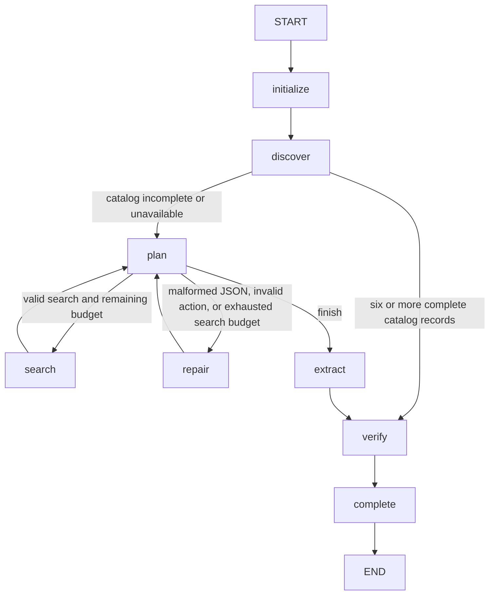

# Research Agent implementation

> Historical implementation notes. The original product-oriented graph below remains relevant to compatibility paths. For the active adaptive research graph, read [the current Agent guide](../AGENT.md) and [architecture](../ARCHITECTURE.md).

The application now runs a compiled `StateGraph` from `@langchain/langgraph` (pinned 1.6.0). This replaced the former hand-written `for` loop; the graph is invoked by the existing asynchronous research HTTP endpoint. LangChain Core (pinned 1.3.2) wraps the search adapter as a schema-validated tool. Local Ollama uses `ChatOllama` from `@langchain/ollama` (pinned 1.3.0). Zod validates graph state and allowed model actions. The high-level `langchain` package and Python are not required by this implementation.

## Graph

State contains the question, conversation, source snapshots, current action, trace, search/model/repair counters and final result. Nodes return state updates; the graph's conditional edges decide where to go next. The LLM selects queries or finishes; it cannot execute arbitrary tools or change application budgets.

## Limits and failure behavior

### Product data contract

`comparisonData.comparisonReady` is the normalized comparison dataset; `comparisonData.researchDrafts` keeps incomplete observations and explicit rejection reasons. When complete products exist, the result adapts them into `candidates` with `productData`, source quotations, imagery and provisional calculation status. The frontend renders these complete records with price, CPU, memory, storage, weight, OS and display evidence. If a new run has no complete products, recovery observations remain saved but its main view is a research draft, without placeholder comparison cards or a fabricated ranking. Older immutable snapshots remain readable.

Required fields are a source-backed page price, CPU, RAM, storage, net weight, OS and screen resolution, grouped by a concrete merchant product. Every field retains its original quote and source ID. Missing price or mismatched configurations stay in drafts rather than becoming placeholder comparison rows. Runtime hours are optional unless requested; absence in a captured specification is recorded explicitly, never converted from Wh. Stock, delivery regions and checkout eligibility are annotations only and never block information collection.

Merchant dynamic reading currently supports the public Suning mobile product template through a fresh, anonymous local Chrome context (`playwright-core`). This is not a claim of working dynamic price extraction for every shopping platform. It reads the main price selector rather than unrelated recommendation prices. It neither logs in nor stores browser credentials.

- Up to four search calls, seven planner model calls and three focused extraction model calls per uninterrupted run (ten model calls total). Focused extraction may reread up to three short source pages.
- Up to two model-output repairs; malformed actions never reach the search tool.
- No automatic search-provider retries. Search/model transport failures are reported to the job rather than converted into fictional sources.
- Sources use existing IDs, safe HTTP(S) links, saved text and retrieval timestamps. Candidate numbers require matching source quotes before becoming unreviewed facts. Human confirmation still happens in the decision workspace; quote matching is not proof of semantic accuracy.
- Missing evidence stays unknown. Subjective preferences and deterministic scoring remain outside the model's control.
- Empty searches preserve earlier evidence and become observations rather than aborting an otherwise useful run. A final result still requires at least one retrieved source.
- Model input keeps the original question, prior queries and search budget. Source text is projected into at most 12,000 characters of original excerpts per planning call, prioritizing parameter-rich specifications; lower-ranked pages retain their IDs/titles and may receive no body excerpt. Focused extraction uses up to three candidate-related pages with 4,000 original characters per page. Complete captured snapshots remain available for quote checks. These character limits are not exact token guarantees. Local ChatOllama uses a 16,384-token context setting.
- Searches can use local tofu-search through a bounded Python bridge or Tavily. The tofu bridge disables LLM content filtering/rewriting, applies a 40-second library deadline and a 75-second subprocess ceiling, and caps response bytes. Empty results are not replaced with demo data.

## Checkpoints: current scope

Supplemental research uses saved candidate names and assigns up to three target queries in graph state before focused extraction. The planner cannot silently replace those targets. `POST /api/spaces/:id/research` saves a new version of that space; `POST /api/spaces/:id/refresh` only rereads existing URLs. Supplement merging preserves settings/scenarios/assumptions, keeps distinct explicit configurations separate and namespaces new citation IDs. External numeric disagreements can invalidate a reviewed field while preserving both quoted observations.

HTTP research jobs use the official `SqliteSaver` from `@langchain/langgraph-checkpoint-sqlite` (pinned 1.1.0), stored at ignored `data/agent-checkpoints.sqlite`. LangGraph invocation uses `durability: "sync"` so the next step starts after its predecessor's checkpoint is saved. Durable task/event JSON records are stored under `data/jobs/`. On a server restart, previously running jobs become interrupted; continuing them is an explicit user action. The same thread ID and `invoke(null)` recover saved graph state. The default standalone graph factory still uses MemorySaver for isolated tests and scripts unless a saver is passed.

`GET /api/jobs`, `GET /api/jobs/:id` and `POST /api/jobs/:id/resume` back the task UI and hash-based progress URLs. A server-replacement test resumes a failed search without repeating the saved planning step. External actions interrupted before their completion checkpoint can run again; execution is not exactly-once. Stable result IDs and exclusive snapshot commits prevent duplicate completed spaces on persistence retries. Only one active task per server instance is supported; run one instance against a data directory.

Refresh jobs persist source-level JSON snapshots separately. Resume skips sources already recorded in that refresh snapshot. Refresh does not invoke the model or change ranking rules: it invalidates affected confirmations and leaves new values for review. Human fact confirmation remains in the decision workspace, not a LangGraph `interrupt` node.

`GET /api/agent` and the health response expose non-secret framework, node and limit metadata. Saved live research results include framework and call-count metadata; secrets are never graph state.

## Reproducible validation

0.3 adds multiple optional source observations per numeric fact. Every observation passes the same saved-text, number and unit checks. Different values remain conflicting/unknown until explicit review; matching values do not prove independent reporting or exact SKU identity. The UI exposes source-level quotations rather than presenting a source count as proof.

Optional image enrichment reads at most three public HTTPS source pages in parallel, bounds HTML reads, checks private addresses and redirect targets, and stores image URLs/provenance rather than downloading image files. Candidate binding additionally checks recognized official brand domains and a model-family token in the source title. This heuristic is conservative and does not verify the exact SKU visually. Images never enter decision scores. The scenario graph visualizes deterministic decision alternatives; it is separate from the Agent's LangGraph execution trace.

The 0.2.1 evidence gate checks numeric units and a small set of ambiguity patterns. It rejects starting/reference prices and multi-option memory, preserving rejected extractions for inspection. This is a conservative heuristic, not an entailment checker: exact SKU identity, compatibility, conditional discounts, page authenticity and contradictions across sources are not automatically proved. New research starts in reviewed-only calculation mode; only an explicit user setting enables provisional calculation. Confirming a value remains a human decision.

`npm test` executes the real LangGraph runtime with controlled model/search adapters. `npm run test:agent:local` invokes the real local Ollama through `ChatOllama`, while search results come from an explicit fictional fixture. It performs no real search and does not need a Tavily key. A successful fixture run establishes basic model/tool/graph compatibility, not real-world extraction accuracy or complete V1 acceptance.

## Scenario exploration

`POST /api/spaces/:id/explore` accepts `{scenarioId, scenarios}`. The server validates conditions and owns candidate-pool membership and research metadata; client-supplied pool/research claims are discarded. `scenario` jobs use discovery (not fixed candidate supplementation), SQLite checkpoints, and durable task events. The saved result keeps `baselineSettings`, `baselineCandidateIds`, per-scenario `candidateIds`, and the active scenario. New candidates must have complete normalized source-backed core fields. Existing product snapshots are reused without overwriting baseline facts. Distinct merchant URLs/configurations are not merged by a product family name.

The browser keeps the decision path visible while polling actual job events. Budget, memory and weight changes invalidate the last search scope; preference-weight changes only recalculate. Resume reconnects to still-running jobs or resumes failed/interrupted checkpoints. Searches can finish without a complete new product; that is recorded as an empty discovery result with rejected/draft leads, never a fabricated recommendation. One active job per data directory is supported.

Personal decision records use the existing immutable version endpoint. The optional `decision` payload contains a workspace candidate ID (or null) and up to 1,500 characters of reasoning. The server validates membership, assigns the recorded time and snapshots the candidate name; it does not alter evidence or the preference model. An undecided record needs a nonempty note. Older versions retain their earlier record or its absence. The browser's three studio surfaces distinguish What-if exploration, evidence inspection and the user's decision journal.

## Merchant catalog discovery (graph version 4)

Local tofu mode first browses two public Suning catalog pages, groups exact seller/product links, distributes brands, and checks at most 16 product pages to collect up to eight complete records. It reads each mobile page's displayed price and that same seller/product's specification table. Collapsed table rows are read as public DOM text; a hidden RAM/storage/weight row is not treated as a missing field. No login, stock gate, cart or checkout is used.

Every admitted record still needs all seven core fields and saved quotations. A mismatch between a page's title and its explicit model row creates a draft. Product-photo provenance is retained. Existing product URLs are excluded during follow-up scenario discovery. When six complete catalog records are available, the graph verifies them directly without inventing additional model calls. Otherwise it uses the bounded model/search fallback, preserving whatever complete catalog records were obtained. The fallback's three extraction calls are separate from the catalog's 16 product checks; catalog results are not truncated to the first three candidates. One workspace currently holds up to twelve configurations.

The canvas displays all eligible options as a compact horizontal choice strip. Selecting one inspects its image, price and baseline tradeoff without changing the computed preference winner or overwriting the original decision. Full parameter tables and execution traces remain opt-in.

Scenario inheritance is explicit through `parentScenarioId`. Both version saves and research starts resolve candidate membership from the server's saved parent scopes; posted membership and research metadata are ignored. New unsaved descendants can resolve their parents in the same bounded request, with missing-parent and cycle rejection. Existing branches retain their saved scopes even if the client posts a different parent. Browser mutations send only IDs, names, conditions and parent links, rather than reposting quotations and full task histories.

Quick canvas changes compare eligibility against the conditions at the start of the interaction (or the inherited/researched conditions after reopening). Exit reasons use the deterministic constraint engine; quick changes create neither a new branch nor a network research job. Catalog discovery continues toward matching complete products within its attempt budget and prioritizes matches before the eight-product output limit.
# Adaptive decision workflow

The browser's primary workflow calls `general-research.mjs`. It uses LangGraph with `understand → search → read → extract → complete → analyze`. `planDecision` obtains a validated schema from the model for each original request, rather than selecting domain-specific field templates. It supports number, boolean and enum fields and a data-only primary/summary layout. A new concern can extend a space's schema; previously saved criteria gain null limits and zero weights for new dimensions so their original results stay intact.

`decision-schema.mjs` validates field keys, types, bounds and presentation references, evaluates cited facts and preserves the current situation. `legacy-decision.mjs` only adapts historical records, including their scoring ranges, review semantics and product detail quotations. It is not used to plan new questions. Fictional housing data in `general-space.mjs` is a demo fixture only.

The analyst receives checked facts and deterministic eligibility. Its interpretation is stored separately from evidence and displayed only for the conditions it analyzed. Browser tests cover changed labels and input types, new concerns, photo inspection, source details and preserved laptop choices. Provider success and complete data on arbitrary domains remain separate from renderer/graph correctness.
