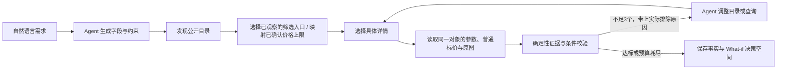

# Agent 候选发现与页面读取修复 · 2026-11-18

本轮针对[上一批验收](LIVE-ACCEPTANCE-2026-11-18.md)中未通过的电脑、上海与深圳租房任务修复。固定任务和判定标准不变；保持真实来源、对应原图、不登录和不以库存筛选的边界。

**最终完整批次按当前来源记录协议10/10通过**：5项电脑、5项租房，每项至少3条符合原任务条件、可在应用中比较且原图实际加载的记录。合计51条达标记录及51张已加载来源图。该结果是已参与调试任务的回归验收；同机型配色重复、跨平台核验及独立字段真值仍有边界，见文末。

## 原因与修复

| 真实失败原因 | 已实现的处理 |
| --- | --- |
| 沪深默认目录主要展示豪宅，便宜房源不在当前结果中；并行选择类型、价格筛选没有保留组合条件 | 从公开城市索引选择实际同城入口；解析页面已有筛选链接，最多连续导航两步，让第二步建立在第一步的结果上 |
| 商品目录没有用已确认的预算筛选，模型凭名称盲选高价商品 | 将 Agent 字段契约中唯一、明确的人民币价格上限映射到平台实际价格输入框，使用真实页面控件提交；详情仍重新核价 |
| 促销页主价格容器同时包含普通标价与到手价，或者普通价格换了样式 | 分离主价格与 `.final-price`；支持优惠明细中明确标为“易购价”的普通标价，排除优惠券、会员节省金额和推荐商品价格 |
| 研究补救只知道“排除了几个”，不知道为什么排除；又回到相同的长查询 | 将确定性比较产生的超预算、过重等原因和已观察范围反馈给 Agent，允许在同一补救预算内换一个商品目录查询 |
| 原本已按预算读取的目录，又被当作普通URL重新读取，丢失筛选状态 | 已有真实目录观察直接复用，保存控件提交后的实际地址与筛选执行状态 |
| 模型给用户引文添加空格，原本明确的预算约束被丢弃 | 恢复原需求中仅空白差异的精确片段；只从该片段里唯一、兼容的数量恢复约束，不改写需求 |
| 字段 `sqm` 没有匹配原文“平方米”，导致真实面积全部未知 | 统一等价平方米单位别名；平方英尺不按平方米处理，独立验收器也按等价单位比较 |
| “不推测通勤”等行为要求及无约束的“型号/配置”被建成比较字段 | 将行为指令、身份展示和决策条件分开；真实通勤数值约束仍保留，照片要求仍独立验证 |
| 目录摘要缺少重量等字段，模型因此不再打开详情 | URL选择提示明确区分“未知”和“不满足”，让详情读取负责补齐；不以模型记忆补数值 |

这里没有预设电脑品牌、房源清单、预算数值或前端字段模板。查询类别与平台导航由模型选择；价格筛选只使用已经验证的字段契约。网站解析仍需要平台适配，不代表任意网站都可读取。

## Agent 在这次修复中做了什么

LangGraph负责节点执行、状态与检查点；模型选择比较维度、目录工具、筛选链接、具体详情和补查方向。读取器观察页面，确定性比较器给出排除原因，再把反馈送回模型。它是受工具白名单和预算约束的研究 Agent，不是多 Agent 协作或模型训练。

本批次 C04 的实际闭环：最初4个记录只有2个可比较，排除原因是内存不足与重量超限。补救阶段把原条件及这些原因交给模型，模型选择新的“轻薄本 24G”目录查询，再读取实际详情；最终10个记录里有3个同时满足预算8000元、内存至少24GB和重量至多1.6kg，且3张来源图可加载。补救本身用了2次URL选择、1次查询调整、1次目录调用、6次页面读取，停止原因为 `target-reached`。**没有放宽条件，也没有把全部10个记录当作合格推荐。**

What-if继续使用保存事实进行确定性重算，修改条件不会隐式触发搜索。只有明确要求补充研究时才调用研究图；上述改动不要求把内部步骤塞进主界面。

## 关键实现与限制

- [目录导航](../../src/catalog-navigation.mjs)：只能选择读取器实际暴露的筛选URL，房源读取器先排除其他城市、登录及外部地址；最多两个连续目录读取，每步选择最多两次模型尝试。更具体的目录优先参与详情选择。
- [商品DOM观察](../../src/merchant-page-dom.mjs)：普通价与到手价分开；普通价格观察相互冲突时不取更低值。订金、定金、尾款不作为全款标价。
- [商品读取](../../src/public-merchant-read.mjs)：参数页、标价页、照片按同一商家与商品编号绑定，价位控件由真实键盘输入和点击触发，不通过猜测URL参数提交。
- [房源读取](../../src/public-rental-read.mjs)：从公开城市索引发现同城入口，保留同城目录筛选的实际链接，不根据城市缩写或预算自行构造筛选路径。
- [规划约束](../../src/plan-constraints.mjs)：恢复原需求的空白差异引文，从唯一可换算数量校正模型值，并按工具声明区分 `keywords` 与 `location` 输入。修复记录进入 `agent.planRepairs`。
- [有界补救](../../src/research-recovery.mjs)：全网搜索与新商品目录查询共享最多两次发现额度，另有14次明确页面读取、3次提取、4次URL选择上限；不改用户约束。

已补回归覆盖：普通价/优惠价混合容器、不同价格样式、价格冲突、定金、公开城市索引、同城连续筛选、无商品但有筛选的目录、错误URL选择重试、真实编译图先筛选后读取、引文与单位、身份和行为元数据，以及根据排除原因改变目录查询并遵守预算。

存储容量数量校正沿用现有比较器的口径，保留原文“1TB”。该口径不是制造商十进制容量或物理字节数实测；不能把内部 `1024` 换算惯例当成 SI 单位定义。

## 读取器兼容检查

这些检查使用已观察到的URL，验证读取器行为，**不计入自主研究通过率**：

- 商品页中的普通标价6569元与优惠到手价5569元被区分，读取器取得6569元。
- 另一种商品价格布局的易购价24099元可读取，没有改用23499元到手价或推荐商品金额。
- 价格上限5000元通过平台控件实际提交，返回地址保留平台生成的筛选状态；目录确实出现了不同价位的商品线索。
- 沪深页面实际给出的低价目录返回了约2500–2999元/月的公开整租线索；仍需读取详情核对面积和对应图片。

## 固定任务真实验收

任务集 SHA-256 仍为 `f8463b876734944f81abce99cc756e62933394a1568faf07b96995766d5e763c`，要求每项至少三个不同记录同时通过原始条件、应用比较资格与原图加载。执行期间冻结应用代码和配置，保留失败，不拼接不同版本结果。

| 独立完整批次 | 严格通过 | 已暴露的问题 | 汇总 |
| --- | --- | --- | --- |
| `2026-11-18T06-13-05-093Z`，图版本11 | 3/10 | 预算引文空白、容量口径、缺少原生租房发现、过滤未组合、元数据混入条件 | [逐项结果](measurements/discovery-first-2026-11-18.json) |
| `2026-11-18T08-30-26-066Z`，图版本12 | 7/10 | 深圳/杭州面积 `sqm` 与行为字段、轻薄电脑身份字段导致规划失败 | [逐项结果](measurements/discovery-contract-2026-11-18.json) |
| `2026-11-18T09-03-35-358Z`，图版本13 | 10/10 | 当前固定任务全部达到记录、比较及原图门槛；仍有候选多样性边界 | [逐项结果](measurements/discovery-final-2026-11-18.json) |

本批次仍使用本机模型、tofu与公开读取器，评估进程关闭应用搜索缓存；没有预存候选或已知商品URL输入到研究问题。

图版本13本地回归：217项单元/HTTP测试、55项浏览器测试、35条构造引文回归通过，JavaScript语法与完整工作树源码检查通过。真实任务顺序为 R05、C04、R01、C02、C05、C01、C03、R02、R03、R04，问题与门槛不变。

隔离运行检查也通过，包含SQLite启动、24条静态路由、电脑/住房示例、列表、导出导入和删除。未复测Docker或远程CI，以上本地结果不替代完整发布验收。

### 最终批次逐项记录

| 任务 | 原需求摘要 | 最终记录数 | 达标记录 / 已加载原图 | 秒 | 模型 / 全网搜索 / 页面读取 / 原生目录 |
| --- | --- | ---: | ---: | ---: | --- |
| C01 | Java电脑：≤7000元、≥16GB、≤2kg | 6 | 4 / 4 | 65.328 | 4 / 0 / 6 / 1 |
| C02 | 办公电脑：≤5000元、≥16GB | 6 | 6 / 6 | 65.103 | 4 / 0 / 6 / 1 |
| C03 | 开发工具电脑：≤10000元、≥32GB、≤2kg | 4 | 3 / 3 | 54.558 | 4 / 0 / 4 / 1 |
| C04 | 便携电脑：≤8000元、≥24GB、≤1.6kg | 10 | 3 / 3 | 117.037 | 8 / 0 / 10 / 2 |
| C05 | 存储电脑：≤6500元、≥16GB、固态≥1TB | 6 | 6 / 6 | 83.215 | 5 / 0 / 6 / 1 |
| R01 | 杭州整租：≤4000元/月、≥30㎡ | 6 | 6 / 6 | 37.342 | 6 / 0 / 8 / 1 |
| R02 | 成都整租：≤3000元/月、≥30㎡ | 6 | 6 / 6 | 54.128 | 8 / 0 / 7 / 1 |
| R03 | 上海整租：≤4500元/月、≥25㎡ | 6 | 6 / 6 | 55.356 | 7 / 0 / 8 / 1 |
| R04 | 北京整租：≤4500元/月、≥25㎡ | 6 | 6 / 6 | 58.049 | 7 / 0 / 8 / 1 |
| R05 | 深圳整租：≤3500元/月、≥25㎡ | 6 | 5 / 5 | 101.026 | 9 / 2 / 14 / 1 |

原始记录在忽略目录 `work/live-acceptance/2026-11-18T09-03-35-358Z/`，逐项保留规划输出、目录/页面读取、结果、图片加载检查与错误日志。公开JSON只导出汇总。运行指纹为 `f4feb02b289cd51af78f81bd0ee5fb13c0cdd5dab7d0eec5f5783bfc4d61f147`，十项运行期间代码及配置未变；汇总离线复核与原始10/10一致，没有重新填写缺失字段或拼接其他批次。

62条候选记录中51条达到门槛；本批次合计模型62次、全网搜索2次、显式页面读取77次、原生目录11次。这是应用层方法调用计数，目录内部多次请求、商品参数页与浏览器图片加载不按底层HTTP总量计入；未测Token总量、费用或独立字段准确率。耗时包含真实模型/工具执行，不据此推断等资源提速。

## 解读边界

任务集已参与调试，是固定回归验收，不是未见任务集。来源有引文不代表发布者信息真实；原页图片可加载不代表已实地核验房源。商品和房源当前各有一个主要原生公开目录适配器，多个记录不等于多平台交叉核验；tofu仍作为全网发现路径，但充分的原生目录结果可以直接进入读取。读取器兼容检查、构造测试、真实任务分开报告。不同版本的实测耗时变化没有控制网页与模型选择，不能包装成等资源性能提升。

人工查看本批次合格电脑的名称与同页参数，未见将内存条等配件当作合格整机的情况；这不是逐字段独立标注。还发现 C03 的3条合格商品中，2条是同系列的不同配色，实际只有2个机型系列。现有去重按来源商品号/房源号，不等于按硬件配置或实体房屋去重。**任务协议的达标记录数不能宣传为同等数量的不同机型**；候选多样性和跨卖家实体合并仍需单独改进与验收。

本轮只改研究、读取、证据规范化及验收工具，没有重排已经认可的前端，也没有改写用户已有决策。真实实验在忽略目录和隔离进程中进行，评估关闭应用搜索缓存，不清空共享Redis。
