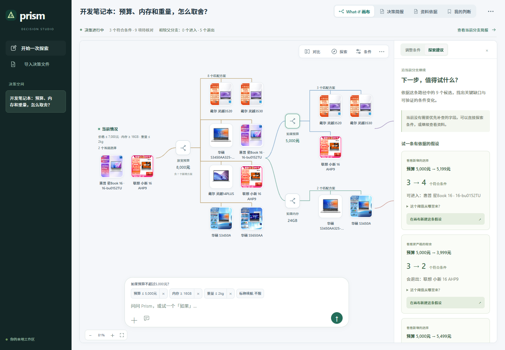

# 决策探索：实现与验收记录

日期：2026-11-26。对应本地实现；尚未发布新版本。

## 这轮解决什么

研究返回候选之后，用户还需要知道：哪些条件值得尝试，哪些不确定信息值得先核对。原有画布可以改条件，这轮将“找出有据的调整建议”和“带着具体目标补查”接入同一画布。

入口：画布右上角「探索」。主工作区仍是画布，侧栏可切换「调整条件／探索建议」。没有新增执行日志或角色轨迹页面。

## 用户流程与对应实现

| 操作 | 实现 | 交接边界 |
| --- | --- | --- |
| 查看值得尝试的条件 | [共享计算模块](../../src/decision-guidance.mjs)枚举候选事实阈值，最多改变两项条件，重算前后结果 | 只使用当前分支范围内、有可核对依据的候选；不修改其他条件与评分权重 |
| 查看建议依据并应用 | [探索侧栏](../../public/decision-guidance-view.mjs)展示原文、变化数量及候选；[画布交互](../../public/universal-view.mjs)新建或定位子分支 | 保留原始情况，同父分支的相同假设复用已有子分支 |
| 找出值得核对的字段 | 硬条件未知优先；只缺评分字段时，用其可能贡献的评分上限筛选任务 | 已违反其他已知硬条件的候选不占优先补查位；上限不是概率预测 |
| 发起指定字段补查 | [服务端契约](../../src/decision-investigation.mjs)重新确定目标，经[持久化任务](../../src/jobs.mjs)交给[现有四角色研究图](../../src/general-research.mjs) | 固定候选、字段和条件；客户端不能自行扩大字段范围；旧链接重新读取 |
| 补查后继续比较 | 仅合并同一实体的目标字段，在新子分支替换该候选的观察版本 | 原候选、基线及其他字段保留；来源矛盾继续未知，查不到不填值 |
| 继续对话或切换路径 | 请求失败后恢复按钮；研究完成时检查用户是否已切换空间／分支 | 不强行切走用户当前路径；窄屏侧栏为输入框留出空间 |

研究中的模型与工具权限、Skill 路由、独立审查、调用预算和 SQLite 阶段检查点沿用现有实现。指定字段补查不会另起一个通用 Agent 框架。人工确认不足的已有引文会转入确认操作，避免无意义的网络补查。

## 可直接复查的交互

### 保存报价对应的条件建议

历史苏宁资料的 ¥5,000 分支有三个符合条件的候选。应用根据有原文的报价提出：

- 预算 ¥5,000 → ¥5,199：三个变为四个，进入候选为惠普星 Book 16。
- 预算 ¥5,000 → ¥3,999：三个变为两个，退出候选为联想小新 16 AHP9。

这些阈值来自保存的原始报价，不是模型估价，也不把滑块步长当商品价格。截图重放历史观察；未进行新的市场行情采集。18 张显示中的来源配图均加载成功。

### 受控补查的端到端结果

测试以明确标注的软件虚构来源和模型适配器运行真实 HTTP、LangGraph 子图、审查与持久化路径：

1. 原候选有租金与面积引用，通勤未知。
2. 服务端接受通勤补查，忽略客户端试图增加的租金字段。
3. 读取来源后，模型同时返回通勤值、不同的租金／面积值和无关候选。
4. 结果仅将有据的通勤 35 分钟合入新候选观察；原租金 3,200 元及面积 32 平方米保持。
5. 新观察仅进入子分支，基线的通勤仍未知；无关候选未入库。
6. 若来源对应另一套房，补查结果仍为 `needs-evidence`，不会借用它的通勤值。

这项验证证明任务约束和交接能按预期执行；不是公开网页研究准确率的测量。

## 验收范围

- [计算与来源测试](../../tests/decision-guidance.test.mjs)：精确阈值、两条件调整、分支范围、停用候选、伪引文、优先缺口、人工确认、冲突保留。
- [HTTP 研究测试](../../tests/decision-investigation.test.mjs)：真实四角色执行、重读来源、仅合并目标字段、错误实体拦截、过期任务拒绝及演示隔离。
- [Edge 交互测试](../../tests/browser/decision-guidance.spec.mjs)：应用建议、重复假设复用、失败重试、补查返回、期间切换路径、刷新与移动端操作。
- 完整回归：328 项单元／HTTP 测试、80 项 Microsoft Edge 浏览器测试通过。
- 全量浏览器检查发现移动端侧栏遮挡输入框，已修复并复测；对话路径跳转与旧交互均保留。

当前范围为分支内的关键字段补查及一至两条件调整建议。文件导入建库、持续来源监控和自动重新评估已保存判断仍属于后续工作。
