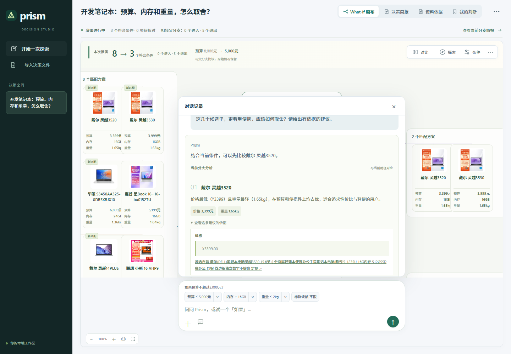
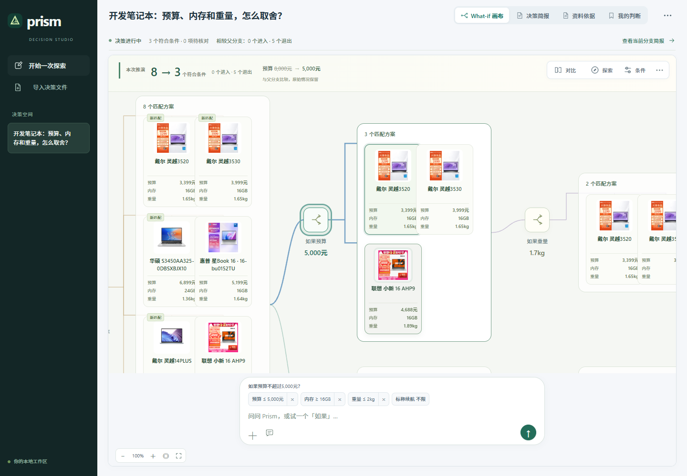

# 智能问答与画布联动改进

日期：2026-11-26。本地实现及验收记录。

## 从提问到条件推演

用户可以直接问“更看重便携，应该怎么取舍”。回答会列出建议关注的候选、解释与对应参数；展开可查看程序从保存资料中取得的原文和来源。点击「在画布定位方案」，会回到同一分支、高亮该候选；用户继续改条件时，顶部展示相较父分支的数量和条件变化。

两张图均使用历史苏宁商品资料与对应原图；第一张是实际模型调用结果，不是人工编写的回答。没有重新采集实时价格。

## 问答如何得到约束

1. [问答上下文](../../src/decision-answer.mjs)重新校验当前分支的事实引用，并计算符合条件、未匹配、信息不足和暂停状态。
2. 模型通过[对话协议](../../src/conversation.mjs)选择候选 ID、依据字段和解释，不负责输出来源原文。程序检查候选范围、资格和所选字段；不支持的数值解释会退回可核对的字段比较。
3. 正权重维度中，如果另一个已知候选在各项都不差、至少一项更好，推荐层不优先推荐被支配者。该检查只涉及用户这次设定的比较维度；被支配的候选仍保留在画布，不能据此推断整个商品的质量。
4. [回答卡片](../../public/decision-answer-view.mjs)根据合法引用字段回填参数、原文与链接，解释和原文分开呈现。点击定位不会修改条件、事实或个人判断。
5. 回答绑定分支和资料摘要。条件、候选事实或关联来源变化后，显示为历史分析，可展开旧回答，不冒充当前建议。文件导入会检查引用对象，并重新检查事实。

问“下一步查什么”时，直接使用已有关键缺口计算；问一个带假设预算的选购问题时，不会悄悄改写当前分支。需要新资料的请求沿用现有研究流程。

## 画布改了什么

- 默认 100% 展示当前路径，保留主动查看全景、平移、缩放与回到当前分支。
- 方案由图片缩略图变为关键参数卡片；只展示该分支实际参与比较的字段，后续研究新增的维度不回填到原始情况的显示中。
- 顶部显示条件前后值、符合数量及进入／退出数量；新匹配候选有独立标记，当前分支与连线强调显示。
- 问答建议可定位并高亮画布中的同一候选；窄屏问答展开时，条件侧栏自动让出空间。
- 非关键、零权重且无限制的缺失字段不再混入工作区的关键待核对数量。

## 实际调用与测试

本地模型：**qwen3.5:9b**。问题为“这几个候选里，更看重便携，应该如何取舍？请给出有依据的建议。”输入使用已有历史商品空间中预算 5,000 元的分支。

该分支有三个符合硬条件的候选。最终回答关注戴尔灵越 3520，并引用保存的价格 3,399 元与重量 1.65 kg；一次不合格的模型建议在交接时被过滤。该轮耗时 **17.67 秒**，前后条件、候选事实及来源均未改变。这是单次本地调用记录，不能据此推算整体准确率或跨 Agent 优劣。

回归覆盖：

- [11 项新增核心测试](../../tests/decision-answer.test.mjs)：越界推荐、停用或被排除候选、伪引用、缺失依据、已变更的分析、只用人工确认资料、支配关系、合法数值对比及假设问题不改条件。
- [4 项新增 Edge 流程测试](../../tests/browser/decision-answer.spec.mjs)：原文查看、定位方案、真实 HTTP 对话交接、刷新恢复、过期分析、条件变化、全景／聚焦及移动端操作。
- 完整回归通过 **339 项单元／HTTP 测试、84 项 Microsoft Edge 浏览器测试**；记录保存在本地工作目录。软件测试结果与实际网页研究质量分别记录。

优势应在多条件决策任务中比较：候选资格是否正确、引用是否可复核、改变条件后的结论是否一致，以及是否产生不必要的重复研究。这里的改动为这些指标提供了约束和验证入口，没有把功能数量等同于模型推理能力。
