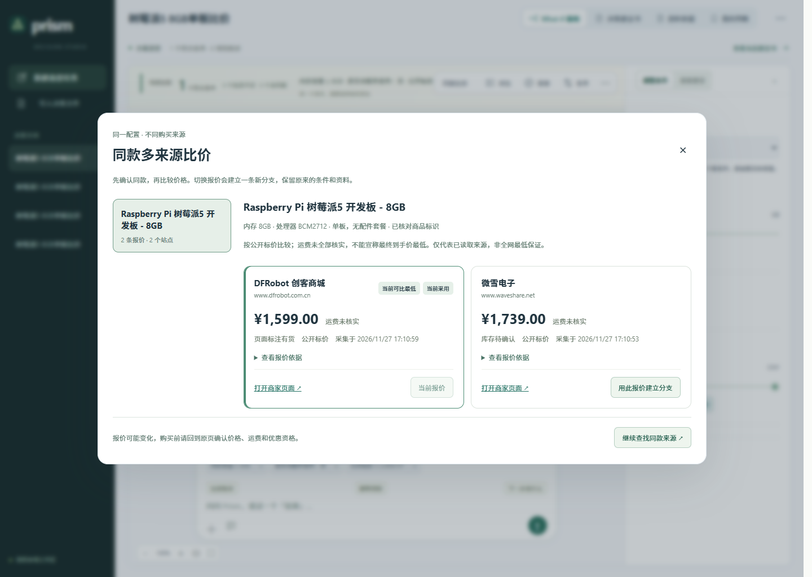

# 同款多来源比价：真实任务与验收

采集与验收日期：2026-11-27。本报告记录该日期的真实任务结果；报价及页面状态以采集时为准。

## 已跑通的真实使用流程

本地 Qwen、官方 SDK MCP 调用、SearXNG 实例和 Microsoft Edge 联合运行。用户只提出需求，**没有给商品链接，也没有预填候选或报价**：

> 预算2000元，购买树莓派5的8GB单板，不要配件套装。请比较不同商家的同款公开报价，核对内存和套餐内容，保留原页配图与来源依据。

Agent 选择商家目录，沿实际表单及分类链接取得详情，再核对商品身份。成功取得以下同配置报价：

| 真实来源 | 页面标价 | 配置与包装依据 | 库存与运费 |
| --- | --- | --- | --- |
| [DFRobot](https://www.dfrobot.com.cn/goods-3783.html) | CNY 1,599 | 树莓派5、8GB、BCM2712；包装清单为开发板 ×1 | 页面标注有货；运费未核实 |
| [微雪电子](https://www.waveshare.net/shop/Raspberry-Pi-5-8GB.htm) | CNY 1,739 | Raspberry Pi 5-8GB、BCM2712；已选“单独主机无套餐” | 库存待确认；运费未核实 |

以上是采集时的公开标价，不能当作最终结算价或全网最低价。图片取自对应详情页，没有生成产品照片。

## 研究如何得到这些结果

1. **搜索发现**：保留 tofu 与 Tavily 适配，增加可独立使用的 SearXNG；本地已通过 Docker 部署，并实际验证 JSON 查询返回 10 条线索。公开 RSS 搜索可能忽略 `site:` 或返回介绍文章，不能单靠它完成比价。
2. **商家目录补充**：DFRobot 从首页实际分类页找到 GET 搜索表单；微雪沿实际分类链接发现商品。程序不猜商品 URL，多家商家的链接交替进入有限上下文，防止第一家的配件与目录挤掉第二家详情。
3. **详情读取**：DFRobot 使用原页主价 DOM，核对显示价与数据属性；微雪静态页面没有渲染价格，使用 Edge 等待脚本显示主价后读取。不借用推荐商品、未选内存或配件套装的价格。
4. **同款校验**：原页品牌、型号、处理器、内存和包装内容分别保留；相同配置才归并商家报价。4GB、16GB、另一代主板及含配件套餐不会给8GB单板贡献价格。
5. **程序与模型分工**：过滤、默认低价、运费缺项和价差由程序重建。模型收到已核对报价集合，负责选择与说明；已核对的来源不能在回答中被重新说成“没有价格依据”。用户改变采用来源仍需在画布明确选择。

还修复了 Node 24 原生 HTTPS 读取的 DNS 回调格式：启用 `all` 时必须返回地址数组，否则会出现 `Invalid IP address: undefined`。这是之前公开页面读取失败的实际原因之一。

## Edge 实际操作验收

除了受控回归，还对上述真实结果执行了以下操作：

- 打开同款比价，显示两家独立来源及各自的标价、库存描述和采集时间，默认采用1,599元。
- 采用微雪1,739元报价，建立新分支；原始商品、1,599元报价、条件和来源保持不变。刷新浏览器后分支仍在。
- 问答解释当前来源与较低报价的差额，返回**140元**；正确保留运费与部分库存待确认。建议绑定当前分支，未自动替用户切换报价。
- 将当前微雪分支的预算降至1,600元，匹配数从1变0；原来的1,599元报价与原始路径保留。问答与预算调整均未启动新的研究请求。
- 导出 Markdown 决策建议书，保留两家报价、当前采用来源、字段引用与采集时间；页面没有 JavaScript 错误。

本地可核对记录位于忽略目录 `work/feasible-pricing-2026-11-27/`：

| 记录 | 作用 |
| --- | --- |
| `actual-job-second.json`、`actual-space.json` | 无链接自主研究的任务与保存结果 |
| `actual-journey.json`、`edge-state.json` | 真实报价分支、模型建议、预算变化与零研究请求检查 |
| `real-model-answer.json`、`real-proposal.md` | 实际模型回答和浏览器下载的报告 |
| `pages/4.html`、`pages/6-edge.html` | 采集的商家原页快照；微雪为渲染后页面 |
| `unit-frozen.log`、`browser-full.log`、`browser-offers-final.log` | 软件回归日志 |

最终冻结代码再次执行无商品链接的同一需求，得到**1个商品配置、2个商家报价**；该结果再次通过Edge报价切换、刷新恢复和Markdown导出，未混入其他代际或配件。最终空间ID为 `0e578ad3-64c5-4070-9fee-0e557bbb38cc`，记录见 `final-journey.json`、`edge-final.log` 和 `final-proposal.md`。

## 软件验证

**389 项单元／HTTP 测试通过；完整94项 Edge 测试通过。** 问答与报价说明调整后，另跑**14项相关 Edge 回归**，全部通过。

新增检查覆盖 Node DNS 回调、主价与关联价隔离、动态价格缺失、内存与套餐变体、包装清单、目录同源和真实链接约束、多商家上下文分配、搜索故障时的目录发现，以及精确同款任务不凑其他产品。模型问答测试还覆盖：即使模型错误宣称价格缺失或要求继续研究，已核对的报价也不能被篡改，不能据此偷偷启动研究。

之前未通过的探测与本轮修复背景

此前罗技与笔记本检索取得了一些线索，但京东匿名读取失败，苏宁详情存在配置差异或缺货，未组成两个可比同款报价。文件保留在 `work/price-comparison-2026-11-27/`。当时的375项核心与94项浏览器测试只证明软件行为，不能替代真实研究验收。

本轮实际部署 SearXNG 后，原生 Google、Qwant、Brave、DuckDuckGo 等存在拒绝、验证或解析问题；没有把“容器在运行”当成搜索成功。改用公开 Bing RSS 引擎，实际取得结果，并用商家原生目录补足商品线索。Crawl4AI 仍为可选接口，本轮没有部署或以其作为成功条件。

## 使用与适用范围

运行 `npm run search:up`，在研究设置选择 SearXNG，地址 `http://127.0.0.1:4330`；本机研究预览为 `http://127.0.0.1:4324`。新建任务可用 `npm run test:offers:live` 自动验收；检查现有结果可用 `npm run test:offers:live -- --space 空间ID`，另一个端口通过 `PRISM_BASE_URL` 指定。脚本只在当前条件有合格商品、同款身份已核对且至少两个独立站点报价可用时通过，记录存入忽略目录 `work/offer-acceptance/`。该命令已对最终真实结果执行并通过。

具体设置见[安装说明](../SETUP.md)，实现结构见[同款比价说明](../MULTI-SOURCE-OFFERS.md)。

本轮证明了公开商家页面上的完整同款比价流程。仍不能据此声称所有平台都可匿名读取、所有品类都能稳定归并，或已经测得真实市场任务成功率。需要登录、资格价格不明或配置证据不足的来源会保留待核对。
