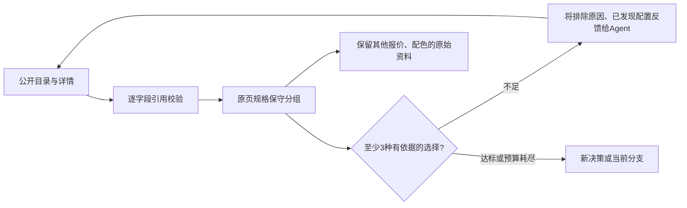
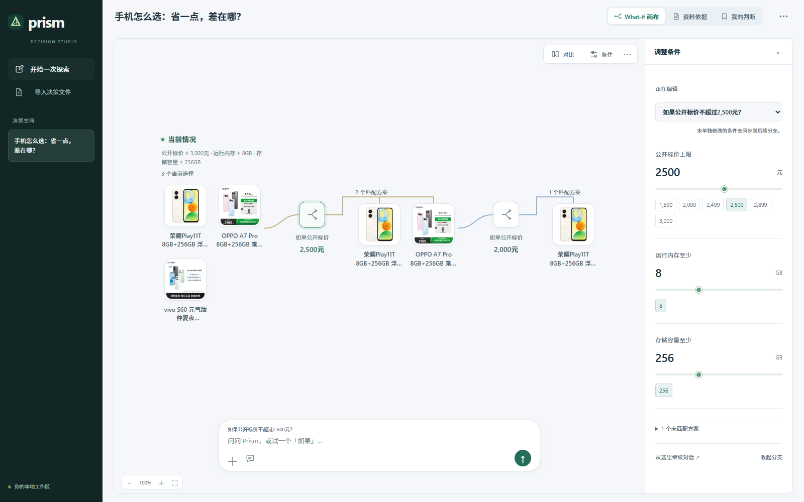

# Prism 预览版质量与配置多样性 · 2026-11-18/19

这轮继续处理[上一轮报告](AGENT-DISCOVERY-2026-11-18.md)留下的同配置配色重复，以及已知任务之外的场景和分发验证。目标是可解释、可复核的本机预览版，不把一批成功任务当成任意场景成功或成熟V1证明。

本报告记录本机验收阶段的结果与操作边界。随后按用户要求同步GitHub；发布提交和远程检查状态以仓库实际记录为准。

**最终结论：本机功能回归通过，真实研究仍未完全达标，保持开发预览状态。** 图版本24的完整原十项为9/10，扩展五项为3/5。当前剩余问题集中在严格大内存配置的发现，以及广州租房的价格目录选择。没有用成功的单项重跑替换完整批次中的失败。

## 实现变化

[配置分组](../../src/candidate-diversity.mjs)要求同一商品来源中的品牌、型号和至少三个有原文支持的规格条目，再比较规范化的参数集合及非价格决策值。它不按相似名称或相同评分猜测身份，也不把同小区房源合并。

同组的不同报价/配色仅选一个当前条件下更合适的观察参与新研究的比较，其他原始来源和分组原因保留。不会把不同卖家的报价混成一个事实，不会任选方便的价格覆盖原引用。人工确认、个人假设及明确的外观偏好不参与这种自动分组。继续研究只调整选中分支的比较范围，原始情况和其他分支保留。

手机参数读取增加“运行内存”与“机身内存”的语义区分；前者对应RAM，后者在该参数表中对应设备存储。独立任务检查也阻止256GB存储被误当成满足8GB RAM。比较字段仍由Agent从问题生成。

用户明确要求不同配置，且所选公开读取器提供规格观察能力时，这项要求进入证据契约和研究停止条件；不能区分配置的来源资料不计入数量。补查将已有配置、排除原因反馈给模型。若大段回答遗漏了新的目录请求，补搜重写、简短工具选择及其格式修复合计最多四次模型调用，要求模型给出不同的短查询；品牌词只能取自本轮已读页面，不能预填品牌清单或猜型号。目录与全网搜索仍共用两次补充发现额度。

初始目录遇到明确连接超时等临时故障时，全阶段最多重试一次；无效城市或不支持的地址不重试。恢复节点区分“目录请求失败”与“已读取该目录”，因此初次超时不再阻止后续有效重试。租房请求使用工具声明的 `location`，不再由写死的 `keywords` 格式误导模型。

保留对象身份专用键（例如 `model`）作为展示元数据，不再通过枚举“手机型号”等领域名称去修补字符串评分字段。明确约束这个身份字段时仍保留它交由类型校验处理。目录导航最多三步，每步只能使用页面实际暴露的链接，以支持“价格页→类型页→保留类型的价格页”这种平台流程，不自行拼接组合URL。

图版本24将已有的“剔除无明确优先级依据的额外维度”提前到类型校验之前。否则模型附加一个只有单项的城市枚举，会使整个任务在筛选无关维度前失败。明确引用用户要求的字段保留，分类字段仍须符合原有校验；不凭空添加城市选项。原始问题和城市目录请求仍用于限定检索范围。用图版本23的R01/R03实际失败响应离线重放，分别读取原来的两份/一份模型响应即可得到合法规划，保留4000元/30㎡、4500元/25㎡及原图要求。这是格式修复重放，实际联网结果另列。

## 验收设计

- 原十项[任务](../../tests/fixtures/research-acceptance-tasks.json)的问题和数值门槛不改；新代码需重新执行，不能复用上一版10/10。
- 新增[五项场景](../../tests/fixtures/research-acceptance-extended.json)：32GB轻薄电脑、1TB存储电脑、智能手机、南京整租、广州整租。前三项要求来源参数能支持配置分组，仅配色不算新配置。
- 每项至少三个符合原条件、实际可比较且来源图片在浏览器加载成功的结果；没有预填型号或详情URL，不登录、不按库存排除。
- 任务、应用代码和配置在各批执行时冻结；保留逐项失败及原始输出。新场景属于额外验收，不是独立标注数据集，也不是对照上轮的准确率实验。

当前图版本24已通过235项单元/HTTP测试及56项 Microsoft Edge 浏览器回归。源码包在独立目录重新安装依赖后，也通过全部235项测试。每个真实批次单独记录应用/任务/配置指纹，具体结果见下表。

## 已发现的边界

首次新增场景批次 `2026-11-18T10-36-44-179Z` 为3/5：手机、1TB电脑、南京租房通过；32GB电脑失败是需求中的“仅配色不同不算”被当成关注外观，保守分组因此关闭；广州租房的原生目录超时后只取得了无关全网来源。没有删改原问题来获得通过。

后续保留的定向批次：`2026-11-18T10-50-10-395Z`为1/2，广州目录在一次超时重试后恢复，得到6套合格带图记录，32GB仍只有2种合格配置；`2026-11-18T10-57-15-304Z`、`2026-11-18T11-02-12-877Z`的32GB任务仍未通过，补查词过长或反复命中相同商品。修复短查询和已观察品牌上下文后，`2026-11-18T11-07-10-592Z`取得4种达标配置与4张可加载来源图。该单项成功不代替完整批次；后续完整批次分别记录，不能挑选成功单项拼成通过率。

目录兼容探针分别读取三个查询，观察到长串关键词主要返回两个32GB整机线索，而短查询带来更多不同整机和部分配件；这是已知查询的读取诊断，不能把标题中出现“32G”的条目数当成合格电脑数。实际验收仍读取参数、识别对象类型、检查条件及图源。

配置分组以已读取的完整规格集合为依据，是导航和展示的去重策略，不是跨平台商品身份的独立真值判断。缺少可靠参数时不会擅自合并；不同来源填写不同、甚至错误的规格仍可能降低效果。

应用分组和验收配置计数共用规格签名函数；数量不是独立人工标注的配置真值。验收另外固定原问题的阈值、字段语义及原图要求，以发现“模型自建条件通过、原需求未满足”的情况。外部网页和模型服务本身未冻结，因此同一应用版本的不同批次仍可能变化。

本机Docker Desktop引擎返回“unable to start”；Compose静态配置检查通过不能代替容器构建和运行。仓库历史CI链接可查看，但本次API读取遇到403限流，且远程历史结果不能覆盖当前未提交的代码。发布验收必须区分这两者。

当前基础容器镜像也未打包无Key研究所需的Python/tofu与Chrome运行环境，因此其基础运行自检不等于完整研究验收。本轮优先交付已验证的本机模式，不能宣传完整Agent容器开箱即用。

标准 `npm test` 改为串行运行，与本地验收命令一致，避免此前Windows高并发HTTP测试出现的 `ENOBUFS`。这属于测试运行稳定性调整，不是Agent执行速度提升。

后续完整批次也有失败，全部保留：[图版本20原十项9/10](measurements/preview-original-before-replan-2026-11-18.json)、[图版本22原十项9/10](measurements/preview-original-before-duplicate-feedback-2026-11-19.json)、[图版本23原十项7/10](measurements/preview-original-before-priority-order-2026-11-19.json)。图版本23的失败为C03仅两种合格配置，以及R01/R03的单项枚举规划错误。C04修复后的单项曾达到3个，完整重测仍有只得到2个的情况，不能挑选单项成功结果宣称稳定通过。

扩展任务的完整批次分别为：[图版本20为5/5](measurements/preview-extended-final-2026-11-18.json)、[图版本23为4/5](measurements/preview-extended-before-priority-order-2026-11-19.json)。任务已经用于调试，不能称作保留测试集，跨版本结果也不拼成总体通过率。

最后版本未通过的三项分别是：

- C03：32GB、重量≤2kg、预算≤10000元，仅2种合格配置。补搜将容量词和无效的低配置词混入查询，未有效扩大合格选择。
- E01：同类严格要求并明确排除仅配色差异，仅1种合格配置。补搜把多个已观察品牌连在同一个查询里，调换词序后仍没有新增合格结果。
- E05：广州整租、月租≤3000元、面积≥25㎡，仅2套合格房源。目录筛选进入偏高价段，读取记录多在3000–4000元；后续补搜也没达到3套。界面的条件资格仍按原3000元计算，没有把超限房源算成成功。

下一轮需要优先改善有类型约束的查询选择和价格筛选校验，并继续保留失败；反复更换语序、增加页面数量或沿用曾经通过的5/5结果，都不能证明当前研究已稳定。

## 最后冻结版本的完整真实批次

两套任务分别执行并保存指纹，均使用图版本24；各套任务文件进入指纹，因此两套runtimeHash不同。代码、配置在每套执行时保持不变。没有预填候选、详情URL、生成图片或把人工选页回放计为自主研究。

### 原十项：9/10

批次：`2026-11-19T08-43-25-753Z`；[原始冻结摘要](measurements/preview-original-final-2026-11-19.json)。合格记录53条，其中本轮图片加载检查成功52条。每项门槛仍为至少3条合格记录及3张加载成功的对应图片。

| 任务 | 达标记录 | 图片加载 | 模型/搜索/读取/目录调用 | 用时秒 | 结果 |
| --- | ---: | ---: | --- | ---: | --- |
| C01 | 6 | 6 | 4/0/6/1 | 68.035 | 通过 |
| C02 | 6 | 6 | 4/0/6/1 | 69.682 | 通过 |
| C03 | 2 | 2 | 11/0/12/3 | 124.321 | 未通过 |
| C04 | 4 | 4 | 9/0/6/2 | 83.058 | 通过 |
| C05 | 6 | 6 | 4/0/6/1 | 68.221 | 通过 |
| R01 | 6 | 6 | 9/0/8/1 | 58.934 | 通过 |
| R02 | 6 | 6 | 7/0/9/1 | 43.239 | 通过 |
| R03 | 6 | 5 | 7/0/9/1 | 44.749 | 通过 |
| R04 | 6 | 6 | 8/0/8/1 | 41.555 | 通过 |
| R05 | 5 | 5 | 7/0/9/1 | 41.73 | 通过 |

任务文件SHA-256：`f8463b876734944f81abce99cc756e62933394a1568faf07b96995766d5e763c`。调用数是应用provider边界的次数，读取器内部浏览器导航/HTTP请求未逐项计入。

### 扩展五项：3/5

批次：`2026-11-19T08-54-47-267Z`；[原始冻结摘要](measurements/preview-extended-final-2026-11-19.json)。合格记录18条，其中本轮图片加载检查成功18条。每项门槛仍为至少3条合格记录及3张加载成功的对应图片。

| 任务 | 达标记录 | 图片加载 | 模型/搜索/读取/目录调用 | 用时秒 | 结果 |
| --- | ---: | ---: | --- | ---: | --- |
| E01 | 1 | 1 | 11/0/6/3 | 84.248 | 未通过 |
| E02 | 6 | 6 | 4/0/6/1 | 65.463 | 通过 |
| E03 | 3 | 3 | 5/2/9/1 | 168.733 | 通过 |
| E04 | 6 | 6 | 8/0/9/1 | 57.414 | 通过 |
| E05 | 2 | 2 | 13/2/14/1 | 134.547 | 未通过 |

任务文件SHA-256：`b266846978b752776d7bc4f4d0ca8fb928b1e8a430d577e4717f8e0d12f65e7a`。调用数是应用provider边界的次数，读取器内部浏览器导航/HTTP请求未逐项计入。

## 交互与结论可信度

结果摘要的可比较数量、关键依据缺失数量改由确定性比较器生成。真实测试中出现过“重量待补全”却被模型概括成“满足条件”的回答；现在这类自由文本不会决定或覆盖资格。模型解释仍需关联具体方案、字段和来源；关联有效不等于文字语义经过独立事实核查。

条件按钮优先使用已取得的有效参数和保存过的假设，避免机械产生“257GB、258GB”一类建议。它不为手机、笔记本或住房写死选项；用户仍能输入任意合法阈值。拖动时保留同一个滑杆，数值提交后同步滑杆和当前按钮；输入框失焦时保留画布节点，防止下一次图片点击被重绘吞掉。

此图来自2026-11-19实际 Microsoft Edge 页面，使用前一天E03研究取得的三个公开商品配置及原图。3000→2500→2000元是为界面检查设置的假设，分别呈现3个原始选择、2个和1个分支匹配。六个可见图片节点均加载；点击图片打开资料弹窗，核对价格、运行内存和存储；把2500元分支改为2000元后两个分支结果均为1，原始情况仍为3。无页面脚本错误。它是保存资料的交互回放，不是另一次自主手机研究。

## 测试与分发边界

- Windows、Node 24.19.0：235项单元/HTTP测试、56项 Edge 浏览器测试通过；后者包括跨场景字段、全部方案图节点、弹窗、完整对话、条件继承、撤销、空分支、保存/导入和本地删除。
- 源码包在单独目录安装相同锁文件依赖，安装审计未报告漏洞，全部235项测试通过。运行自检覆盖健康、SQLite启动、24条静态资源、电脑/租房演示、列表、导出/导入和删除；使用隔离存储。
- 最终归档另附SHA-256侧文件和逐文件清单。归档代码与上述受测副本逐字节比较；报告/README允许在结果整理后更新。排除实际`.env`、用户决策、provider-settings、缓存和原始实验目录。
- 本机验收阶段没有修改Git暂存选择、提交或推送；之后的GitHub同步单独进行。历史远程CI只覆盖历史提交。Node 22、Linux和完整无Key研究容器没有在本轮本机重测。基础镜像缺少Python/tofu/browser研究栈，本机Docker引擎也不能启动。
- 没有访问用户登录资料、要求购物平台登录、下单、按库存过滤，或替换为生成图片。现有用户应用进程和决策数据不参与测试；临时研究、浏览器工作区及原始结果存放在忽略目录。

源码记录支持率只说明值与保存的页面摘录、对象和单位相符，不能证明发布者参数本身正确、当前仍为该价格或跨平台已交叉核实。C05沿用既有容量比较器的1TB=1024GB内部约定，不把它称作SI定义；这也不验证格式化后的可用容量。
