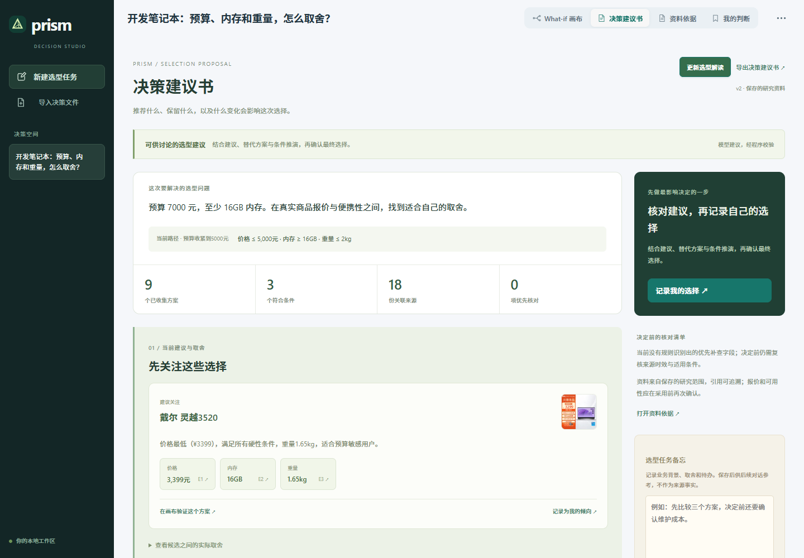

# 可验证的方案选型工作台：主流程验收

日期：2026-11-27。对应本地工作树，尚未作为新版本发布。

## 产品目标

Prism 接收一个需要比较候选和约束的选型问题，经资料研究、画布推演和人工判断，交付一份可复核的决策建议书。问答、画布和建议书围绕同一任务工作。

交付物应说清：当前建议是什么，其他候选为什么暂不优先，哪些条件会改变比较结果，引用在哪里，以及决定前还需要做什么。

## 本轮落地

| 环节 | 用户得到什么 | 对应实现 |
| --- | --- | --- |
| 任务入口 | 明确的选型目标、不可妥协的条件、偏好与建议书重点；保留通用任务 | [任务入口](../../public/task-start.mjs) |
| 建议组织 | 当前建议、备选、实际取舍、推演、原文引用、核对事项与历史选择 | [建议书数据模型](../../src/decision-proposal.mjs) |
| 只读解读 | 基于当前资料生成分析；忽略模型对条件的修改和新研究请求 | [对话](../../src/conversation.mjs)中的 `purpose: proposal` |
| 证据复核 | E1 等编号定位原文与采集时间；打开证据不改写空间 URL | [建议书页面](../../public/decision-proposal-view.mjs) |
| 验证假设 | 从建议书回到已有路径，或建立一条有依据的新假设 | [工作区交互](../../public/universal-view.mjs) |
| 人工确认 | 建议先填入个人倾向，用户保存后才形成判断记录 | [判断快照](../../src/decision-workflow.mjs) |
| 导出交付 | Markdown 与页面共用建议书模型，保留当前分支、建议依据与未决事项 | [导出](../../src/decision-report.mjs) |

规则初筛、模型参与的建议和导入的历史分析有不同标记；演示资料不会伪装为模型或联网研究。候选不足时，建议书保留未完成状态，不强行给出结论。

生成分析不会自动确认用户选择。条件、事实、来源或保存的任务背景变化后，旧建议不能继续冒充当前建议；历史选择也会根据其记录时的条件单独复核。

## 实际本地模型运行

- 模型：**qwen3.5:9b**。
- 输入：已有历史苏宁商品空间，当前分支预算 5,000 元、内存至少 16 GB、重量不超过 2 kg；九条候选记录，三个符合条件。
- 操作：在新版页面点击「生成选型解读」。
- 结果：生成带价格、内存和重量引用的建议；建议关注戴尔灵越 3520，其他符合条件的候选保留为备选。
- 本次耗时约 **24.25 秒**。条件、候选事实、来源和分支的实际范围均保持。原有分支缺失的继承覆盖标记由既有校验器补齐，不改变分支条件。
- 从同一页面成功下载 Markdown 建议书。页面与导出均包含相同的建议理由及 E1 等原文编号。
- 未重新搜索市场或读取实时价格，使用的是历史资料。该记录用于验证完整链路，不代表整体研究准确率。

## 验收

- 新增 **11 项核心测试**：页面与导出的同一依据、陈旧分析隔离、任务背景失效、分支候选范围、状态分类、人工选择复核、导入来源标记和只读生成。
- 新增 **6 项 Edge 使用流程**：入口、生成、引用、导出、刷新、假设回画布、人工确认、失败重试、移动端，以及补查后再生成建议的完整路径。
- 全量 **350 项单元／HTTP 测试、90 项 Microsoft Edge 浏览器测试通过**。
- 1440 像素桌面与 390 像素手机视口均检查无页面横向溢出；建议书刷新后保留当前视图。
- 本轮修复了条件控件快速更新时顶部推演摘要未同步的问题。删除验收改为按空间标识检查，并验证同名的其他任务仍保留。

## 当前范围

已完成“提出问题—研究候选—验证取舍—形成建议书—人工记录与导出”的主流程。JSON 导入、来源重读、定向补查和判断复核沿用已有能力；任意 PDF／表格材料建库、持续来源监控和托管协作分享仍是后续工作。
